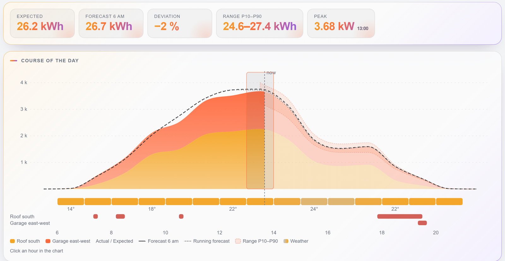
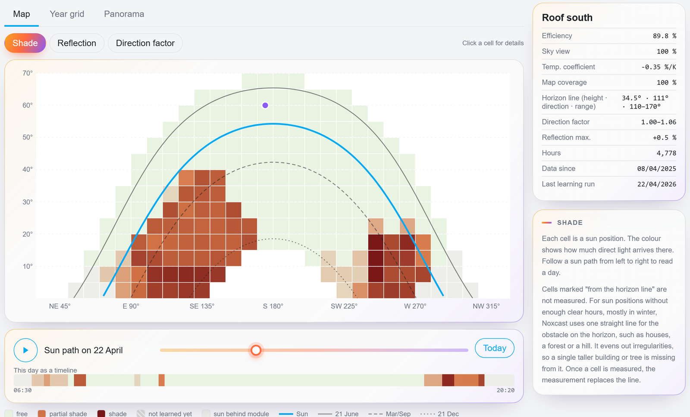
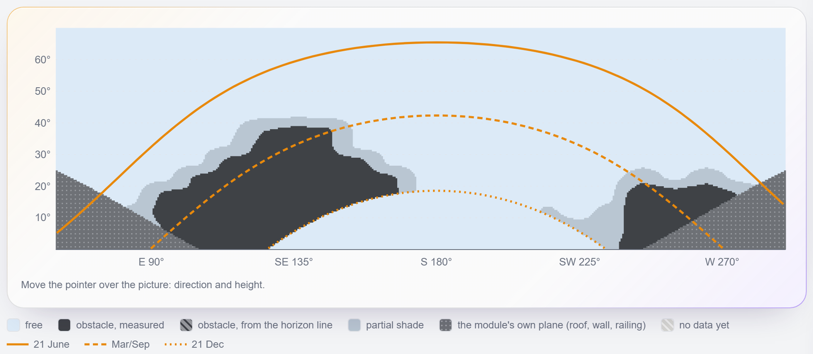
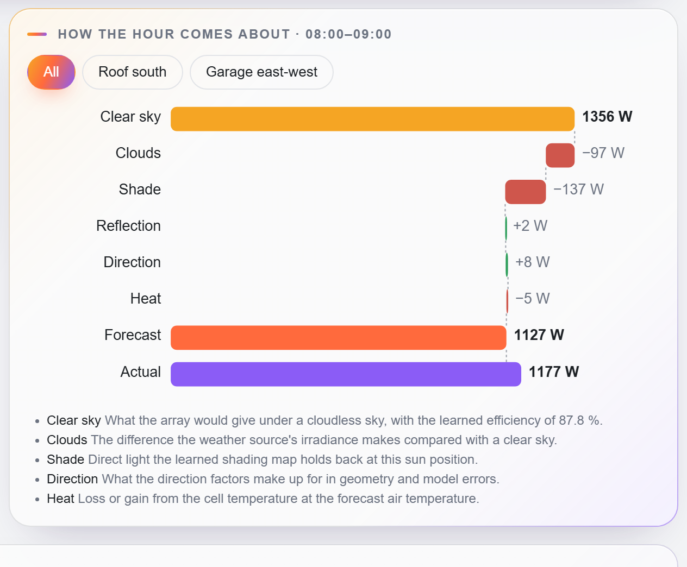
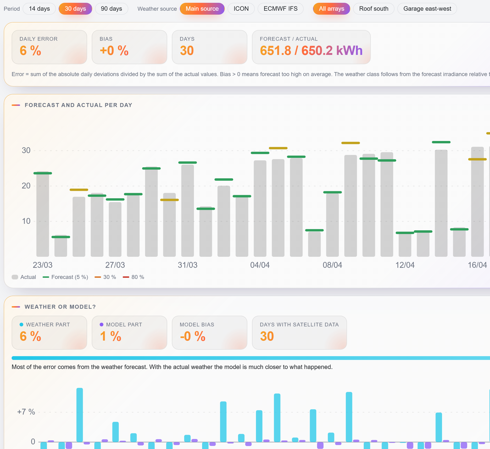
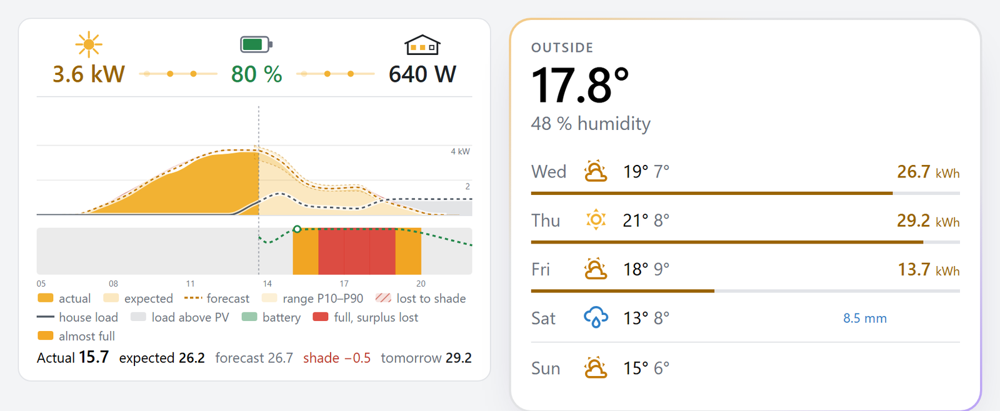
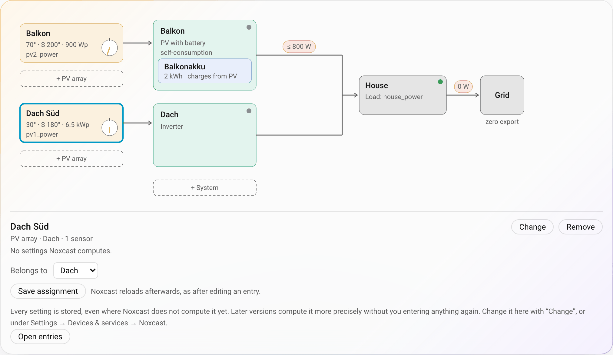

# Noxcast

[English](README.md) | **Deutsch**

**Eine PV-Prognose für Home Assistant, die deine Anlage lernt und jede Zahl erklärt.**

Noxcast sagt voraus, was deine Solarmodule heute und in den nächsten Tagen liefern, Stunde für Stunde. Ausgangspunkt
sind Sonnengeometrie und Wettervorhersage. Aus deinen eigenen Messwerten lernt Noxcast, was deine Anlage wirklich tut
(Wirkungsgrad, Schatten von Bäumen und Häusern, Reflexion, Wärme), und zeigt für jede Stunde, wie die Zahl zustande
kommt. Optional: eine Lastprognose fürs Haus, eine Akku-Simulation und der beste Zeitpunkt für die Waschmaschine.



**Stand:** Version 0.x: stabile Releases, noch jung. Solange die Version mit 0 beginnt, kann eine Minor-Version
inkompatible Änderungen bringen; jede ist im [Changelog](CHANGELOG.md) (englisch) markiert, mit dem, was du tun musst. Alle Screenshots zeigen Demodaten.

**Sprachen:** Noxcast gibt es auf Deutsch und Englisch. Einrichtung, Entitäten, Panel und Karten folgen der Sprache
deines Home-Assistant-Benutzers; andere Sprachen fallen auf Englisch zurück.

- **Neu bei PV-Prognosen?** Fang mit den [ersten Schritten](#erste-schritte) an.
- **Du kommst von einer anderen Prognose-Integration?** Lies [Warum Noxcast](#warum-noxcast).

## Warum Noxcast

Die meisten Prognosen rechnen mit Neigung, Azimut und Spitzenleistung, vielleicht mit einem Dämpfungsfaktor oder
einem Horizont, den man von Hand einträgt. Noxcast nutzt diese Werte auch, als Ausgangspunkt, und lernt dann aus
deinem Verlauf, was auf deinem Dach anders ist.

| | Noxcast |
|---|---|
| **Schatten** | Gelernt je Sonnenposition (10° Azimut × 5° Höhe) aus deinen eigenen Messwerten: der Baum im Südosten, das Nachbarhaus im Westen. Nichts zu zeichnen oder einzutragen. |
| **Lernen** | Aus bis zu zwei Jahren Home-Assistant-Verlauf, den du schon hast, gleich am ersten Tag. Danach jede Nacht. |
| **Erklärung** | Je Stunde vom klaren Himmel über Wolken, Schatten, Reflexion, Richtung und Wärme bis zur Prognose. Keine Blackbox: zuerst Physik, dann gelernte Werte, zuletzt eine statistische Korrektur. |
| **Bandbreite** | P10–P90 aus deinem eigenen Archiv vergangener Prognosen. Es verschiebt die Wolken und liegt deshalb nie über klarem Himmel. |
| **Genauigkeit** | Jede Vortagsprognose wird archiviert und mit dem verglichen, was passiert ist. Mit dem Satellitenfilter (eine Option) wird der Fehler jedes Tages in Wetteranteil und Modellanteil aufgeteilt. |
| **Datenqualität** | Stunden mit vollem Akku, ausgeschlossenen Zeiträumen, Ausfällen und Schnee auf den Modulen bleiben beim Lernen außen vor. Eine Leistungsgrenze eines Eingangs, Mikrowechselrichters oder Systems ohne Akku deckelt die Prognose. |
| **Montage** | Mehrere Ausrichtungen an einem Eingang (Ost + West, senkrechte Balkonmodule) als eine PV-Gruppe. |
| **Wetter** | Open-Meteo, ICON und ECMWF IFS stundenweise gemittelt. Kein Konto, kein API-Schlüssel, kostenlos für private Nutzung. |
| **Datenschutz** | Läuft in Home Assistant. Nur deine Koordinaten gehen an Open-Meteo. |
| **Selbstprüfung** | Meldet eine Konfiguration, die nicht zu den Messwerten passen kann, etwa einen Wirkungsgrad über 100 % oder einen falschen Azimut. |

### Was es lernt

Jedes Feld der Schattenkarte ist eine Sonnenposition. Rot heißt: Dort kommt weniger Direktlicht an. Die Linien sind
die Sonnenbahnen im Juni, zur Tagundnachtgleiche und im Dezember; so liest du ab, wann ein Hindernis eine Rolle spielt.



Das Panorama zeigt dasselbe so, wie es eine Kamera auf dem Modul sähe: Gerade Kanten bleiben gerade, Baum und Haus
sehen aus wie vor Ort. Ziehen schwenkt den Blick. Die gepunktete Fläche ist die Ebene des Moduls selbst; dahinter
erreicht die Sonne es nicht.



### Wie eine Stunde zustande kommt

Jede Prognosestunde lässt sich in ihre Schritte zerlegen. Hier steht die Morgensonne hinter dem Baum:



### Wie gut es ist

Prognose gegen Ist für die letzten 14, 30 oder 90 Tage, nach Wetterklasse und Wettermodell. Mit dem Satellitenfilter
wird der Fehler jedes Tages aufgeteilt: Der Wetteranteil ist das, was die Wettervorhersage falsch hatte, der
Modellanteil das, was Noxcast mit dem vom Satelliten gemessenen Wetter falsch hatte. Weil Satellitenwerte Flächenmittel
sind, enthält der Modellanteil auch deren Fehler (etwa bei Nebel): Er sagt über viele Tage etwas über das Modell, nicht an
einem einzelnen Tag. Ein Vergleich der Wettermodelle zeigt auf Knopfdruck,
welches Modell oder Modellpaar im letzten Jahr am besten zu deiner Anlage gepasst hätte.



### Auf dem Dashboard

Eine Tageskarte mit der Leistung jetzt und dem Verlauf des Tages und eine Wetterkarte mit dem erwarteten Ertrag je Tag.



### Alles, was es kann

| Teil | Was du bekommst |
|---|---|
| PV-Prognose | Je PV-Gruppe und gesamt: heute, morgen, übermorgen (bis 7 Tage), stündlich und in 15-Minuten-Schritten, mit P10–P90-Band; als Solarprognose im Energie-Dashboard angeboten |
| Heute | Prognose um 06:00 fixiert, Erwartung des Tages (gemessen + korrigierter Rest), Restenergie |
| Lernen | Wirkungsgrad, Schattenkarte, Horizontlinie, Reflexion, Richtungsfaktor, Himmelssicht, Temperaturverlust |
| Wetter | Open-Meteo, auch als Wetter-Entität fürs Dashboard |
| Genauigkeit | Archiv der Vortagsprognosen: Prognose gegen Ist, aufgeteilt in Wetterfehler und Modellfehler; nächtlicher Backtest |
| Last (optional) | Lastprognose fürs Haus: Grundlast je Stunde plus deine Verbraucher |
| Akku (optional) | Simulation bis zum nächsten Ladebeginn morgen: voll / leer, Überschuss, verlorener Überschuss, Netz |
| Planung (optional) | Bestes Fenster und PV-Anteil für flexible Verbraucher (Waschmaschine, Trockner, …) |
| Oberfläche | Seitenleisten-Panel *Noxcast*, Tageskarte und Wetterkarte |

### Was Noxcast nicht ist

- Es steuert nichts. Alle Ergebnisse sind Sensoren und Attribute für deine eigenen Automationen.
- Es braucht einen Leistungssensor je PV-Gruppe. Ein Tageszähler für Energie allein reicht nicht (siehe
  [unten](#was-du-brauchst)).
- Die Schattenkarte füllt sich mit klaren Stunden. Eine Position, die die Sonne nur im Winter erreicht, bleibt offen,
  bis ein klarer Wintertag kommt; bis dahin füllt die Horizontlinie sie.

## Erste Schritte

### Was du brauchst

| | Wozu | Wo du es findest |
|---|---|---|
| Home Assistant 2026.10 oder neuer | | Einstellungen → Info |
| Ein **Leistungssensor** für deine PV (W oder kW) | Noxcast lernt aus seinem Verlauf | Einstellungen → Entitäten, nach deinem Wechselrichter suchen. Ein Leistungssensor zeigt die aktuelle Leistung in W oder kW und hat im Verlauf ein Liniendiagramm. |
| Neigung, Azimut und Spitzenleistung der Module | Der Ausgangspunkt der Prognose | Datenblatt oder Installateur. Neigung: 0° waagerecht, 90° senkrecht. Azimut: 90° Ost, 180° Süd, 270° West. Spitzenleistung in Watt (Wp). |
| Optional: der Ladestand des Akkus | Stunden mit vollem Akku bleiben außen vor, weil der Wechselrichter dann abregeln kann | Einstellungen → Entitäten, ein Sensor in % |
| Internetzugang zu Open-Meteo | Die Wettervorhersage | Kostenlos für nicht-kommerzielle Nutzung, ohne Schlüssel |

Welcher Sensor? Am besten einer je MPPT-Eingang des Wechselrichters (oft *PV1 power*, *PV2 power* oder *DC power*
genannt). Die Gesamtleistung des Wechselrichters geht auch, solange alle Module daran in dieselbe Richtung zeigen oder
du die anderen Ausrichtungen einträgst (siehe die Beispiele). Ein Energiezähler in kWh reicht allein nicht; ein
*Ableitung*-Helfer (Einstellungen → Geräte & Dienste → Helfer) macht daraus eine Leistung.

Noxcast liest die Langzeitstatistik von Home Assistant, die der Recorder standardmäßig führt. Je mehr Verlauf, desto
früher sind die gelernten Werte gut; genutzt werden bis zu zwei Jahre.

### Installieren

1. HACS öffnen → ⋮ → *Benutzerdefinierte Repositories*, `https://github.com/TelosNox/noxcast` mit der Kategorie
   *Integration* hinzufügen.
2. In HACS nach *Noxcast* suchen und herunterladen. HACS bietet das neueste stabile Release an. Um eine Vorabversion zu testen,
   HACS für Noxcast Beta-Versionen anzeigen lassen.
3. Home Assistant neu starten.

Ohne HACS: `custom_components/noxcast` nach `config/custom_components` kopieren und neu starten.

### Einrichten

1. Einstellungen → Geräte & Dienste → *Integration hinzufügen* → **Noxcast**. Die Einspeisevorgabe wählen (was ins
   Netz darf: frei, begrenzt oder Nulleinspeisung); alles andere kann leer bleiben.
2. Der letzte Schritt verlinkt den Reiter *Anlage* im Noxcast-Panel. Dort auf *+ System* tippen und die Vorlage
   wählen, die zum Gerät passt (z. B. Wechselrichter ohne Akku), dann darunter *+ PV-Gruppe*: den oder die
   Leistungssensoren wählen, Neigung, Azimut und Spitzenleistung eintragen. Eine PV-Gruppe je Gruppe von Modulen,
   die gemeinsam gemessen wird. Das Bild zeigt jeden Teil, bevor du ihn speicherst. (Dasselbe geht auf der Seite der
   Integration: ⋮ → *System hinzufügen*, dann das Menü des Systems.)
3. Fertig. Noxcast lernt sofort aus dem vorhandenen Verlauf und danach jede Nacht um 01:30.

Dann **Noxcast** in der Seitenleiste öffnen: *Übersicht* zeigt, was heute und in den nächsten Tagen ansteht,
*Gelerntes*, was es über jede PV-Gruppe herausgefunden hat, *Tag* die Prognose von heute im Detail. Fürs Dashboard: *Karte hinzufügen* → *Noxcast*.



### Beispiele

| Deine Anlage | PV-Gruppen in Noxcast |
|---|---|
| Ein Wechselrichter, alle Module nach Süden | Eine PV-Gruppe mit dem Leistungssensor des Wechselrichters |
| Hybridwechselrichter, Ostdach an PV1, Westdach an PV2 | Zwei PV-Gruppen: PV1 Ost, PV2 West |
| Ost- und Westmodule am selben Eingang | Eine PV-Gruppe, Ost als Hauptausrichtung, West als *Weitere Ausrichtung 2*, jede mit eigener Spitzenleistung |
| Balkon mit Mikrowechselrichter, zwei Module unterschiedlich geneigt | Eine PV-Gruppe mit einer weiteren Ausrichtung |
| Zwei Wechselrichter, beide Süd, einer teils von einem Baum verschattet | Zwei PV-Gruppen, damit der Baum nur dort gelernt wird, wo er wirkt |

### Wenn etwas falsch aussieht

- **Wirkungsgrad über 100 % oder *Prüfen* an der PV-Gruppe:** Die Konfiguration passt nicht zu den Messwerten. Meist
  ist die Spitzenleistung zu niedrig, der Azimut gespiegelt (Ost und West vertauscht) oder ein Sensor fehlt in der
  PV-Gruppe. *Gelerntes* → die PV-Gruppe → *Passt die Konfiguration?* sagt, was zu prüfen ist.
- ***Prüfen* mit Leistung bei untergegangener Sonne, oder unplausibel viel PV an Tagen mit Akkuladung aus dem Netz:** Der
  Leistungssensor misst die Ausgangsleistung eines Wechselrichters mit Akku statt nur die PV. Einen Sensor der PV- oder
  MPPT-Leistung wählen.
- **Schattenkarte größtenteils grau:** noch zu wenige klare Stunden. Sie füllt sich über die Wochen.
- **Prognose zu hoch an Tagen mit vollem Akku:** den Akku mit seinem System eintragen, dann den Dienst
  `noxcast.relearn` aufrufen.
- **Tage mit Wartung oder Ausfall:** Ein Tag, an dem eine PV-Gruppe fast nichts geliefert hat, bleibt von selbst
  außen vor (*Passt die Konfiguration?* zeigt, wie viele und den letzten). Einen teilweisen Ausfall oder eine Wartung mit
  `noxcast.exclude_period` ausschließen.
- *Diagnose* im Panel listet jeden Sensor, den Noxcast liest, fehlende Daten und Fehler. Der Diagnose-Download der
  Integration enthält, was ein Fehlerbericht braucht.
- **Was hat das Lernen gesehen?** *Gelernt* → *Datenbasis* zeigt pro Gruppe, wofür die Tagesstunden verwendet
  wurden (verwendet, begrenzt, Akku voll, Schnee, kein Ertrag, ausgeschlossen), gewichtet nach der Energie bei
  klarem Himmel, insgesamt und pro Monat, und weist auf Auffälligkeiten mit ihrem deutlichsten Tag hin: „Akku voll“,
  obwohl die Gruppe lieferte, was das Modell erwartet, bei ruhigem Himmel deutlich über dem, was das gelernte Modell bei
  klarem Himmel zulässt, Tage ohne Ertrag bei hellem Himmel und ohne Schnee, helle Tage unter 70 % des Modells, die kein Filter
  erklärt, und Zeiten nach Schneefall, die erst die Grenze von 7 Tagen nach dem letzten Schneefall beendet hat, obwohl helle Stunden freie Module gezeigt hätten. Neu berechnet bei jedem nächtlichen Lernen.
  Mit dem Satellitenarchiv sagt sie auch, ob genug Daten für die gezeigten Tage da sind: Findet die nächtliche
  Rückrechnung den Stundenfehler auf Tagen, die das Modell nicht gelernt hat, um mehr als 10 % über dem auf gelernten
  Tagen, gibt es noch zu wenige Tage je Sonnenstand, und kräftige Tage im Kalender können von fehlenden Daten
  kommen; sonst nicht. Ein Kalender des letzten Jahres zeigt ein Feld pro Tag,
  gefärbt nach Ertrag gegen Modell oder schraffiert in der Farbe des Grunds, aus dem der Tag ausgelassen wurde;
  blass ist ein Tag, dessen Abweichung im üblichen Rahmen bleibt: was der Fehler des Satelliten bei diesem Himmel
  (bei Bewölkung oft ein Viertel, bei klarem Himmel wenige Prozent) und das gewöhnliche Rauschen des Modells der
  Gruppe von Tag zu Tag zusammen verursachen, sodass nur kräftige Farben auf Modell oder Konfiguration hinweisen;
  Administratoren öffnen per Klick die Stunden eines Tages als Linien für Messung, Modell und Obergrenze bei klarem Himmel mit den
  ausgelassenen und begrenzten Stunden hinterlegt, und per Klick auf eine Stunde, wie das Modell zustande kommt (klarer Himmel,
  Wolken, Schatten, Reflexion, Richtung, Temperatur).
- **Passen die Filter zu deiner Anlage?** *Passt die Konfiguration?* exportiert jede gemessene Tagesstunde einer
  Gruppe als CSV (*Stunden als CSV*, für Administratoren), Zeiten in UTC. `status` ist `used` (verwendet),
  `lower_bound` (angezeigt als *begrenzt*: `at_limit`, `charging_max`, `held_back`; die echte Leistung war mindestens so hoch) oder `left_out`
  (ausgelassen), und `reasons` nennt alle Gründe: `before_use` (vor Inbetriebnahme),
  `battery_full` (ein Akku der Systeme der Gruppe), `maybe_charging`, `no_output` (kein Ertrag), `snow` (Schnee),
  `excluded` (ausgeschlossen), `negative`. Mit dem Satellitenarchiv (Optionen) enthält die Datei auch das Modell mit
  der gemessenen Strahlung, zerlegt in klaren Himmel, Wolken, Schatten, Reflexion, Richtung und Wärme. Öffne sie in
  einer Tabellenkalkulation oder hänge sie an ein Issue.

## Konfiguration

Einstellungen → Geräte & Dienste → Integration hinzufügen → **Noxcast**. Danach auf der Seite der Integration
Untereinträge anlegen (⋮ → *System hinzufügen* / *Verbraucher hinzufügen*). PV-Gruppen, Akku und Teilsysteme eines
Systems stecken in seinem Eintrag: Öffnen zeigt ein Menü mit allem, was darin ist, und jeder Punkt öffnet sein
Formular.

### So hängt alles zusammen


Der Haushalt hat den Hausverbrauch, das Netz und die *Einspeisevorgabe*. Darin stecken die Systeme: Ein System ist,
was über einen Ausgang Strom ans Haus abgibt. Es enthält PV-Gruppen und höchstens einen Akku, oder Teilsysteme: Geräte,
die eine Steuerung gemeinsam regelt, etwa die Geräte eines EcoFlow Stream. Der Haushalt ist der Noxcast-Eintrag selbst:
Ändern auf der Seite der Integration mit ⋮ → *Neu konfigurieren*.

Vorgaben gelten von außen nach innen: Ein Teilsystem folgt der Regelung und Einspeisung seines Systems, ein System
der Einspeisevorgabe des Haushalts. Eingetragen wird nur, was abweicht, als Abweichung. Grenzen gelten auf jeder
Ebene, die engere zählt:


| Deine Anlage | In Noxcast |
|---|---|
| Dach-Wechselrichter ohne Akku | Ein System *Wechselrichter ohne Akku* mit seinen PV-Gruppen, Regelung *Volle Leistung* |
| Hybrid-Wechselrichter mit Akku | Ein System *PV mit Akku in einem Gerät*: eine PV-Gruppe je MPPT-Eingang, sein Akku, Regelung *Eigenverbrauch* |
| Balkongerät mit Akku | Dieselbe Vorlage mit der Ausgangsgrenze, z. B. 800 W |
| Steckerspeicher, der aus dem Überschuss lädt | Ein System *Akku am Hausnetz*, ohne PV-Gruppen |
| EcoFlow Stream mit Ultra und AC Pro | Ein System *Gekoppelte Systeme* mit der gemeinsamen Grenze und *Akkus gleichen sich aus*; seine Teilsysteme sind der Ultra mit seinen PV-Gruppen und seinem Akku und der AC Pro mit seinem Akku |
| Alter Dach-Wechselrichter und ein Stream, Netzbetreiber verlangt Nulleinspeisung | Zwei Systeme und die Einspeisevorgabe *Nulleinspeisung*. Das Dach kann sie nicht einhalten: Sein System bekommt die Abweichung *Speist den Rest trotzdem ein*. Der Stream folgt der Vorgabe |

### 1. Haupteintrag

| Feld | Bedeutung |
|---|---|
| Hausverbrauch | Optional. Leistung des ganzen Hauses (W/kW). Schaltet die Lastprognose ein |
| Tagestyp | Optional. Entität, deren Zustand um 12 Uhr der Tagestyp ist (Workday-Sensor, ein `input_select` wie Homeoffice / Büro / Urlaub). Profile werden je Zustand gelernt |
| Netzleistung | Optional. Leistung am Netzanschluss, positiv = Bezug (*umkehren*, wenn Einspeisung positiv ist). Ein System mit *Eigenverbrauch* ohne Akku braucht sie: Stunden, in denen der Haushalt zeitweise kaum etwas bezog (unter 100 W), zählen beim Lernen als „mindestens so viel“, weil das Gerät PV zurückgehalten haben kann |
| Einspeisevorgabe, Einspeisegrenze | Was der Haushalt einspeisen darf, wie es der Netzbetreiber verlangt oder du es willst: frei, höchstens eine Leistung in W, höchstens ein Anteil der PV-Leistung in % oder Nulleinspeisung (nie etwas; Überschuss bei vollen Akkus zählt als ungenutzt). Jedes System folgt dieser Vorgabe, außer es nennt eine Abweichung. Die Akkuprognose speist Überschuss ohne Platz bis zur Grenze ein und zählt den Rest als abgeregelt. Mit einer Grenze und dem Sensor *Netzleistung* zählen Stunden, in denen die Einspeisung des Haushalts die Grenze erreichte, (bis auf 5 %, mindestens 100 W) beim Lernen als „mindestens so viel“, weil die PV zurückgehalten worden sein kann; ein Anteil in % zählt von der Leistung aller PV-Gruppen. Eine feste Grenze am Wechselrichter selbst (etwa 60 % der Module) zeigt sich nicht am Netzanschluss: Sie gehört als *Ausgangsgrenze* ins System |
| Prognosetage | 2–7, heute eingeschlossen (Standard 3) |

### 2. Systeme (wie die Module zum Haus kommen)

Ein System ist alles, was über einen Ausgang Strom ans Haus abgibt: ein Wechselrichter, ein Gerät mit PV und Akku, ein
Akku mit eigenem Wechselrichter am Hausnetz oder mehrere Geräte, die sich absprechen. Jede PV-Gruppe und jeder Akku
gehört zu einem System. Ein System enthält entweder PV-Gruppen und höchstens einen Akku oder Teilsysteme (eine Ebene),
nie beides.

Ein System fragt zuerst, was es ist (Name, Vorlage, bei einem bestehenden auch *Gehört zu*), dann seine
Einstellungen, von der Vorlage vorausgefüllt. Jede Einstellung bleibt änderbar. Danach listet sein Menü, was sich tun lässt, jeder Eintrag
markiert: ✎ ändert das System selbst oder eines seiner Teilsysteme, eine PV-Gruppe oder den Akku, + fügt etwas hinzu,
− entfernt etwas nach einer Rückfrage (sie nennt, was mit verschwindet); ein Teilsystem hat ein eigenes Menü. Jedes Formular speichert beim Absenden, *Fertig* schließt nur den Dialog. Ein System zu löschen löscht alles, was darin
steckt. Teilsysteme haben keinen eigenen Eintrag: Sie stecken im Eintrag ihres Systems, so zeigt die Liste der Einträge, was worin steckt.


| Vorlage | Für |
|---|---|
| Wechselrichter ohne Akku | Mikro-Wechselrichter, String-Wechselrichter, eine ältere Dachanlage |
| PV mit Akku in einem Gerät | Balkongerät mit Akku, Hybrid-Wechselrichter, ein DC-Speicher zwischen Modulen und Mikro-Wechselrichter |
| Akku am Hausnetz | Steckerspeicher oder Speicher-Wechselrichter mit eigenem Wechselrichter, ohne PV |
| Gekoppelte Systeme | Geräte, die sich absprechen und eine Grenze teilen, z. B. EcoFlow Stream mit mehreren Geräten; sie werden seine Teilsysteme |


| Einstellung | Bedeutung |
|---|---|
| Ausgangsgrenze | Was das System höchstens abgibt (z. B. 800 W). Mit Teilsystemen: was sie zusammen abgeben; jedes Teilsystem behält zusätzlich seine eigene Grenze, die engere gilt. Ohne Akku darunter ist die Grenze fest: Das Lernen zählt Stunden an ihr als „mindestens so viel“, und sie deckelt die PV-Prognose; bei mehreren PV-Gruppen ihre Summe, jede gibt ihren Anteil an der Leistung darüber ab. Mit Akku darunter und dessen Sensor *Lade-/Entladeleistung* zählen Stunden, in denen die Abgabe (PV minus Ladeleistung) die Grenze erreichte, im Lernen als „mindestens so viel“, egal wie viel der Akku nahm. Ohne Akku so eintragen, wie die PV-Leistungssensoren an der Grenze messen: Sensoren der DC-Leistung zeigen einige Prozent mehr als die AC-Leistung. Zeigen die Messwerte eine Grenze, schlägt Noxcast sie unter [Reparaturen](#reparaturen) vor |
| Grenze gilt pro Phase, Phase | Für Geräte, deren Grenze für jede Phase einzeln gilt statt für die Summe (z. B. EcoFlow Stream im Dreiphasen-Modus): Jedes Teilsystem nennt seine Phase, die Geräte an einer Phase teilen sich deren Grenze, und ein Gerät allein an einer Phase bekommt die ganze Grenze. Ohne diese Einstellung gilt die Grenze für alle Teilsysteme zusammen, egal an welcher Phase sie einspeisen (ein klassisches Balkonkraftwerk: höchstens 800 W insgesamt). Ein *dreiphasiges* Gerät speist ein Drittel seiner Leistung in jede Phase und teilt sich mit diesem Drittel die Grenze jeder Phase; nur dreiphasige Geräte teilen sich das Dreifache der Grenze. Ein Gerät ohne Phase bleibt bei den Phasengrenzen außen vor, weil nicht bekannt ist, wie viel es von einer Phase nimmt |
| Regelung | *Volle Leistung* gibt alles ab, was die PV liefert (einfacher Wechselrichter), *Eigenverbrauch* richtet sich nach einem Smart Meter und deckt den Hausverbrauch, *Feste Leistung* gibt eine eingestellte Leistung ab. Eine feste Leistung wirkt wie eine *Ausgangsgrenze*: Ohne Akku begrenzt sie die Prognose, und das Lernen zählt Stunden an ihr als „mindestens so viel“; mit Akku lädt PV darüber den Akku, und Stunden mit vollem Akku oder größter Ladeleistung fallen heraus oder zählen als „mindestens“. Bei einer Leistung, die nach Zeitplan wechselt, Eigenverbrauch wählen, oder feste Leistung mit dem Durchschnitt. Nur am System: Seine Teilsysteme sind Geräte, die eine Steuerung gemeinsam regelt, und folgen ihm, auch bei der Einspeisung. Ein Gerät, das dieser Steuerung nicht folgt, ist ein eigenes System |
| Abweichung von der Einspeisevorgabe | Optional, meist leer: Das System folgt der Einspeisevorgabe des Haushalts. *Speist den Rest trotzdem ein*: ein Wechselrichter mit voller Leistung, der keine Nulleinspeisung einhalten kann, oder ein Gerät, dessen Einspeisekontrolle aus ist. *Speist nie ein*: ein Gerät, das bei vollem Akku weiter nur den Verbrauch deckt, während der Haushalt einspeisen darf. Der Reiter *Anlage* zeigt je System, welcher Regel es folgt |
| Akku lädt aus | Eigener PV (vor dem Ausgang) oder dem Haushalt (eigener Wechselrichter am Hausnetz) |
| Akkus gleichen sich aus | Die Akkus der Teilsysteme gleichen ihre Ladestände an; sie bekommen eine gemeinsame Akku-Prognose |

Noxcast speichert jede Einstellung, auch die, die es noch nicht verrechnet. Der Panel-Reiter *Anlage* zeichnet die
Anlage als Flussbild (PV-Gruppen, Systeme mit ihren Akkus und Grenzen, Haus, Netz). Jede Einstellung steht dort, wo sie
wirkt: die Ausrichtung einer PV-Gruppe als Kompassnadel (Norden oben, länger je steiler), ihre Spitzenleistung und
Sensoren im Kasten, eine Leistungsgrenze je Sensor auf der Leitung von der PV-Gruppe, die Ausgangsgrenze eines Systems
(*je Phase*, wo sie pro Phase gilt) und seine Abweichung von der Einspeisevorgabe an seinem Ausgang, die Phase eines
Teilsystems auf der Leitung, in die es einspeist, die Einspeisevorgabe zwischen Haus und Netz. Ein Tipp auf einen Teil
zeigt seine Einstellungen und ob jede genau, vereinfacht oder noch nicht zählt. Dort hängt *Gehört zu* eine PV-Gruppe, einen Akku
oder ein System an ein anderes System, mit denselben Regeln wie in den Formularen. *Ändern* (nur für Administratoren) öffnet
neben dem Bild dasselbe Formular wie der Einstellungsdialog, für ein System, eine PV-Gruppe, einen Akku oder den
Haushalt: Jede Änderung erscheint sofort im Bild, *Speichern* übernimmt sie wie der Dialog, und Noxcast lädt neu. Die
gestrichelten Kästen fügen einen Teil dort hinzu, wo er passt: *+ PV-Gruppe* unter den PV-Gruppen eines Systems,
*+ Akku* in einem System, dessen Vorlage einen hat, *+ Teilsystem* in einem System gekoppelter Geräte, *+ System*
unter allen Systemen. Ein neues System beginnt mit seiner Vorlage, gewählt auf einem Bild der vier; der neue Teil steht
hervorgehoben im Bild, bevor *Speichern* ihn anlegt. *Entfernen* zeigt erst, was mit dem Teil geht, und das Bild ohne
ihn, und entfernt nichts vor *Endgültig entfernen*. Die Formulare für Systeme,
PV-Gruppen und Akkus zeigen dasselbe Bild oben. Spätere Versionen verrechnen mehr davon, ohne dass du etwas neu eintragen musst.

*Gerät tauschen* an einem System ist für den Tag, an dem ein Gerät des Systems ersetzt wird und die PV-Module
bleiben, wo sie sind. Es liegt bewusst abseits: Wähle das System im Bild, ganz unten in seinen Details erklärt der
kleine Link *Gerät wurde getauscht? Tausch einrichten …* zuerst, wann der Tausch passt; erst *Weiter* öffnet den
Assistenten. Nutze es, wenn

- ein neuer Wechselrichter, Mikrowechselrichter oder ein neues Kompaktgerät (Wechselrichter, MPPTs und Akku in einem)
  dieselben Module übernimmt, jedes Modul an derselben Art Eingang wie bisher;
- nur ein neuer Akku oder ein neuer Zähler kommt, mit eigenen Sensoren (*neues Gerät wandelt die Leistung* aus);
- dieselbe Hardware eine neue Integration bekommt, sodass ihre Sensoren neue Entitäts-IDs haben (ebenfalls aus).

Nutze es nicht, wenn

- Module dazukommen, wegfallen, umziehen, gedreht oder anders verschaltet werden: das ist eine geänderte PV-Gruppe,
  dafür gibt es *Ändern* an der Gruppe (oder *Entfernen* und *+ PV-Gruppe*), und ihre Schattenkarte beginnt neu;
- ein zweites Gerät zum System dazukommt: füge es mit *+ Teilsystem* oder *+ PV-Gruppe* hinzu;
- sich nur eine Grenze, die Akkukapazität oder eine andere Einstellung ändert, bei denselben Sensoren: nimm *Ändern*;
- die alten Statistiken schon gelöscht sind: dann lässt sich nichts Gelerntes mehr übernehmen, richte die neuen
  Sensoren mit *Ändern* ein.

Baue zuerst das neue Gerät ein und lass es laufen; der Assistent schlägt seine Sensoren vor, sobald Home Assistant sie
kennt. Er listet jeden Sensor, den das System nutzt, mit dem Sensor des neuen Geräts, den Noxcast vorschlägt, dazu das
Datum des Tauschs (leer: der Tag, an dem die neuen PV-Sensoren ihre ersten Werte haben) und je PV-Gruppe, ob das neue
Gerät ihre Leistung wandelt. *Tauschen* behält die Stunden des alten Geräts in einem eigenen Speicher, damit die
Schattenkarte bleibt, und lernt den Wirkungsgrad des neuen Geräts als Verhältnis zum alten; der Tag des Tauschs zählt
für keines der Geräte. Bis das neue Gerät etwa 20 klare Stunden bei Sonnenständen hat, die auch das alte gesehen hat,
gilt sein Wirkungsgrad als der des alten (die Kennzahlen unter *Gelerntes* zeigen, wie viele noch fehlen). Die alten
Statistiken unter *Entwicklerwerkzeuge → Statistiken* nicht löschen, bevor der Tausch gespeichert ist. Das System
listet den Tausch danach, und der neueste lässt sich rückgängig machen, solange die alten Statistiken noch da sind.
Prüfe danach mit *Ändern* die Grenzen und den Akku des neuen Geräts.

### 3. PV-Gruppen (eine je Gruppe von Leistungssensoren)

Eine PV-Gruppe ist, was gemeinsam gemessen wird, meist ein MPPT-Eingang oder ein Wechselrichter.


| Feld | Bedeutung |
|---|---|
| Gehört zu | Das System, in dem die PV-Gruppe steckt. Leer: das System, aus dessen Menü sie geöffnet wurde |
| Leistungssensoren | Einer oder mehrere; sie werden addiert. Nur was die Module erzeugen (PV- oder MPPT-Leistung), nicht die Ausgangsleistung eines Wechselrichters mit Akku dahinter: Sie zählt auch, was der Akku abgibt, samt Strom aus dem Netz, als Sonne. Zeigt ein Sensor Leistung, während die Sonne untergegangen ist, meldet Noxcast das unter [Reparaturen](#reparaturen) |
| Neigung, Azimut, Spitzenleistung | Der Module (Azimut 180° = Süd) |
| Weitere Ausrichtung 2–4 | Optional: Module an denselben Sensoren, die in eine andere Richtung zeigen (z. B. Ost + Süd + West an einem Eingang, senkrecht Ost + West). Jede mit Neigung, Azimut und eigener Spitzenleistung; die Spitzenleistung der PV-Gruppe ist die Summe |
| Konfiguration gültig seit (*Erweitert*) | Optional: Verlauf vor diesem Datum ignorieren (z. B. nach einem Umbau) |
| Temperaturkoeffizient (*Erweitert*) | Optional: Pmax-Koeffizient aus dem Datenblatt in %/K; sonst gelernt |
| Montage | Frei hinterlüftet (Balkon, Aufständerung; 30 K Erwärmung der Zellen bei 1000 W/m²), dachparallel (50 K) oder ins Dach integriert (60 K). Ein eigener Wert in K steht unter *Erweitert* |
| Jeder Sensor liefert höchstens (*Leistungsgrenze*) | Optional: wenn ein MPPT-Eingang oder ein Mikrowechselrichter weniger durchlässt, als die Module liefern, sodass die Leistung an sonnigen Tagen flach auf einem Höchstwert bleibt. In W, wie die Leistungssensoren messen (z. B. 800), für jeden Sensor der PV-Gruppe. Die Prognose wird darauf begrenzt. Zeigen die Messwerte eine Grenze, schlägt Noxcast sie unter [Reparaturen](#reparaturen) vor |

Gelernt wird sofort aus dem vorhandenen Verlauf und danach jede Nacht (01:30).

### 4. Verbraucher (optional, für die Lastprognose)

Ein Verbraucher mit eigenem Sensor wird aus dem Hausverbrauch herausgerechnet und für sich prognostiziert. Das Formular
hat zwei Schritte: erst Sensor und Zeitbindung, dann nur die Felder dieser Zeitbindung.

| Feld | Bedeutung |
|---|---|
| Leistungs- oder Energiesensor | Leistung in W/kW mit `state_class: measurement` oder Energie in Wh/kWh mit `state_class: total` oder `total_increasing`. Ein Leistungssensor ist die erste Wahl: Energiezähler zählen oft in Schritten von 0,1 kWh, zu grob für einzelne Stunden. Als Energie gehen ein durchlaufender Zähler und ein Zähler je Programm (z. B. die Programmenergie einer Waschmaschine); ein Zähler, der zwischen den Läufen unbekannt ist, zählt dort als kein Verbrauch |
| Restlaufzeit / verstrichene Zeit | Optional: Ein laufendes Programm zählt bis zu seinem Ende. Mit einem Energiesensor ergibt die verstrichene Zeit die Leistung des laufenden Programms, bei beiden Zählerarten |
| Zeitbindung | *Fest*: Teil der Lastprognose. *Flexibel*: Du wählst, wann es läuft; Noxcast schlägt das Fenster vor |
| Art (nur fest) | *Profil*: eigener Median je Stunde. *Programm*: läuft mit Ende (Spülmaschine); gelernte Startzeiten, Läufe pro Tag, Leistungskurve. *Sitzung*: an, dann offen (PC, TV); gelernte Einschaltwahrscheinlichkeit und Dauer. *Geregelt*: folgt der Außentemperatur (Wärmepumpe, Klimaanlage) |
| Leistung eines Laufs, Dauer eines Laufs | Nur flexibel, optional: sonst aus dem Verlauf gelernt |
| Jetzt starten ab PV-Anteil | Nur flexibel, optional (Standard 70 %): Schwelle des Sensors *jetzt starten* |

### 5. Akkus (optional, braucht den Hausverbrauch)

Name, Ladestand-Sensor, Kapazität und System (*Gehört zu*) stehen oben; Grenzen und Leistung stehen in Abschnitten, die zu bleiben,
bis sie einen Wert enthalten. Das System sagt, wo der Akku sitzt (siehe *Akku lädt aus*), und gibt seine
Ausgangsgrenze.

| Feld | Bedeutung |
|---|---|
| Ladestand-Sensor, Kapazität | Pflicht |
| Lade-/Entladeleistung | Optional: Lade- und Entladeleistung für die Karte, positiv = Laden (sonst *umkehren*) |
| Ladegrenze oben / Entladegrenze unten | Zahl oder Entität (z. B. Ladegrenze, Notstromreserve) |
| Gilt als voll ab | Prozentpunkte unter der Ladegrenze, ab denen der Akku beim Lernen als voll gilt (Standard 3: bei einer Ladegrenze von 100 % ab 97 %). Kurz vor der Grenze lädt ein Akku langsamer, und PV kann schon abgeregelt werden |
| Reserve | Prozentpunkte über der Entladegrenze, bei denen das Entladen praktisch endet (z. B. durch eine Einspeisestopp-Regel) |
| Gehört zu | Das System, in dem der Akku steckt, ein Akku je System. Leer: das System, aus dessen Menü er geöffnet wurde |
| Wirkungsgrad | Im Zyklus; Standard 95 % vor dem Ausgang eines Geräts mit PV, 90 % am Hausnetz |
| Max. Lade- / Entladeleistung | Optionale Grenzen; darüber geht Überschuss ins Netz oder das Netz liefert. Mit dem Sensor für die Akkuleistung zählen Stunden, in denen er mit der größten Leistung lädt, beim Lernen als „mindestens so viel“, wo PV zurückgehalten sein kann (siehe unten) |

Mit Ausgangsgrenze am System liefern PV seiner PV-Gruppen und der Akku zusammen höchstens die Grenze; PV darüber kann
nur den Akku laden. Teilsysteme mit Akkus unter einer gemeinsamen Grenze geben zusammen höchstens diese Grenze ab.
Die Akkus eines Systems werden als ein Speicher simuliert (Kapazitäten addiert, Grenzen nach Kapazität gewichtet).
Getrennte Systeme, jedes mit eigenem Wechselrichter am Haus, werden je für sich simuliert: Jedes lädt aus seiner
eigenen PV, ein Akku am Hausnetz auch aus dem, was die anderen abgeben. Den Verbrauch teilen sie sich gleichmäßig,
jedes höchstens bis zu seiner Entladeleistung; was eines nicht liefern kann, übernehmen die anderen. Ein System mit
*Feste Leistung* liefert sie, egal wie viel das Haus bezieht. *Akku voll um*, *Akku leer um* und *Akku höchster
Stand* zeigen dann das früheste System (den Ladestand: alle Akkus nach Kapazität gewichtet) und nennen jedes
System im Attribut `systems`; der Reiter *Akku & Überschuss* zeigt sie je System, und seine Was-wäre-wenn-Rechnung rechnet genauso, mit einer Kapazität je System. Der Reiter *Anlage* zeigt die gleichmäßige
Aufteilung als vereinfacht, da sich nicht jedes System so einpendelt.

Welche Akkus beim Lernen einer PV-Gruppe Stunden auslassen, folgt aus den Systemen: der Akku ihres eigenen Systems;
mit *deckt den Hausverbrauch* auch die Akkus der Teilsysteme, mit denen es sich abstimmt; für ein Teilsystem ohne
Akku unter einer gemeinsamen Ausgangsgrenze die Akkus der anderen Teilsysteme. Ein Akku außerhalb des Systems der
PV-Gruppe, auch einer am Hausnetz bei Nulleinspeisung, zählt nicht: Der Wechselrichter, der die Einspeisung auf null
hält, kennt ihn nicht und regelt mit ihm genauso ab wie ohne ihn. Ein Akku gilt als voll ab *Gilt als voll ab* unter seiner
Ladegrenze (bei einer Grenze aus einer Entität ihr aktueller Wert). Ein Akku, der mit seiner größten Leistung lädt, nimmt
ebenfalls nichts mehr auf: Wo der Rest nicht abfließen kann (das System deckt den Hausverbrauch, oder eine
Ausgangsgrenze gilt), zählt das Lernen diese Stunden als „mindestens so viel“, wie bei einer festen Grenze. Sie
auszulassen würde gerade die hellen Stunden entfernen. Noxcast liest die Ladeleistung aus Mittelwerten, weil ein
einzelner Messwert von wenigen Sekunden weit über dem liegen kann, was der Akku aufnimmt: Eine Stunde zählt, wenn
einer ihrer 5-Minuten-Mittelwerte 95 % der *Max. Ladeleistung* erreicht. Diese 5-Minuten-Mittelwerte hebt Noxcast in
seinem eigenen Archiv auf; Stunden von davor haben nur ihren Stundenmittelwert, der ab 85 % zählt, und eine Stunde
zwischen 70 und 85 % lässt das Lernen aus. Dafür braucht es den Sensor für die Akkuleistung und die
größte Ladeleistung.

### 6. Optionen (⋮ → Konfigurieren)

| Option | Standard |
|---|---|
| Wettermodelle | `icon_seamless` + `ecmwf_ifs`, stundenweise gemittelt; jedes Open-Meteo-Modell kann dazukommen |
| Lufttemperatur aus Archiv | An: nötig, um den Temperaturverlust zu lernen |
| Satellitenfilter | Aus: wählt mit der Satellitenstrahlung klare Stunden zum Lernen aus und teilt den Prognosefehler in Wetter und Modell |
| Archiv-URLs, Satellitenmodell, API-Schlüssel | Open-Meteo; nur für selbst gehosteten oder kommerziellen Zugang ändern |

Ob der Satellitenfilter hilft, hängt von der Region ab (Berge und Küstennebel verschlechtern ihn). Nach dem Einschalten
und dem nächsten nächtlichen Lernlauf zeigt der Sensor **Übereinstimmung Satellit** jedes Arrays, wie gut Satellit und
Anlage bei klaren und bewölkten Stunden übereinstimmen (Korrelation, unverschattete Stunden). Ab 0,9 arbeitet der
Filter gut; auf der Anlage, an der er entwickelt wurde, lag der Wert bei 0,90–0,94. Unter etwa 0,8 ist er vermutlich nicht
besser als eine grobe Reanalyse (dort 0,69–0,78), dann lohnt ein Versuch ohne ihn. Ohne ihn werden Himmelssicht,
Richtungsfaktor und Temperaturkoeffizient (sofern kein Datenblattwert eingetragen ist) nicht gelernt.

## Dashboard-Referenz

### Seitenleisten-Panel *Noxcast* (Gesamtübersicht)

Erscheint nach der Einrichtung in der Seitenleiste; nichts zu konfigurieren. Reiter:

| Reiter | Inhalt |
|---|---|
| Übersicht | Der Einstieg: heute erwartet, bis jetzt gegen die Prognose dafür, Rest heute und PV-Leistung jetzt mit dem Tagesverlauf; für flexible Verbraucher, ob jetzt starten, und die besten Fenster; Ladestand des Akkus, wann voll und wann leer, verlorener Überschuss; die nächsten Tage mit Spanne und klarem Himmel; die Prognose von gestern gegen Ist und der Fehler der letzten 14 Tage; eine Statuszeile mit letztem Lernlauf, Sensoren ohne Werte und der installierten Version. Jeder Teil führt in den Reiter, der ihn erklärt |
| Gelerntes | Ein Lernstand (letzter und nächster Lernlauf, wie weit jede PV-Gruppe ist, für Administratoren ein Knopf zum sofortigen Neulernen); was der letzte nächtliche Lernlauf je PV-Gruppe geändert hat; je PV-Gruppe die gelernten Karten für Schatten, Reflexion und Richtung über Sonnenazimut × Höhe, mit Ebenen dafür, wie sicher jedes Feld ist und wie es sich im letzten Lauf geändert hat, mit den Sonnenbahnen des Jahres, ein Datumsregler, Werte je Feld, ein Raster Monat × Stunde, Kennzahlen (Wirkungsgrad, Himmelssicht, Temperaturkoeffizient, Abdeckung) und eine Plausibilitätsprüfung von Neigung und Azimut |
| Tag | Ein Tag (bis 400 Tage zurück, 2 voraus): die PV-Gruppen übereinander, Prognose gegen Erwartung gegen Ist, P10–P90, Wetter je Stunde, Schatten- und Reflexionszeiten; unter *Gruppen* der Verlauf jeder PV-Gruppe, gemessener Teil kräftig und Prognose blass, und ihr Ist bis jetzt; für den ganzen Tag oder eine gewählte Stunde, je PV-Gruppe oder alle zusammen, ein Wasserfall vom klaren Himmel über Wolken, Schatten, Reflexion und Wärme bis zur Prognose und zum Ist, und für vergangene Tage, warum das Ist abwich, in Teilen, die sich aufaddieren: Wetter laut Satellit, verfehlter Schatten, begrenzte Stunden und Modell; wie sich die Erwartung des Tages Stunde für Stunde entwickelt hat; wohin die Energie ging (PV, Akku, Netz, Haus) |
| Prognosegüte | Vortagsprognosen gegen Ist über 14 / 30 / 90 Tage: Fehler, Verzerrung, Kalender, nach Wetterklasse, jedes Wettermodell gegen das Mittel; mit Satellitenfilter die Aufteilung in Wetteranteil und Modellanteil; wie oft der Ist-Wert unter, in oder über dem veröffentlichten Bereich P10–P90 lag, je Wetterklasse, für ganze Tage und einzelne Stunden; ein nächtlicher Backtest: das heutige Modell auf vergangenen Tagen, auch auf Tagen, aus denen es nicht gelernt hat; auf Knopfdruck ein Vergleich aller Wettermodelle und Modellpaare über das letzte Jahr, mit Empfehlung |
| Last | Rest von heute und morgen nach Teilen (Grundlast, jeder Verbraucher), gelernte Profile, Backtest, vorgeschlagene wiederkehrende Geräte |
| Akku & Überschuss | Simulation bis zum Ladebeginn morgen, bei mehreren Systemen auch je System, Was-wäre-wenn mit mehr Kapazität oder einem zusätzlichen Verbraucher, die Vorhersage vom Morgen gegen das, was passiert ist, letzte 30 Tage |
| Anlage | Die Anlage, wie eingetragen: Haushalt, Systeme, Teilsysteme, PV-Gruppen und Akkus, und je Einstellung, ob Noxcast sie genau, vereinfacht oder noch nicht verrechnet |
| Diagnose | Installierte Version, Wetter, letzter Lernlauf, Archiv; jeder Sensor, den Noxcast liest, mit Zustand, Statistik und Abdeckung; fehlende Daten und Fehler |

### Tageskarte `custom:noxcast-card`

Wird automatisch registriert; hinzufügen über *Karte hinzufügen* → *Noxcast*. Sie zeigt immer, womit Noxcast
konfiguriert ist (PV-Gruppen, Hausverbrauch, Netz, Akkus, Einspeisung); die Karteneinstellungen ändern nur die
Darstellung.

- **Leistung jetzt** als Reihe von Zahlen: PV, Akku, Haus, Netz, mit wandernden Punkten für die Flüsse. Symbole über
  den Zahlen zeigen ihren Zustand: Die Sonne wächst mit dem Anteil an der Spitzenleistung, der Akku ist bis zu seinem
  Ladestand gefüllt, ein Fenster des Hauses leuchtet je Laststufe auf, und der Strommast bekommt je Stufe einen Blitz
  (blau beim Bezug, gelb beim Einspeisen). Eine Stufe geht sofort hoch; herunter geht sie sofort unter 60 % ihrer
  Grenze, sonst nach 30 s darunter. Ein Tipp auf eine Zahl öffnet ihre Entität. Stehen mehrere Entitäten dahinter,
  wie bei PV-Gruppen und Akkus, listet sie diese zuerst mit ihren aktuellen Werten; ein Tipp auf eine Zeile öffnet
  diese Entität.
- **Tagesdiagramm:** PV-Ist (durchgezogen), Erwartung und Prognose (gestrichelt), Schattenverlust schraffiert,
  Hausverbrauch, Akkustand (gemessen, dann simuliert; voraus färben sich die Linie und eine weiche Tönung darunter
  bernsteinfarben, wo der Akku voll ist und Überschuss verloren geht, schraffiert, wo das nur bei mehr Sonne
  (P90) passiert), P10–P90-Band,
  je PV-Gruppe eine Spur mit Schatten- und Reflexionszeiten, oben Wettersymbole je Stunde. Das Diagramm nutzt die
  ganze Kartenbreite, die Skala steht darin. Überfahren oder Antippen einer Stunde zeigt ihre Werte.
- **Zahlen des Tages** unter dem Diagramm: Ist, Erwartung, die Prognose vom Morgen, Schattenverlust und die Prognose
  für morgen.

| Option | Standard | |
|---|---|---|
| `show_battery`, `show_effects`, `show_band`, `show_load` | `true` | Akkustand, Schatten-/Reflexionsspuren, P10–P90, Hausverbrauch im Diagramm |
| `show_weather` | `true` | Wettersymbole über dem Diagramm |
| `range` | `production` | `production` (eine Stunde um Sonnenauf- und -untergang) oder `day` (0–24 Uhr, Nacht gestaucht) |
| `labels` | `icons` | `icons` (Symbole, die den Zustand zeigen) oder `text` (Namen, Akku-Prozent und Leistung) |
| `sun_glow` | `false` | Das Sonnensymbol leuchtet nach Anteil an der Spitzenleistung |
| `home_steps` | `[100, 300, 1000]` | Symbole: Ab diesen Watt leuchtet je ein Fenster des Hauses |
| `grid_steps` | `[300, 1000]` | Symbole: zweiter und dritter Blitz am Netz, in beide Richtungen (der erste kommt mit dem Fluss, ab `flow_min_w`) |
| `battery_arrows` | `false` | Pfeile hoch und runter neben dem Akkusymbol, der des Flusses leuchtet |
| `flow_style` | `chain` | `chain` (Punkte zwischen den Zahlen) oder `bus` (eine Linie darunter) |
| `flow_speed` | `normal` | `calm`, `normal`, `lively` |
| `flow_min_w` | `10` | Kleinster angezeigter Fluss in W |
| `look` | `plain` | `plain` (Home-Assistant-Karte) oder `noxcast` (Panel-Optik) |
| `legend` | `true` | Legende unter dem Diagramm |
| `font_scale` | `1` | 0,8–1,6 |

Alle Optionen stehen auch im visuellen Editor, gruppiert nach Leistung jetzt, Tagesdiagramm und Optik.

### Wetterkarte `custom:noxcast-weather-card`

Die kommenden Tage, je einer pro Zeile (Symbol, Höchst- / Tiefstwert, Niederschlag), mit dem PV-Ertrag, den Noxcast
erwartet, aus Noxcasts eigenem Wetter – demselben, das die Prognose antreibt.

| Option | Standard | |
|---|---|---|
| `days` | `5` | 1–7 Tage Wetter; PV nur innerhalb des Prognosehorizonts |
| `show_pv` | `true` | PV-Ertrag je Tag |
| `pv_bar` | `line` | Anteil am Ertrag bei klarem Himmel als `line`, `fill` oder `none` |
| `pv_today` | `expected` | Ertrag heute als `expected` (Sensor „Erwartung heute“) oder `forecast` (Sensor „Prognose heute“) |
| `temperature`, `humidity`, `name` | – | Optional gemessene Außenwerte über den Tagen |
| `look` | `noxcast` | `noxcast` oder `plain` |

## Entitäten

Geräte **Noxcast (gesamt)** und **Noxcast *PV-Gruppe***:

| Entität | Gesamt | PV-Gruppe | Hinweise |
|---|---|---|---|
| Prognose heute | ✓ | ✓ | Um 06:00 fixiert |
| Erwartung heute | ✓ | ✓ | Gemessene Stunden + korrigierter Rest |
| Erwartung Rest heute | ✓ | ✓ | Rest von *Erwartung heute* |
| Prognose morgen, übermorgen | ✓ | ✓ | |
| Prognose in 3 … 6 Tagen | ✓ | ✓ | Nur innerhalb der *Prognosetage*; deaktiviert, bis du sie aktivierst; ohne P10–P90 |
| Systemwirkungsgrad, Abdeckung Schattenkarte, Temperaturkoeffizient, Übereinstimmung Satellit | | ✓ | Gelernte Werte |
| Schatten heute (Sensor und Bild), Schattenkarte (Bild) | | ✓ | |
| Letzter Lernlauf, Prognosefehler (30 Tage) | ✓ | | Fehler je PV-Gruppe und je Wettermodell als Attribute |
| Wetter | ✓ | | Aktuelle Stunde, stündliche und tägliche Vorhersage für 7 Tage |

Prognosesensoren tragen `hourly` (ISO-Zeitstempel → kWh, `schema_version` 1) und `quarter_hourly` (dasselbe in
15-Minuten-Schritten, die zusammen jede Stunde ergeben); die Gesamtsensoren zusätzlich `p10` / `p90`. Die Gesamtprognose wird im Energie-Dashboard als Solarprognose angeboten.

Mit Hausverbrauch: **Last Rest heute**, **Last morgen** (Attribute `hourly`, `base`, `consumers`, `correction`,
`backtest`). Mit Akkus: **Überschuss Rest heute**, **Überschuss verloren heute** (beide mit den Attributen
`fed_in` und `curtailed`: was vom Überschuss ohne Platz ins Netz geht und was abgeregelt wird), **Akku voll um**, **Akku höchster
Stand**, **Akku leer um**, **Akku bei nächstem Ladebeginn** (Attribut `grid`: Netzenergie bis dahin), **Akku tiefster Stand (48 h)**
(Attribute `hourly`: der erwartete Stand zu jeder vollen Stunde der nächsten 48 Stunden in %, `lowest_at`, `until`:
früher, wenn die *Prognosetage* vorher enden). Je flexiblem
Verbraucher: **PV-Anteil jetzt**, **bestes Fenster heute** und **bestes Fenster morgen** (Startzeit; Attribute `end`,
`pv_share`, `lost_share`; unbekannt, wenn kein Lauf passt oder keiner
mindestens 5 % aus Überschuss bekommt) und der Binärsensor **jetzt starten**: an, solange ein
jetzt gestarteter Lauf mindestens den eingestellten PV-Anteil aus Überschuss bekommt und höchstens 5 Punkte weniger
als das beste Fenster, das heute noch kommt.

## Andere Werkzeuge (EVCC, Predbat, EMHASS)

Noxcast veröffentlicht seine Prognose in eigenen Attributen, nicht im Format eines anderen Projekts. Jedes Werkzeug
bekommt sie über seinen eigenen Weg: eine Einstellung, einen Template-Sensor oder einen REST-Befehl. Die Entitäts-IDs
unten sind die einer englischen Einrichtung; die IDs folgen der Sprache, die Home Assistant beim Hinzufügen von
Noxcast hatte, also kopiere deine aus den Einstellungen der Entität. Die Stundenwerte sind kWh pro Stunde, also
dieselbe Zahl wie die mittlere Leistung in kW; die Werte von `quarter_hourly` sind kWh pro 15 Minuten, ein Viertel
der mittleren Leistung in kW. Die Wettervorhersage kommt in Stunden, deshalb bekommt jeder 15-Minuten-Schritt die
Bewölkung seiner Stunde und folgt dem Lauf der Sonne innerhalb der Stunde (und bleibt unter einer Leistungsgrenze);
Wolken, die innerhalb der Stunde kommen und gehen, stecken nicht darin.

### EVCC

EVCC liest die Solarprognose des Energie-Dashboards von Home Assistant. Wähle dort Noxcast als Solarprognose (und
keine andere, weil EVCC sie addiert), dann in EVCC:

```yaml
tariffs:
  solar:
    - type: template
      template: homeassistant
      uri: http://homeassistant.local:8123
```

EVCC liest daraus Stundenwerte.

### Predbat

Predbat liest Prognosen in der Form der Solcast-Integration: ein Attribut `detailedForecast` mit halbstündlichen
Einträgen (`period_start`, `pv_estimate` in kW), die Tagessumme in kWh als Zustand. Ein Template-Sensor je Tag baut
das aus dem Attribut `quarter_hourly`, jede halbe Stunde aus ihren zwei Viertelstunden:

```yaml
template:
  - sensor:
      - name: Noxcast Predbat today
        unique_id: noxcast_predbat_today
        unit_of_measurement: kWh
        state: "{{ states('sensor.noxcast_expected_today') }}"
        attributes:
          detailedForecast: >
            
            
            
            
              
            
            {{ ns.out }}
```

Wiederhole ihn mit `sensor.noxcast_forecast_tomorrow` und `sensor.noxcast_forecast_day_after_tomorrow` (und
`sensor.noxcast_forecast_in_3_days`, die es ab 4 *Prognosetagen* gibt und die deaktiviert ist, bis du sie aktivierst), dann in Predbats `apps.yaml`:

```yaml
  pv_forecast_today: sensor.noxcast_predbat_today
  pv_forecast_tomorrow: sensor.noxcast_predbat_tomorrow
  pv_forecast_d3: sensor.noxcast_predbat_day_after_tomorrow
  pv_forecast_d4: sensor.noxcast_predbat_in_3_days
```

Noxcast hat P10 / P90 pro Tag, nicht pro Stunde, deshalb tragen die Einträge kein `pv_estimate10` / `pv_estimate90`:
Predbat nimmt dann die mittlere Prognose für seinen schwachen und starken Fall. Den Akku simuliert Predbat selbst.

### EMHASS

EMHASS nimmt Prognosen als Zuordnung von Zeit zu W, mit der Zeitzone im Schlüssel, und hält in seinen eigenen
Zeitschritten jeden Wert bis zum nächsten. Ein REST-Befehl baut sie aus den Attributen `quarter_hourly` der PV und
`hourly` der Last (stell EMHASS auf einen Zeitschritt von 15 Minuten, denn mit einem längeren nimmt es nur den Wert
am Anfang jedes Schritts); `sensor.battery_soc` steht für
den Ladestand deines Akkus in %:

```yaml
rest_command:
  emhass_mpc:
    url: http://localhost:5000/action/naive-mpc-optim
    method: POST
    content_type: application/json
    payload: >
      
        
        
          
            
          
        
        {{ '{' ~ ns.items | join(', ') ~ '}' }}
      
      {"prediction_horizon": 48,
       "pv_power_forecast": {{ watts(['sensor.noxcast_expected_today', 'sensor.noxcast_forecast_tomorrow'],
                                     'quarter_hourly', 4) }},
       "load_power_forecast": {{ watts(['sensor.noxcast_load_rest_of_today', 'sensor.noxcast_load_tomorrow'],
                                       'hourly', 1) }},
       "soc_init": {{ states('sensor.battery_soc') | float / 100 }}}
```

Die Lastprognose enthält jeden eingerichteten Verbraucher. Lass weg, was EMHASS als verschiebbare Last plant, sonst
zählt die Last doppelt: Richte so einen Verbraucher in Noxcast als *flexibel* ein (er zählt dann mit null).

## Reparaturen

Noxcast meldet Probleme unter Einstellungen → System → Reparaturen und entfernt jede Meldung, sobald sie behoben ist:

| Meldung | Wann |
|---|---|
| Noch keine PV-Gruppe | Die Integration ist eingerichtet, aber keine PV-Gruppe hinzugefügt |
| Sensoren fehlen | Eine eingetragene Entität existiert nicht (umbenannt oder entfernt) |
| Keine Wettervorhersage | Open-Meteo war seit über einem Tag nicht erreichbar |
| Konfiguration passt nicht | Eine PV-Gruppe liefert mehr, als die eingetragenen Module können, oder ihr Sensor zeigte in den letzten 60 Tagen Leistung, während die Sonne untergegangen war (dann misst der Sensor mehr als die PV, etwa einen Akku hinter dem Wechselrichter). Sonst stimmen Spitzenleistung, Sensor, Neigung oder Azimut wahrscheinlich nicht (das Badge *Prüfen* unter *Gelerntes*) |
| Welche PV-Gruppen laden den Akku? | Ein Akku lädt vor dem Ausgang eines Geräts mit PV, aber zu seinem System gehört keine PV-Gruppe (nach dem Update: seine bisherigen Einstellungen nannten keine PV-Gruppe). In diesen PV-Gruppen sein System wählen, oder das System auf *Akku am Hausnetz* umstellen. Bis dahin rechnet es wie bisher |
| Leistung scheint begrenzt | Jeder Leistungssensor einer PV-Gruppe ohne *Leistungsgrenze* blieb an mindestens 3 der letzten 60 Tage flach auf oder nahe seinem Höchstwert, zu Zeiten, in denen die Sonne die Leistung verändert hätte, und ging nie darüber. Noxcast schlägt diesen Höchstwert als Grenze vor: *Grenze setzen*, *Anderer Wert* (beide tragen sie in die Einstellungen der PV-Gruppe ein) oder *Es gibt keine Grenze* (keine Meldung mehr, bis sich der Wert um mehr als 5 % ändert). Bis du antwortest, ändert sich nichts |
| System: Leistung scheint begrenzt | Die PV-Gruppen eines Systems ohne Akku und ohne *Ausgangsgrenze* blieben zusammen an mindestens 3 der letzten 60 Tage flach auf oder nahe ihrer höchsten Summe, in den 5-Minuten-Werten, zu Zeiten, in denen der gelernte klare Himmel diese Summe verändert hätte und deutlich darüber lag (Ost und West an einem Wechselrichter, wo kein Sensor allein flach bleibt). Nicht für ein System, das den Hausverbrauch deckt oder eine feste Leistung abgibt. Noxcast schlägt diesen Höchstwert als Ausgangsgrenze des Systems vor, so wie die Sensoren messen: *Ausgangsgrenze setzen*, *Anderer Wert* (beide tragen sie in die Einstellungen des Systems ein) oder *Es gibt keine Grenze*, wie oben |

## Dienste

| Dienst | |
|---|---|
| `noxcast.exclude_period` | Einen Zeitraum vom Lernen ausschließen (z. B. Abregelung im Urlaub, Wartung) |
| `noxcast.relearn` | Jetzt neu aus dem Verlauf lernen |

Beide brauchen einen Administrator, ebenso der Bereich *Diagnose* im Panel.

## So funktioniert es

### Prognose einer Stunde

Berechnet in sechs 10-Minuten-Schritten je Stunde (Sonnenstand in jedem Schritt) und gemittelt:

1. **Wetter:** GHI, DNI, DHI und Lufttemperatur von Open-Meteo, die konfigurierten Modelle gemittelt.
2. **Geometrie:** Direktstrahlung, diffuses Himmelslicht und Bodenreflexion auf der Modulebene; bei mehreren
   Ausrichtungen je Ebene jede bei null abgeschnitten und nach Anteil an der Spitzenleistung summiert.
3. **Gelernte Werte der PV-Gruppe:** Direktstrahlung × Schattendurchlass × Richtungsfaktor, diffuses Himmelslicht ×
   Himmelssicht, plus reflektiertes Licht aus der Umgebung.
4. **Wirkungsgrad** (gelernt, bei 25 °C) × Spitzenleistung.
5. **Temperatur:** Zelltemperatur aus Lufttemperatur und Einstrahlung (Erwärmung), Verlust mit dem gelernten oder
   dem Datenblatt-Koeffizienten.

### Klarer Himmel

Die Einstrahlung bei klarem Himmel (Bezug für die Klarheit, Obergrenze für Bandbreite und Korrekturen) ist ein festes
physikalisches Modell ohne gelernte Werte und ohne Wetterdaten: Sonnenstand nach NOAA aus Breite, Länge und Zeit,
Einstrahlung nach dem vereinfachten Solis-Modell von Ineichen mit dem Luftdruck aus der Höhe (Standardatmosphäre).
Breite, Länge und Höhe stammen aus den Einstellungen von Home Assistant. Aerosole (AOD 0,1 bei 700 nm) und
Wasserdampf (1 cm) sind fest, für jeden Standort und jede Jahreszeit gleich. Erst danach machen die gelernten Werte
der PV-Gruppe (Schatten, Richtung, Reflexion, Himmelssicht, Wirkungsgrad) und der Temperaturverlust bei der
vorhergesagten Lufttemperatur aus dieser Einstrahlung die Leistung der Gruppe bei klarem Himmel.

### Lernen (nachts, aus der Langzeitstatistik)

- **Datenfilter:** Stunden mit vollem Akku, ausgeschlossene Zeiträume, Ausfälle und unvollständige Stunden bleiben
  außen vor. Ebenso Tage, an denen eine PV-Gruppe höchstens 2 % eines klaren Tages geliefert hat (ausgefallen,
  ganz unter Schnee oder zu dunkel für den Wechselrichter), und mit dem Archiv (*Lufttemperatur aus Archiv*) die Stunden nach mindestens
  1 cm Schneefall (in Stunden bis 3 °C; wärmer fällt er als Regen), bis die Gruppe wieder liefert, es getaut hat oder eine Woche vorbei ist. Unruhige Stunden (durchziehende Wolken, Neustarts) zählen nicht für Wirkungsgrad, Richtungsfaktor und
  Reflexion. Stunden an einer *Leistungsgrenze* zählen als „mindestens so viel“: Die Module hätten mehr liefern
  können. Als Messwert genommen, ließen sie Wirkungsgrad und Mittagsschatten zu niedrig erscheinen; ohne sie blieben
  von den sonnigen Stunden nur die bewölkten und verschatteten übrig. Eine kurze Spitze an der Grenze, etwa am Rand
  einer Wolke, zählt nicht: Eine Stunde bleibt Messwert, wenn ihr Mittel unter 80 % der Grenze blieb und 90 %
  dessen erreichte, was die Module unverschattet unter dem Himmel des Satelliten liefern, denn dann kann die Grenze
  wenig abgeschnitten haben. Sonnenstände, an denen die meisten klaren
  Stunden an der Grenze lagen, zeigt die Karte ohne Schatten (markiert *an der Leistungsgrenze*): Ein Schatten ist
  dort erst zu sehen, wenn er die Leistung unter die Grenze drückt. Liegt die Grenze weit unter dem, was die Module
  liefern, kommt der Wirkungsgrad aus Stunden mit tiefer Sonne, morgens und abends, wo das Modell am ungenauesten ist,
  und kann einige Prozent danebenliegen; an sonnigen Stunden deckelt ohnehin die Grenze die Prognose. Zeigen auch
  diese Stunden ihn nicht, rechnet Noxcast mit typischen 90 % und markiert das im Panel (*typischer Wert*).
- **Wirkungsgrad:** aus Stunden mit hoher erwarteter Leistung. Mit Satellitenfilter, sobald die Schattenkarte genug
  freie Sonnenpositionen kennt, nur aus Stunden an diesen Positionen, damit Schatten, den sie noch nicht kennt (Bäume), ihn nicht
  drückt. Die Plausibilitätsprüfung von Neigung und Azimut (*Geometrie prüfen*) nutzt ebenfalls nur freie Stunden
  und braucht sie auf beiden Seiten der Modulrichtung.
- **Schattenkarte** (10° Azimut × 5° Höhe): der Anteil des Direktlichts, der ankommt, nur wo Direktlicht möglich ist.
  Sie folgt der Form echter Hindernisse; Werte ≥ 0,9 gelten als frei. Neuere Beobachtungen wiegen mehr; übereinstimmende
  neue Beobachtungen ersetzen alte (ein gefällter Baum).
- **Horizontlinie:** ein Hindernis am Horizont (Häuser, ein Wald, ein Hügel) als eine gerade Linie (Höhe im rechten
  Winkel, Richtung, Azimutbereich), angepasst an klare Stunden. Zu den Seiten hin ist das Hindernis weiter entfernt,
  deshalb sinkt die Linie. Sie füllt nur die Felder ohne gelernten Wert, meist Winterpositionen, die wenige klare Tage
  nicht erreichen, und wird eingezeichnet, solange die Daten ihr nicht widersprechen. Sie glättet Unregelmäßigkeiten:
  Ein einzelnes höheres Gebäude oder ein Baum zeigt sich nur in gelernten Feldern. Behalten wird sie nur, wenn sie den
  Schatten in ihrem Bereich klar erklärt; sie steht unter Gelerntes, und Felder, die sie füllt, sind in der Karte
  markiert.
- **Sicherheit der Schattenkarte** (Ebene *Sicherheit* unter Gelerntes): je Feld, auf wie vielen Stunden sein Wert
  beruht, woher er kommt (klare Stunden, alle Stunden, angepasst an den Stundenverlauf, aus den Nachbarfeldern, an der
  Leistungsgrenze) und wie weit diese Stunden streuen. *Sicher* braucht mindestens 12 klare Stunden innerhalb ±0,05
  (ohne Satellitenfilter 30 Stunden), *ziemlich sicher* 6 klare Stunden innerhalb ±0,12 (oder 12 Stunden);
  *abgeleitete* Felder haben keine eigenen Stunden.
- **Was der letzte Lernlauf geändert hat** (Karte *Letzter Lernlauf* und Ebene *Änderung* unter Gelerntes, ab dem
  zweiten Lauf): Stunden, Wirkungsgrad, Himmelssicht, Abdeckung der Karte und die Schattenfelder, die um 0,05 oder mehr
  dunkler oder heller wurden, mit ihrem Wert vorher, die größten davon mit den Stunden, auf denen sie beruhen, und neu
  ausgelassene Tage. Ein klarer Tag am 15. jedes Monats, gerechnet mit dem alten und dem neuen Stand, zeigt in kWh,
  was alle Änderungen zusammen ausmachen.
- **Richtungsfaktor** (grobe Bereiche, 0,8–1,2): was an unverschatteten Positionen übrig bleibt – Geometrie- und
  Modellfehler.
- **Reflexion:** Licht von hellen Flächen, wo das Modul selbst wenig Direktlicht bekommt.
- **Himmelssicht:** der Anteil des Himmels, den die Module sehen, aus bedeckten Stunden (braucht den Satellitenfilter). Bis
  genug davon vorliegen, rechnet die Prognose mit freiem Himmel und das Panel zeigt „nicht gelernt“.
- **Temperaturkoeffizient:** obere Hüllkurve der Leistung über der Zelltemperatur.

### Im Lauf des Tages

- Die Prognose wird alle 30 Minuten und beim Start aktualisiert.
- **Prognose heute** wird um 06:00 fixiert. **Erwartung heute** = gemessene Stunden + der Rest, korrigiert danach, wie
  viel klarer oder wolkiger die letzten Stunden waren als vorhergesagt (die halbe Abweichung für die laufende Stunde,
  halbiert mit jeder weiteren Stunde, nie über klarem Himmel). Die laufende Stunde zählt ab 15 gemessenen Minuten.
  Eine Stunde mit vollem Akku zählt nur, wenn sie sonniger war als vorhergesagt: Der Wechselrichter hat dann vielleicht
  abgeregelt, weniger Ertrag sagt also nichts über Wolken.
- Das **P10–P90-Band** kommt aus dem Archiv: wie weit die Klarheit von Ist und Prognose an vergangenen Tagen mit
  ähnlichem Wetter auseinanderlag. Es verschiebt die Wolken und liegt deshalb nie über klarem Himmel (plus 5 % für
  Modellfehler).
- Mit einer **Leistungsgrenze** werden Prognose, Korrektur und Band ohne sie gerechnet, und die Grenze deckelt das
  Ergebnis zuletzt: je 10-Minuten-Schritt jeder Stunde, sodass eine Stunde, die die Grenze nur zeitweise erreicht,
  nur diesen Teil verliert. Eine Grenze, die sich mehrere PV-Gruppen teilen (die Ausgangsgrenze eines Systems ohne
  Akku), deckelt in jedem Schritt ihre Summe; jede PV-Gruppe folgt innerhalb der Stunde ihrem eigenen Verlauf bei
  klarem Himmel und gibt den Teil darüber im Verhältnis ihrer Leistung in diesem Schritt ab. Eine Stunde an der
  Grenze zählt für die Korrektur nur, wenn sie sonniger war als vorhergesagt. Die Prognosesensoren der PV-Gruppe
  zeigen `limited_wh` (Energie über der Grenze) und `limit_w` (ihre eigene Grenze, leer, wenn sie sich nur eine
  teilt), die Gesamtsensoren `limited_wh`.

### Wetter

- Eine Open-Meteo-Abfrage liefert alle konfigurierten Modelle; GHI, DNI und DHI werden gleich gemittelt. Jedes Modell
  wird zusätzlich für sich archiviert, damit seine Genauigkeit mit dem Mittel verglichen werden kann.
- Die Wetter-Entität nutzt dieselben gemittelten Werte für 7 Tage. Zustand: Niederschlag ≥ 0,1 mm/h ist Regen
  (≥ 4 mm Starkregen, Schnee bei ≤ 0 °C, Schneeregen bis 2 °C), sonst Bewölkung < 20 % sonnig / klare Nacht, < 70 %
  teilweise bewölkt, sonst bewölkt; Wind ≥ 10,8 m/s windig; Gewitter und Nebel aus dem Wettercode. Ein Tag wird nach
  seinen hellen Stunden beurteilt.
- Ist Open-Meteo nicht erreichbar, wird die letzte Antwort bis zu 24 h weiter genutzt, auch nach einem Neustart.
- **Wettermodelle vergleichen** (Prognosegüte, von Administratoren gestartet): Für jedes angebotene Modell kommt die
  Prognose, die es 24 Stunden vor jeder Stunde des letzten Jahres abgegeben hat, aus dem Archiv früherer Modellläufe
  von Open-Meteo, eine Abfrage je Modell mit Pausen dazwischen. Das heute gelernte Modell rechnet mit jedem Modell und
  mit dem Stundenmittel jedes Paars, bewertet auf denselben Stunden, die auch das Lernen nutzt. Ein Wechsel wird nur
  empfohlen, wenn die auf der einen Hälfte der Tage beste Kombination deine Auswahl auch auf der anderen Hälfte
  schlägt, in beide Richtungen, in 95 % der Bootstrap-Stichproben. Die Modelle werden nicht automatisch geändert. Ein
  Lauf kostet etwa 300 der rund 10.000 Aufrufe, die die kostenlose Nutzung von Open-Meteo je Internetanschluss und Tag
  erlaubt; Prognose und nächtliches Lernen brauchen etwa 100 bis 200 am Tag. Nach einem erfolgreichen Lauf wartet der nächste 7 Tage; ein Lauf, den
  ein Fehler oder das Abfragelimit von Open-Meteo abgebrochen hat, kann sofort wiederholt werden.

### Archiv und Genauigkeit

Die Prognose für morgen wird bis Mitternacht überschrieben; die letzte Fassung bleibt als Vortagsprognose erhalten
(400 Tage) und wird nachts um die gemessene Leistung ergänzt. Im Lauf des Tages wird die erwartete Tagessumme zu jeder
vollen Stunde (05–21) festgehalten. Mit dem Satellitenfilter läuft dasselbe Modell auf der gemessenen Einstrahlung
jeder vergangenen Stunde: Prognose − das = Wetterfehler, das − Ist = Modellfehler.

Ein zweites Archiv hält die 5-Minuten-Mittel jedes Leistungssensors fest, jede Nacht aus der 5-Minuten-Statistik von
Home Assistant übernommen (die nur etwa zehn Tage aufbewahrt wird), für schärfere Schatten später: 5 Minuten
entsprechen etwa 1,25° Sonnenazimut, und zwei Module einer PV-Gruppe, die im selben Moment voneinander abweichen,
zeigen Teilschatten. Nur Zeiten, in denen die Sonne vor den Modulen steht, in ganzen Watt, für höchstens drei Jahre:
etwa 0,5 MB je Sensor, egal wie lange Noxcast läuft. Für die Prognose noch nicht genutzt; der Diagnose-Download zeigt,
wie weit es reicht (`fine_archive`).

Auch Lufttemperatur, Schneefall und Satellitenstrahlung vergangener Stunden werden aufbewahrt. Jede Nacht holt Noxcast
nur die neuen Stunden und die letzten zwei Wochen noch einmal, die die Archive noch korrigieren. Eine andere
Archiv-URL, ein anderes Satellitenmodell oder ein anderer Standort holt die ganze Historie neu. Ist ein eingeschaltetes
Archiv nicht erreichbar, fällt der nächtliche Lernlauf aus: Die bisher gelernten Werte bleiben, und die Übersicht
zeigt den Grund.

### Lastprognose

load(h) = Grundprofil × Korrektur + feste Verbraucher + geregelte Verbraucher + laufende flexible

- **Grundprofil:** Hausverbrauch minus alle Verbraucher, Median je Stunde und Tagestyp (letzte Wochen).
- **Korrektur:** Verhältnis der letzten 4 Stunden zum Profil, das über die nächsten Stunden gegen 1 ausläuft; ein
  anhaltend höheres Niveau (z. B. Klimaanlage) wird für den Rest des Tages pauschal addiert.
- **Programm:** erwartete Starts je Stunde × Laufkurve, gedeckelt bei den meisten gesehenen Läufen pro Tag minus der
  heute schon gelaufenen; ein laufendes Programm zählt mit seiner Restenergie.
- **Sitzung:** solange an, die aktuelle Leistung für die typische Restdauer zu dieser Tageszeit; sonst
  Einschaltwahrscheinlichkeit × typische Leistung.
- **Geregelt:** Tagesenergie gegen Tagesmitteltemperatur (Schwelle + Steigung, über die Jahreszeiten gelernt), verteilt
  nach der mittleren Stundenform des Verbrauchers.

### Akku-Simulation und Planung

- Stunde für Stunde von jetzt bis zum Ladebeginn morgen (erste Stunde mit PV über der Last): Überschuss lädt bis zur
  oberen Grenze und zur Ladeleistung, der Rest geht dem Akku verloren; ein Defizit entlädt bis
  Entladegrenze + Reserve, der Rest kommt aus dem Netz. Verluste danach, wo der Akku sitzt.
- Mit Ausgangsgrenze am System liefert ein Akku höchstens die Grenze minus das, was die PV-Gruppen des Systems in der
  Stunde liefern, und deren PV über der Grenze geht in den Akku oder wird abgeregelt. Teilsysteme unter einer
  gemeinsamen Grenze: Ihre PV und Akkus geben zusammen höchstens die Grenze ab.
- Überschuss ohne Platz geht ins Netz, soweit die Einspeisevorgabe es erlaubt: bis zur Einspeisegrenze des Haushalts,
  bei Nulleinspeisung nichts; der Rest wird abgeregelt, ebenso PV über einer Ausgangsgrenze. Ein System mit eigener
  Abweichung (speist immer oder nie ein) zählt mit seinem Anteil an der PV der Stunde; was es ohnehin einspeist,
  zählt gegen die Grenze des Haushalts. Die Grenze gilt für die mittlere Leistung
  der Stunde: Kurze Spitzen darüber zählen nicht als abgeregelt.
- Dieselbe Simulation läuft auch für die nächsten 48 Stunden, über den Ladebeginn hinaus, so weit die PV-Prognose
  reicht: *Akku tiefster Stand (48 h)*, für Tarif- und Ladeplaner.
- Die erste Simulation nach 06:00 wird je Tag behalten und mit dem gemessenen Ladestand verglichen.
- **Flexible Verbraucher:** Jeder Lauf wird in den Überschuss gelegt, der ohnehin nicht in den Akku ginge; mehrere
  werden nacheinander platziert. Ergebnisse: bestes Fenster heute und morgen, PV-Anteil bei Start jetzt.

## Datenschutz

Noxcast sendet nur deine Koordinaten an Open-Meteo. Alles andere bleibt in Home Assistant. Fehlermeldungen und Logs
nennen den Wetter-Host und seine Antwort, nicht die Anfrage, und enthalten deshalb weder deinen Standort noch einen
API-Schlüssel. Der Diagnose-Download und der CSV-Export lassen Standort, API-Schlüssel und die Adressen deiner
eigenen Dienste weg und nennen Sensoren nur mit einem Ersatznamen (`sensor.entity_1`). Namen von Gruppen und Systemen
und die Notizen ausgeschlossener Zeiträume bleiben, wie du sie vergeben hast, und der Verlauf der Stunden übers Jahr
zeigt grob die Region: Sieh die Datei durch, bevor du sie veröffentlichst.

## Entwicklung

- Konzept und Designentscheidungen: [docs/concept.md](docs/concept.md) (englisch)
- Tests: `pip install -r requirements_test.txt && pytest` (Linux/macOS; Home Assistant lässt sich unter Windows nicht
  installieren). Die Physik-Tests vergleichen mit pvlib.

## Lizenz

GPL-3.0 – siehe [LICENSE](LICENSE).
