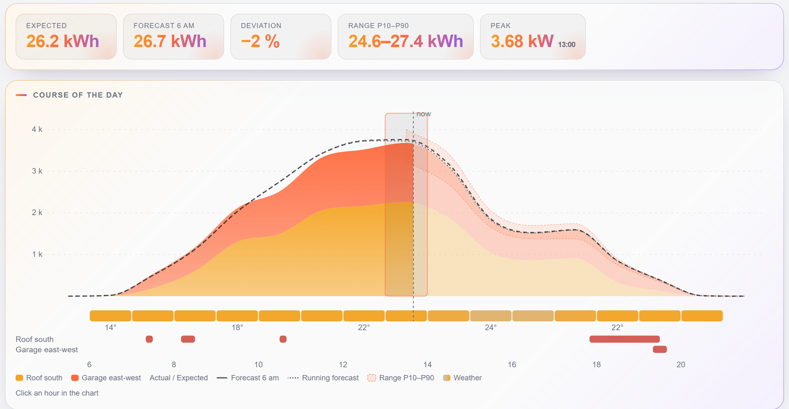
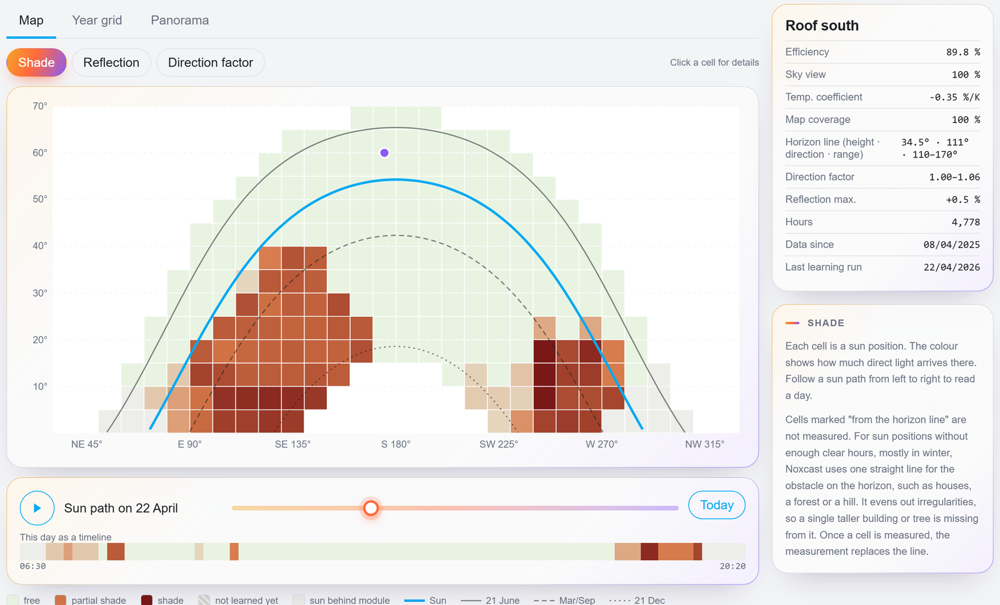
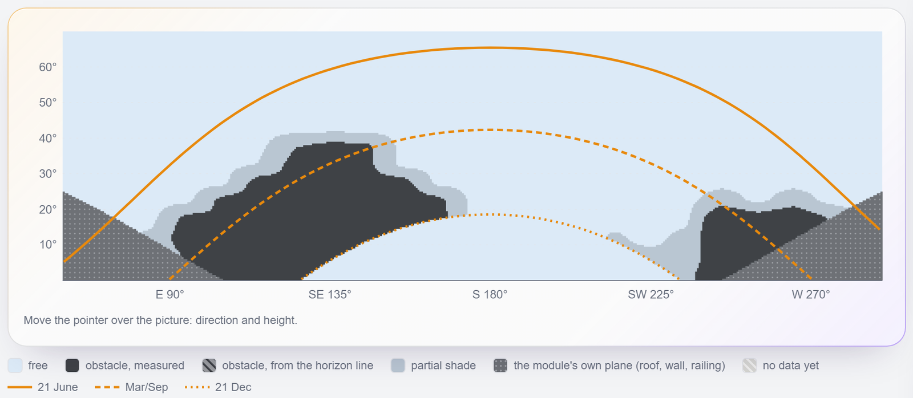
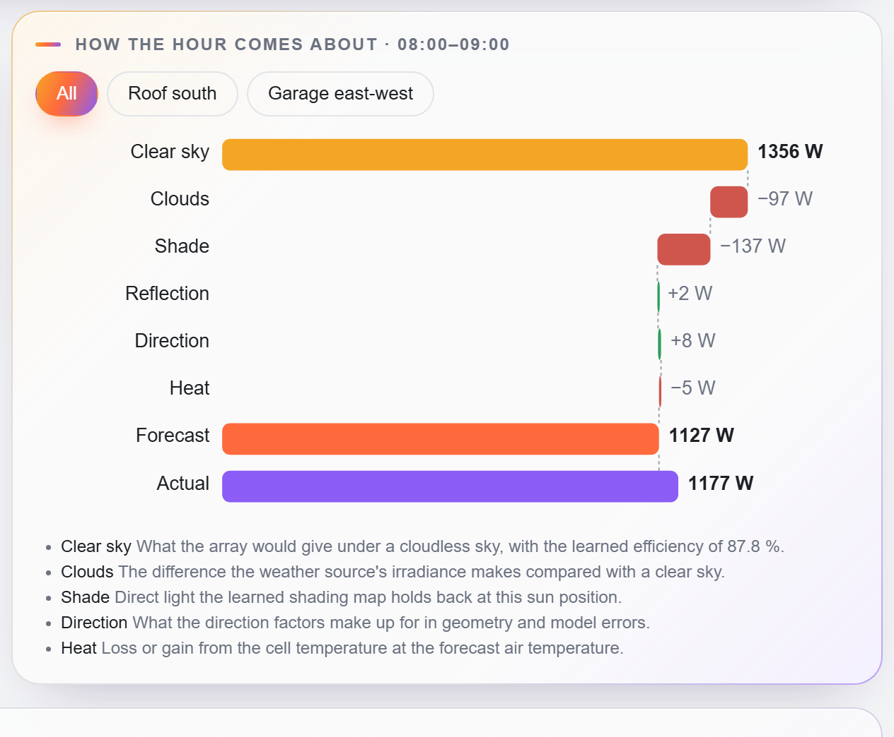
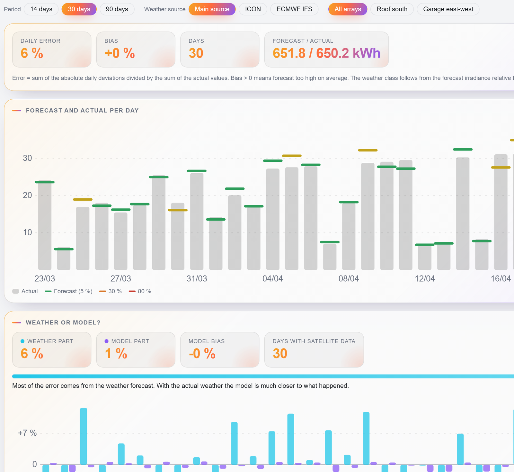
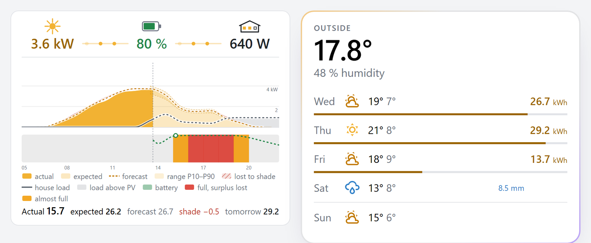

# Noxcast

[English](README.md) | **Deutsch**

**Eine PV-Prognose für Home Assistant, die deine Anlage lernt und jede Zahl erklärt.**

Noxcast sagt voraus, was deine Solarmodule heute und in den nächsten Tagen liefern, Stunde für Stunde. Ausgangspunkt
sind Sonnengeometrie und Wettervorhersage. Aus deinen eigenen Messwerten lernt Noxcast, was deine Anlage wirklich tut
(Wirkungsgrad, Schatten von Bäumen und Häusern, Reflexion, Wärme), und zeigt für jede Stunde, wie die Zahl zustande
kommt. Optional: eine Lastprognose fürs Haus, eine Akku-Simulation und der beste Zeitpunkt für die Waschmaschine.

**Stand:** frühe Version, bisher nur Vorabversionen; inkompatible Änderungen sind möglich und stehen im
[Changelog](CHANGELOG.md) (englisch). Alle Screenshots zeigen Demodaten.

**Sprachen:** Noxcast gibt es auf Deutsch und Englisch. Einrichtung, Entitäten, Panel und Karten folgen der Sprache
deines Home-Assistant-Benutzers; andere Sprachen fallen auf Englisch zurück.

- **Neu bei PV-Prognosen?** Fang mit den [ersten Schritten](#erste-schritte) an.
- **Du kommst von einer anderen Prognose-Integration?** Lies [Warum Noxcast](#warum-noxcast).

## Warum Noxcast

Die meisten Prognosen rechnen mit Neigung, Azimut und Spitzenleistung, vielleicht mit einem Dämpfungsfaktor oder
einem Horizont, den man von Hand einträgt. Noxcast nutzt diese Werte auch, als Ausgangspunkt, und lernt dann aus
deinem Verlauf, was auf deinem Dach anders ist.

| | Noxcast |
|---|---|
| **Schatten** | Gelernt je Sonnenposition (10° Azimut × 5° Höhe) aus deinen eigenen Messwerten: der Baum im Südosten, das Nachbarhaus im Westen. Nichts zu zeichnen oder einzutragen. |
| **Lernen** | Aus bis zu zwei Jahren Home-Assistant-Verlauf, den du schon hast, gleich am ersten Tag. Danach jede Nacht. |
| **Erklärung** | Je Stunde vom klaren Himmel über Wolken, Schatten, Reflexion, Richtung und Wärme bis zur Prognose. Keine Blackbox: zuerst Physik, dann gelernte Werte, zuletzt eine statistische Korrektur. |
| **Bandbreite** | P10–P90 aus deinem eigenen Archiv vergangener Prognosen. Es verschiebt die Wolken und liegt deshalb nie über klarem Himmel. |
| **Genauigkeit** | Jede Vortagsprognose wird archiviert und mit dem verglichen, was passiert ist. Mit dem Satellitenfilter (eine Option) wird der Fehler jedes Tages in Wetteranteil und Modellanteil aufgeteilt. |
| **Datenqualität** | Stunden mit vollem Akku, Nulleinspeisung, Wechselrichtergrenze oder Ausfällen bleiben beim Lernen außen vor. |
| **Montage** | Mehrere Ausrichtungen an einem Eingang (Ost + West, senkrechte Balkonmodule) als eine PV-Gruppe. |
| **Wetter** | Open-Meteo, ICON und ECMWF IFS stundenweise gemittelt. Kein Konto, kein API-Schlüssel, kein Abruflimit. |
| **Datenschutz** | Läuft in Home Assistant. Nur deine Koordinaten gehen an Open-Meteo. |
| **Selbstprüfung** | Meldet eine Konfiguration, die nicht zu den Messwerten passen kann, etwa einen Wirkungsgrad über 100 % oder einen falschen Azimut. |

### Was es lernt

Jedes Feld der Schattenkarte ist eine Sonnenposition. Rot heißt: Dort kommt weniger Direktlicht an. Die Linien sind
die Sonnenbahnen im Juni, zur Tagundnachtgleiche und im Dezember; so liest du ab, wann ein Hindernis eine Rolle spielt.

Das Panorama zeigt dasselbe so, wie es eine Kamera auf dem Modul sähe: Gerade Kanten bleiben gerade, Baum und Haus
sehen aus wie vor Ort. Ziehen schwenkt den Blick. Die gepunktete Fläche ist die Ebene des Moduls selbst; dahinter
erreicht die Sonne es nicht.

### Wie eine Stunde zustande kommt

Jede Prognosestunde lässt sich in ihre Schritte zerlegen. Hier steht die Morgensonne hinter dem Baum:

### Wie gut es ist

Prognose gegen Ist für die letzten 14, 30 oder 90 Tage, nach Wetterklasse und Wettermodell. Mit dem Satellitenfilter
wird der Fehler jedes Tages aufgeteilt: Der Wetteranteil ist das, was die Wettervorhersage falsch hatte, der
Modellanteil das, was Noxcast mit dem echten Wetter falsch hatte.

### Auf dem Dashboard

Eine Tageskarte mit der Leistung jetzt und dem Verlauf des Tages und eine Wetterkarte mit dem erwarteten Ertrag je Tag.

### Alles, was es kann

| Teil | Was du bekommst |
|---|---|
| PV-Prognose | Je PV-Gruppe und gesamt: heute, morgen, übermorgen (bis 7 Tage), stündlich, mit P10–P90-Band; als Solarprognose im Energie-Dashboard angeboten |
| Heute | Prognose um 06:00 fixiert, Erwartung des Tages (gemessen + korrigierter Rest), Restenergie |
| Lernen | Wirkungsgrad, Schattenkarte, Horizontlinie, Reflexion, Richtungsfaktor, Himmelssicht, Temperaturverlust |
| Wetter | Open-Meteo, auch als Wetter-Entität fürs Dashboard |
| Genauigkeit | Archiv der Vortagsprognosen: Prognose gegen Ist, aufgeteilt in Wetterfehler und Modellfehler; nächtlicher Backtest |
| Last (optional) | Lastprognose fürs Haus: Grundlast je Stunde plus deine Verbraucher |
| Akku (optional) | Simulation bis zum nächsten Ladebeginn morgen: voll / leer, Überschuss, verlorener Überschuss, Netz |
| Planung (optional) | Bestes Fenster und PV-Anteil für flexible Verbraucher (Waschmaschine, Trockner, …) |
| Oberfläche | Seitenleisten-Panel *Noxcast*, Tageskarte und Wetterkarte |

### Was Noxcast nicht ist

- Es steuert nichts. Alle Ergebnisse sind Sensoren und Attribute für deine eigenen Automationen.
- Es braucht einen Leistungssensor je PV-Gruppe. Ein Tageszähler für Energie allein reicht nicht (siehe
  [unten](#was-du-brauchst)).
- Die Schattenkarte füllt sich mit klaren Stunden. Eine Position, die die Sonne nur im Winter erreicht, bleibt offen,
  bis ein klarer Wintertag kommt; bis dahin füllt die Horizontlinie sie.

## Erste Schritte

### Was du brauchst

| | Wozu | Wo du es findest |
|---|---|---|
| Home Assistant 2026.10 oder neuer | | Einstellungen → Info |
| Ein **Leistungssensor** für deine PV (W oder kW) | Noxcast lernt aus seinem Verlauf | Einstellungen → Entitäten, nach deinem Wechselrichter suchen. Ein Leistungssensor zeigt die aktuelle Leistung in W oder kW und hat im Verlauf ein Liniendiagramm. |
| Neigung, Azimut und Spitzenleistung der Module | Der Ausgangspunkt der Prognose | Datenblatt oder Installateur. Neigung: 0° waagerecht, 90° senkrecht. Azimut: 90° Ost, 180° Süd, 270° West. Spitzenleistung in Watt (Wp). |
| Optional: der Ladestand des Akkus | Stunden mit vollem Akku bleiben außen vor, weil der Wechselrichter dann abregeln kann | Einstellungen → Entitäten, ein Sensor in % |
| Internetzugang zu Open-Meteo | Die Wettervorhersage | Kostenlos für nicht-kommerzielle Nutzung, ohne Schlüssel |

Welcher Sensor? Am besten einer je MPPT-Eingang des Wechselrichters (oft *PV1 power*, *PV2 power* oder *DC power*
genannt). Die Gesamtleistung des Wechselrichters geht auch, solange alle Module daran in dieselbe Richtung zeigen oder
du die anderen Ausrichtungen einträgst (siehe die Beispiele). Ein Energiezähler in kWh reicht allein nicht; ein
*Ableitung*-Helfer (Einstellungen → Geräte & Dienste → Helfer) macht daraus eine Leistung.

Noxcast liest die Langzeitstatistik von Home Assistant, die der Recorder standardmäßig führt. Je mehr Verlauf, desto
früher sind die gelernten Werte gut; genutzt werden bis zu zwei Jahre.

### Installieren

1. HACS öffnen → ⋮ → *Benutzerdefinierte Repositories*, `https://github.com/TelosNox/noxcast` mit der Kategorie
   *Integration* hinzufügen.
2. In HACS nach *Noxcast* suchen und herunterladen. Bis Version 0.1.0 gibt es nur Vorabversionen: HACS für Noxcast
   Beta-Versionen anzeigen lassen.
3. Home Assistant neu starten.

Ohne HACS: `custom_components/noxcast` nach `config/custom_components` kopieren und neu starten.

### Einrichten

1. Einstellungen → Geräte & Dienste → *Integration hinzufügen* → **Noxcast**. Den Sensor für den Akku-Ladezustand
   wählen, falls vorhanden; alles andere kann leer bleiben.
2. Auf der Seite der Integration: ⋮ → *PV-Gruppe hinzufügen*. Den oder die Leistungssensoren wählen, Neigung, Azimut
   und Spitzenleistung eintragen. Eine PV-Gruppe je Gruppe von Modulen, die gemeinsam gemessen wird.
3. Fertig. Noxcast lernt sofort aus dem vorhandenen Verlauf und danach jede Nacht um 01:30.

Dann **Noxcast** in der Seitenleiste öffnen: *Gelerntes* zeigt, was es über jede PV-Gruppe herausgefunden hat, *Tag*
die Prognose von heute. Fürs Dashboard: *Karte hinzufügen* → *Noxcast*.

### Beispiele

| Deine Anlage | PV-Gruppen in Noxcast |
|---|---|
| Ein Wechselrichter, alle Module nach Süden | Eine PV-Gruppe mit dem Leistungssensor des Wechselrichters |
| Hybridwechselrichter, Ostdach an PV1, Westdach an PV2 | Zwei PV-Gruppen: PV1 Ost, PV2 West |
| Ost- und Westmodule am selben Eingang | Eine PV-Gruppe, Ost als Hauptausrichtung, West als *Weitere Ausrichtung 2*, jede mit eigener Spitzenleistung |
| Balkon mit Mikrowechselrichter, zwei Module unterschiedlich geneigt | Eine PV-Gruppe mit einer weiteren Ausrichtung |
| Zwei Wechselrichter, beide Süd, einer teils von einem Baum verschattet | Zwei PV-Gruppen, damit der Baum nur dort gelernt wird, wo er wirkt |

### Wenn etwas falsch aussieht

- **Wirkungsgrad über 100 % oder *Prüfen* an der PV-Gruppe:** Die Konfiguration passt nicht zu den Messwerten. Meist
  ist die Spitzenleistung zu niedrig, der Azimut gespiegelt (Ost und West vertauscht) oder ein Sensor fehlt in der
  PV-Gruppe. *Gelerntes* → die PV-Gruppe → *Passt die Konfiguration?* sagt, was zu prüfen ist.
- **Schattenkarte größtenteils grau:** noch zu wenige klare Stunden. Sie füllt sich über die Wochen.
- **Prognose zu hoch an Tagen mit vollem Akku:** den Akku-Ladezustand im Haupteintrag eintragen, dann den Dienst
  `noxcast.relearn` aufrufen.
- **Tage mit Wartung oder Ausfall:** mit `noxcast.exclude_period` ausschließen.
- *Diagnose* im Panel listet jeden Sensor, den Noxcast liest, fehlende Daten und Fehler. Der Diagnose-Download der
  Integration enthält, was ein Fehlerbericht braucht.

## Konfiguration

Einstellungen → Geräte & Dienste → Integration hinzufügen → **Noxcast**. Danach auf der Seite der Integration
Untereinträge anlegen (⋮ → *PV-Gruppe hinzufügen* / *Verbraucher hinzufügen* / *Akku hinzufügen*).

### 1. Haupteintrag

| Feld | Bedeutung |
|---|---|
| Akku-Ladezustand | Stunden, in denen ein Akku voll ist, bleiben beim Lernen außen vor (die Leistung kann abgeregelt sein) |
| Akku gilt als voll ab | Ladezustand, ab dem das gilt (Standard 95 %); an deine Ladegrenze anpassen |
| Hausverbrauch | Optional. Leistung des ganzen Hauses (W/kW). Schaltet die Lastprognose ein |
| Tagestyp | Optional. Entität, deren Zustand um 12 Uhr der Tagestyp ist (Workday-Sensor, ein `input_select` wie Homeoffice / Büro / Urlaub). Profile werden je Zustand gelernt |
| Netzleistung | Optional. Leistung am Netzanschluss, positiv = Bezug (*umkehren*, wenn Einspeisung positiv ist) |
| Überschuss wird eingespeist | Aus = Nulleinspeisung: Überschuss bei vollen Akkus zählt als ungenutzt |
| Prognosetage | 2–7, heute eingeschlossen (Standard 3) |

### 2. PV-Gruppen (eine je Gruppe von Leistungssensoren)

Eine PV-Gruppe ist, was gemeinsam gemessen wird, meist ein MPPT-Eingang oder ein Wechselrichter.

| Feld | Bedeutung |
|---|---|
| Leistungssensoren | Einer oder mehrere; sie werden addiert |
| Neigung, Azimut, Spitzenleistung | Der Module (Azimut 180° = Süd) |
| Weitere Ausrichtung 2–4 | Optional: Module an denselben Sensoren, die in eine andere Richtung zeigen (z. B. Ost + Süd + West an einem Eingang, senkrecht Ost + West). Jede mit Neigung, Azimut und eigener Spitzenleistung; die Spitzenleistung der PV-Gruppe ist die Summe |
| Konfiguration gültig seit (*Erweitert*) | Optional: Verlauf vor diesem Datum ignorieren (z. B. nach einem Umbau) |
| Temperaturkoeffizient (*Erweitert*) | Optional: Pmax-Koeffizient aus dem Datenblatt in %/K; sonst gelernt |
| Montage | Frei hinterlüftet (Balkon, Aufständerung; 30 K Erwärmung der Zellen bei 1000 W/m²), dachparallel (50 K) oder ins Dach integriert (60 K). Ein eigener Wert in K steht unter *Erweitert* |

Gelernt wird sofort aus dem vorhandenen Verlauf und danach jede Nacht (01:30).

### 3. Verbraucher (optional, für die Lastprognose)

Ein Verbraucher mit eigenem Sensor wird aus dem Hausverbrauch herausgerechnet und für sich prognostiziert. Das Formular
hat zwei Schritte: erst Sensor und Zeitbindung, dann nur die Felder dieser Zeitbindung.

| Feld | Bedeutung |
|---|---|
| Leistungs- oder Energiesensor | Leistung (W/kW) oder Energie (kWh, z. B. Energie je Programm einer Waschmaschine) |
| Restlaufzeit / verstrichene Zeit | Optional: Ein laufendes Programm zählt bis zu seinem Ende |
| Zeitbindung | *Fest*: Teil der Lastprognose. *Flexibel*: Du wählst, wann es läuft; Noxcast schlägt das Fenster vor |
| Art (nur fest) | *Profil*: eigener Median je Stunde. *Programm*: läuft mit Ende (Spülmaschine); gelernte Startzeiten, Läufe pro Tag, Leistungskurve. *Sitzung*: an, dann offen (PC, TV); gelernte Einschaltwahrscheinlichkeit und Dauer. *Geregelt*: folgt der Außentemperatur (Wärmepumpe, Klimaanlage) |
| Leistung eines Laufs, Dauer eines Laufs | Nur flexibel, optional: sonst aus dem Verlauf gelernt |
| Jetzt starten ab PV-Anteil | Nur flexibel, optional (Standard 70 %): Schwelle des Sensors *jetzt starten* |

### 4. Akkus (optional, braucht den Hausverbrauch)

Name, Ladestand-Sensor, Kapazität und Kopplung stehen oben; Grenzen, Leistung und ein gemeinsamer Wechselrichter stehen in
Abschnitten, die zu bleiben, bis sie einen Wert enthalten.

| Feld | Bedeutung |
|---|---|
| Ladestand-Sensor, Kapazität | Pflicht |
| Lade-/Entladeleistung | Optional: Lade- und Entladeleistung für die Karte, positiv = Laden (sonst *umkehren*) |
| Ladegrenze oben / Entladegrenze unten | Zahl oder Entität (z. B. Ladegrenze, Notstromreserve) |
| Reserve | Prozentpunkte über der Entladegrenze, bei denen das Entladen praktisch endet (z. B. durch eine Einspeisestopp-Regel) |
| Kopplung, Wirkungsgrad | DC (Standard 95 % im Zyklus) oder AC (90 %), oder eigener Wert |
| Max. Lade- / Entladeleistung | Optionale Grenzen; darüber geht Überschuss ins Netz oder das Netz liefert |
| Ausgangsgrenze, PV-Gruppe | Optional, für Balkonkraftwerke: was der Wechselrichter einspeisen darf (z. B. 800 W), und die PV-Gruppe am selben Wechselrichter. PV und Akku liefern zusammen höchstens die Grenze; PV darüber kann nur den Akku laden. Ein Akku je Gruppe |

Alle Akkus werden als ein Speicher simuliert (Kapazitäten addiert, Grenzen nach Kapazität gewichtet).

### 5. Optionen (⋮ → Konfigurieren)

| Option | Standard |
|---|---|
| Wettermodelle | `icon_seamless` + `ecmwf_ifs`, stundenweise gemittelt; jedes Open-Meteo-Modell kann dazukommen |
| Lufttemperatur aus Archiv | An: nötig, um den Temperaturverlust zu lernen |
| Satellitenfilter | Aus: wählt mit der Satellitenstrahlung klare Stunden zum Lernen aus und teilt den Prognosefehler in Wetter und Modell |
| Archiv-URLs, Satellitenmodell, API-Schlüssel | Open-Meteo; nur für selbst gehosteten oder kommerziellen Zugang ändern |

## Dashboard-Referenz

### Seitenleisten-Panel *Noxcast* (Gesamtübersicht)

Erscheint nach der Einrichtung in der Seitenleiste; nichts zu konfigurieren. Reiter:

| Reiter | Inhalt |
|---|---|
| Gelerntes | Ein Lernstand (letzter und nächster Lernlauf, wie weit jede PV-Gruppe ist, für Administratoren ein Knopf zum sofortigen Neulernen); je PV-Gruppe die gelernten Karten für Schatten, Reflexion und Richtung über Sonnenazimut × Höhe mit den Sonnenbahnen des Jahres, ein Datumsregler, Werte je Feld, ein Raster Monat × Stunde, Kennzahlen (Wirkungsgrad, Himmelssicht, Temperaturkoeffizient, Abdeckung) und eine Plausibilitätsprüfung von Neigung und Azimut |
| Tag | Ein Tag (bis 120 Tage zurück, 2 voraus): die PV-Gruppen übereinander, Prognose gegen Erwartung gegen Ist, P10–P90, Wetter je Stunde, Schatten- und Reflexionszeiten; je Stunde ein Wasserfall vom klaren Himmel über Wolken, Schatten, Reflexion und Wärme bis zur Prognose; wie sich die Erwartung des Tages Stunde für Stunde entwickelt hat; wohin die Energie ging (PV, Akku, Netz, Haus) |
| Prognosegüte | Vortagsprognosen gegen Ist über 14 / 30 / 90 Tage: Fehler, Verzerrung, Kalender, nach Wetterklasse, jedes Wettermodell gegen das Mittel; mit Satellitenfilter die Aufteilung in Wetteranteil und Modellanteil; ein nächtlicher Backtest: das heutige Modell auf vergangenen Tagen, auch auf Tagen, aus denen es nicht gelernt hat |
| Last | Rest von heute und morgen nach Teilen (Grundlast, jeder Verbraucher), gelernte Profile, Backtest, vorgeschlagene wiederkehrende Geräte |
| Akku & Überschuss | Simulation bis zum Ladebeginn morgen, Was-wäre-wenn mit mehr Kapazität oder einem zusätzlichen Verbraucher, die Vorhersage vom Morgen gegen das, was passiert ist, letzte 30 Tage |
| Diagnose | Wetter, letzter Lernlauf, Archiv; jeder Sensor, den Noxcast liest, mit Zustand, Statistik und Abdeckung; fehlende Daten und Fehler |

### Tageskarte `custom:noxcast-card`

Wird automatisch registriert; hinzufügen über *Karte hinzufügen* → *Noxcast*. Sie zeigt immer, womit Noxcast
konfiguriert ist (PV-Gruppen, Hausverbrauch, Netz, Akkus, Einspeisung); die Karteneinstellungen ändern nur die
Darstellung.

- **Leistung jetzt** als Reihe von Zahlen: PV, Akku, Haus, Netz, mit wandernden Punkten für die Flüsse. Symbole über
  den Zahlen zeigen ihren Zustand: Die Sonne wächst mit dem Anteil an der Spitzenleistung, der Akku ist bis zu seinem
  Ladestand gefüllt, ein Fenster des Hauses leuchtet je Laststufe auf, und der Strommast bekommt je Stufe einen Blitz
  (blau beim Bezug, gelb beim Einspeisen). Eine Stufe geht sofort hoch; herunter geht sie sofort unter 60 % ihrer
  Grenze, sonst nach 30 s darunter. Ein Tipp auf eine Zahl öffnet ihre Entität. Stehen mehrere Entitäten dahinter,
  wie bei PV-Gruppen und Akkus, listet sie diese zuerst mit ihren aktuellen Werten; ein Tipp auf eine Zeile öffnet
  diese Entität.
- **Tagesdiagramm:** PV-Ist (durchgezogen), Erwartung und Prognose (gestrichelt), Schattenverlust schraffiert,
  Hausverbrauch, Akkustand (gemessen, dann simuliert; rot, wo er voll ist und Überschuss verloren geht), P10–P90-Band,
  je PV-Gruppe eine Spur mit Schatten- und Reflexionszeiten, oben Wettersymbole je Stunde. Das Diagramm nutzt die
  ganze Kartenbreite, die Skala steht darin. Überfahren oder Antippen einer Stunde zeigt ihre Werte.
- **Zahlen des Tages** unter dem Diagramm: Ist, Erwartung, die Prognose vom Morgen, Schattenverlust und die Prognose
  für morgen.

| Option | Standard | |
|---|---|---|
| `show_battery`, `show_effects`, `show_band`, `show_load` | `true` | Akkustand, Schatten-/Reflexionsspuren, P10–P90, Hausverbrauch im Diagramm |
| `show_weather` | `true` | Wettersymbole über dem Diagramm |
| `range` | `production` | `production` (eine Stunde um Sonnenauf- und -untergang) oder `day` (0–24 Uhr, Nacht gestaucht) |
| `labels` | `icons` | `icons` (Symbole, die den Zustand zeigen) oder `text` (Namen, Akku-Prozent und Leistung) |
| `sun_glow` | `false` | Das Sonnensymbol leuchtet nach Anteil an der Spitzenleistung |
| `home_steps` | `[100, 300, 1000]` | Symbole: Ab diesen Watt leuchtet je ein Fenster des Hauses |
| `grid_steps` | `[300, 1000]` | Symbole: zweiter und dritter Blitz am Netz, in beide Richtungen (der erste kommt mit dem Fluss, ab `flow_min_w`) |
| `battery_arrows` | `false` | Pfeile hoch und runter neben dem Akkusymbol, der des Flusses leuchtet |
| `flow_style` | `chain` | `chain` (Punkte zwischen den Zahlen) oder `bus` (eine Linie darunter) |
| `flow_speed` | `normal` | `calm`, `normal`, `lively` |
| `flow_min_w` | `10` | Kleinster angezeigter Fluss in W |
| `look` | `plain` | `plain` (Home-Assistant-Karte) oder `noxcast` (Panel-Optik) |
| `legend` | `true` | Legende unter dem Diagramm |
| `font_scale` | `1` | 0,8–1,6 |

Alle Optionen stehen auch im visuellen Editor, gruppiert nach Leistung jetzt, Tagesdiagramm und Optik.

### Wetterkarte `custom:noxcast-weather-card`

Die kommenden Tage, je einer pro Zeile (Symbol, Höchst- / Tiefstwert, Niederschlag), mit dem PV-Ertrag, den Noxcast
erwartet, aus Noxcasts eigenem Wetter – demselben, das die Prognose antreibt.

| Option | Standard | |
|---|---|---|
| `days` | `5` | 1–7 Tage Wetter; PV nur innerhalb des Prognosehorizonts |
| `show_pv` | `true` | PV-Ertrag je Tag |
| `pv_bar` | `line` | Anteil am Ertrag bei klarem Himmel als `line`, `fill` oder `none` |
| `temperature`, `humidity`, `name` | – | Optional gemessene Außenwerte über den Tagen |
| `look` | `noxcast` | `noxcast` oder `plain` |

## Entitäten

Geräte **Noxcast (gesamt)** und **Noxcast *PV-Gruppe***:

| Entität | Gesamt | PV-Gruppe | Hinweise |
|---|---|---|---|
| Prognose heute | ✓ | ✓ | Um 06:00 fixiert |
| Erwartung heute | ✓ | ✓ | Gemessene Stunden + korrigierter Rest |
| Prognose Rest heute | ✓ | ✓ | |
| Prognose morgen, übermorgen | ✓ | ✓ | |
| Systemwirkungsgrad, Abdeckung Schattenkarte, Temperaturkoeffizient, Übereinstimmung Satellit | | ✓ | Gelernte Werte |
| Schatten heute (Sensor und Bild), Schattenkarte (Bild) | | ✓ | |
| Letzter Lernlauf, Prognosefehler (30 Tage) | ✓ | | Fehler je PV-Gruppe und je Wettermodell als Attribute |
| Wetter | ✓ | | Aktuelle Stunde, stündliche und tägliche Vorhersage für 7 Tage |

Prognosesensoren tragen `hourly` (ISO-Zeitstempel → kWh, `schema_version` 1); die Gesamtsensoren zusätzlich
`p10` / `p90`. Die Gesamtprognose wird im Energie-Dashboard als Solarprognose angeboten.

Mit Hausverbrauch: **Last Rest heute**, **Last morgen** (Attribute `hourly`, `base`, `consumers`, `correction`,
`backtest`). Mit Akkus: **Überschuss Rest heute**, **Überschuss verloren heute**, **Akku voll um**, **Akku höchster
Stand**, **Akku leer um**, **Akku bei nächstem Ladebeginn** (Attribut `grid`: Netzenergie bis dahin). Je flexiblem
Verbraucher: **PV-Anteil jetzt**, **bestes Fenster heute** und **bestes Fenster morgen** (Startzeit; Attribute `end`,
`pv_share`, `lost_share`; unbekannt, wenn kein Lauf passt) und der Binärsensor **jetzt starten**: an, solange ein
jetzt gestarteter Lauf mindestens den eingestellten PV-Anteil aus Überschuss bekommt und höchstens 5 Punkte weniger
als das beste Fenster, das heute noch kommt.

## Reparaturen

Noxcast meldet Probleme unter Einstellungen → System → Reparaturen und entfernt jede Meldung, sobald sie behoben ist:

| Meldung | Wann |
|---|---|
| Noch keine PV-Gruppe | Die Integration ist eingerichtet, aber keine PV-Gruppe hinzugefügt |
| Sensoren fehlen | Eine eingetragene Entität existiert nicht (umbenannt oder entfernt) |
| Keine Wettervorhersage | Open-Meteo war seit über einem Tag nicht erreichbar |
| Konfiguration passt nicht | Die Messwerte einer PV-Gruppe passen nicht zu Spitzenleistung, Neigung, Azimut oder Sensor (siehe *Gelerntes*) |

## Dienste

| Dienst | |
|---|---|
| `noxcast.exclude_period` | Einen Zeitraum vom Lernen ausschließen (z. B. Abregelung im Urlaub, Wartung) |
| `noxcast.relearn` | Jetzt neu aus dem Verlauf lernen |

Beide brauchen einen Administrator, ebenso der Bereich *Diagnose* im Panel.

## So funktioniert es

### Prognose einer Stunde

Berechnet in sechs 10-Minuten-Schritten je Stunde (Sonnenstand in jedem Schritt) und gemittelt:

1. **Wetter:** GHI, DNI, DHI und Lufttemperatur von Open-Meteo, die konfigurierten Modelle gemittelt.
2. **Geometrie:** Direktstrahlung, diffuses Himmelslicht und Bodenreflexion auf der Modulebene; bei mehreren
   Ausrichtungen je Ebene jede bei null abgeschnitten und nach Anteil an der Spitzenleistung summiert.
3. **Gelernte Werte der PV-Gruppe:** Direktstrahlung × Schattendurchlass × Richtungsfaktor, diffuses Himmelslicht ×
   Himmelssicht, plus reflektiertes Licht aus der Umgebung.
4. **Wirkungsgrad** (gelernt, bei 25 °C) × Spitzenleistung.
5. **Temperatur:** Zelltemperatur aus Lufttemperatur und Einstrahlung (Erwärmung), Verlust mit dem gelernten oder
   dem Datenblatt-Koeffizienten.

### Lernen (nachts, aus der Langzeitstatistik)

- **Datenfilter:** Stunden mit vollem Akku, ausgeschlossene Zeiträume, Ausfälle und unvollständige Stunden bleiben
  außen vor. Ein Plateau an der Wechselrichtergrenze wird gelernt und als Deckel angewandt. Unruhige Stunden
  (durchziehende Wolken, Neustarts) zählen nicht für Wirkungsgrad, Richtungsfaktor und Reflexion.
- **Wirkungsgrad:** aus Stunden mit hoher erwarteter Leistung.
- **Schattenkarte** (10° Azimut × 5° Höhe): der Anteil des Direktlichts, der ankommt, nur wo Direktlicht möglich ist.
  Sie folgt der Form echter Hindernisse; Werte ≥ 0,9 gelten als frei. Neuere Beobachtungen wiegen mehr; übereinstimmende
  neue Beobachtungen ersetzen alte (ein gefällter Baum).
- **Horizontlinie:** ein Hindernis am Horizont (Häuser, ein Wald, ein Hügel) als eine gerade Linie (Höhe im rechten
  Winkel, Richtung, Azimutbereich), angepasst an klare Stunden. Zu den Seiten hin ist das Hindernis weiter entfernt,
  deshalb sinkt die Linie. Sie füllt nur die Felder ohne gelernten Wert, meist Winterpositionen, die wenige klare Tage
  nicht erreichen, und wird eingezeichnet, solange die Daten ihr nicht widersprechen. Sie glättet Unregelmäßigkeiten:
  Ein einzelnes höheres Gebäude oder ein Baum zeigt sich nur in gelernten Feldern. Behalten wird sie nur, wenn sie den
  Schatten in ihrem Bereich klar erklärt; sie steht unter Gelerntes, und Felder, die sie füllt, sind in der Karte
  markiert.
- **Richtungsfaktor** (grobe Bereiche, 0,8–1,2): was an unverschatteten Positionen übrig bleibt – Geometrie- und
  Modellfehler.
- **Reflexion:** Licht von hellen Flächen, wo das Modul selbst wenig Direktlicht bekommt.
- **Himmelssicht:** der Anteil des Himmels, den die Module sehen, aus bedeckten Stunden (braucht den Satellitenfilter).
- **Temperaturkoeffizient:** obere Hüllkurve der Leistung über der Zelltemperatur.

### Im Lauf des Tages

- Die Prognose wird alle 30 Minuten und beim Start aktualisiert.
- **Prognose heute** wird um 06:00 fixiert. **Erwartung heute** = gemessene Stunden + der Rest, korrigiert danach, wie
  viel klarer oder wolkiger die letzten Stunden waren als vorhergesagt (die halbe Abweichung für die laufende Stunde,
  halbiert mit jeder weiteren Stunde, nie über klarem Himmel). Die laufende Stunde zählt ab 15 gemessenen Minuten.
- Das **P10–P90-Band** kommt aus dem Archiv: wie weit die Klarheit von Ist und Prognose an vergangenen Tagen mit
  ähnlichem Wetter auseinanderlag. Es verschiebt die Wolken und liegt deshalb nie über klarem Himmel (plus 5 % für
  Modellfehler).

### Wetter

- Eine Open-Meteo-Abfrage liefert alle konfigurierten Modelle; GHI, DNI und DHI werden gleich gemittelt. Jedes Modell
  wird zusätzlich für sich archiviert, damit seine Genauigkeit mit dem Mittel verglichen werden kann.
- Die Wetter-Entität nutzt dieselben gemittelten Werte für 7 Tage. Zustand: Niederschlag ≥ 0,1 mm/h ist Regen
  (≥ 4 mm Starkregen, Schnee bei ≤ 0 °C, Schneeregen bis 2 °C), sonst Bewölkung < 20 % sonnig / klare Nacht, < 70 %
  teilweise bewölkt, sonst bewölkt; Wind ≥ 10,8 m/s windig; Gewitter und Nebel aus dem Wettercode. Ein Tag wird nach
  seinen hellen Stunden beurteilt.
- Ist Open-Meteo nicht erreichbar, wird die letzte Antwort bis zu 24 h weiter genutzt, auch nach einem Neustart.

### Archiv und Genauigkeit

Die Prognose für morgen wird bis Mitternacht überschrieben; die letzte Fassung bleibt als Vortagsprognose erhalten
(120 Tage) und wird nachts um die gemessene Leistung ergänzt. Im Lauf des Tages wird die erwartete Tagessumme zu jeder
vollen Stunde (05–21) festgehalten. Mit dem Satellitenfilter läuft dasselbe Modell auf der gemessenen Einstrahlung
jeder vergangenen Stunde: Prognose − das = Wetterfehler, das − Ist = Modellfehler.

Ein zweites Archiv hält die 5-Minuten-Mittel jedes Leistungssensors fest, jede Nacht aus der 5-Minuten-Statistik von
Home Assistant übernommen (die nur etwa zehn Tage aufbewahrt wird), für schärfere Schatten später: 5 Minuten
entsprechen etwa 1,25° Sonnenazimut, und zwei Module einer PV-Gruppe, die im selben Moment voneinander abweichen,
zeigen Teilschatten. Nur Zeiten, in denen die Sonne vor den Modulen steht, in ganzen Watt, für höchstens drei Jahre:
etwa 0,5 MB je Sensor, egal wie lange Noxcast läuft. Für die Prognose noch nicht genutzt; der Diagnose-Download zeigt,
wie weit es reicht (`fine_archive`).

### Lastprognose

load(h) = Grundprofil × Korrektur + feste Verbraucher + geregelte Verbraucher + laufende flexible

- **Grundprofil:** Hausverbrauch minus alle Verbraucher, Median je Stunde und Tagestyp (letzte Wochen).
- **Korrektur:** Verhältnis der letzten 4 Stunden zum Profil, das über die nächsten Stunden gegen 1 ausläuft; ein
  anhaltend höheres Niveau (z. B. Klimaanlage) wird für den Rest des Tages pauschal addiert.
- **Programm:** erwartete Starts je Stunde × Laufkurve, gedeckelt bei den meisten gesehenen Läufen pro Tag minus der
  heute schon gelaufenen; ein laufendes Programm zählt mit seiner Restenergie.
- **Sitzung:** solange an, die aktuelle Leistung für die typische Restdauer zu dieser Tageszeit; sonst
  Einschaltwahrscheinlichkeit × typische Leistung.
- **Geregelt:** Tagesenergie gegen Tagesmitteltemperatur (Schwelle + Steigung, über die Jahreszeiten gelernt), verteilt
  nach der mittleren Stundenform des Verbrauchers.

### Akku-Simulation und Planung

- Stunde für Stunde von jetzt bis zum Ladebeginn morgen (erste Stunde mit PV über der Last): Überschuss lädt bis zur
  oberen Grenze und zur Ladeleistung, der Rest geht verloren (oder wird eingespeist); ein Defizit entlädt bis
  Entladegrenze + Reserve, der Rest kommt aus dem Netz. Verluste nach Kopplung.
- Mit Ausgangsgrenze liefert ein Akku höchstens die Grenze minus das, was seine PV-Gruppe in der Stunde liefert,
  und PV der Gruppe über der Grenze geht in den Akku oder wird abgeregelt.
- Die erste Simulation nach 06:00 wird je Tag behalten und mit dem gemessenen Ladestand verglichen.
- **Flexible Verbraucher:** Jeder Lauf wird in den Überschuss gelegt, der ohnehin nicht in den Akku ginge; mehrere
  werden nacheinander platziert. Ergebnisse: bestes Fenster heute und morgen, PV-Anteil bei Start jetzt.

## Datenschutz

Noxcast sendet nur deine Koordinaten an Open-Meteo. Alles andere bleibt in Home Assistant. Fehlermeldungen und Logs
nennen den Wetter-Host und seine Antwort, nicht die Anfrage, und enthalten deshalb weder deinen Standort noch einen
API-Schlüssel. Der Diagnose-Download lässt Standort und API-Schlüssel weg, listet aber deine Sensor-IDs: Sieh ihn
durch, bevor du ihn veröffentlichst.

## Entwicklung

- Konzept und Designentscheidungen: [docs/concept.md](docs/concept.md) (englisch)
- Tests: `pip install -r requirements_test.txt && pytest` (Linux/macOS; Home Assistant lässt sich unter Windows nicht
  installieren). Die Physik-Tests vergleichen mit pvlib.

## Lizenz

GPL-3.0 – siehe [LICENSE](LICENSE).
