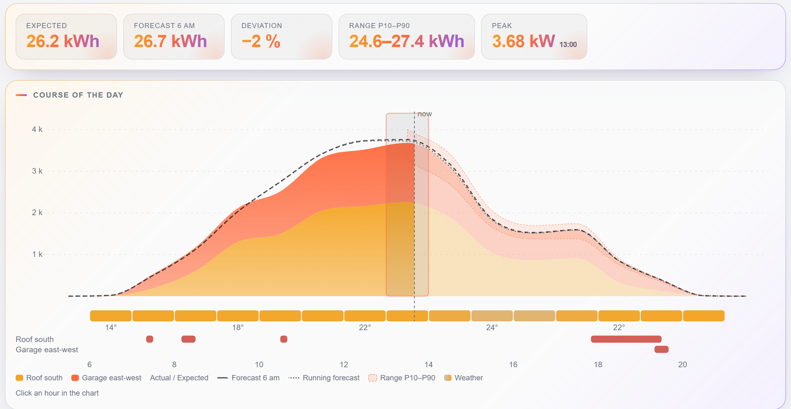
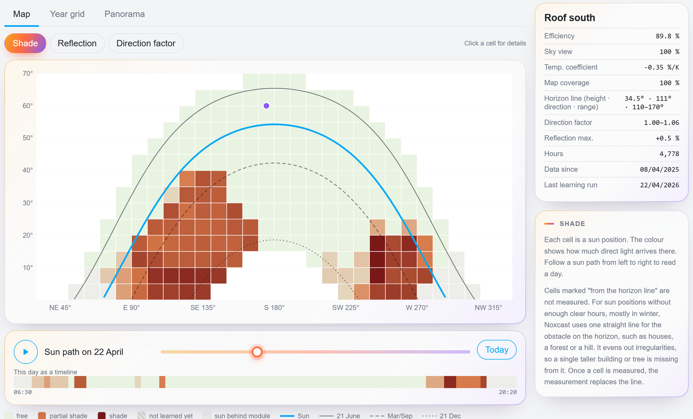
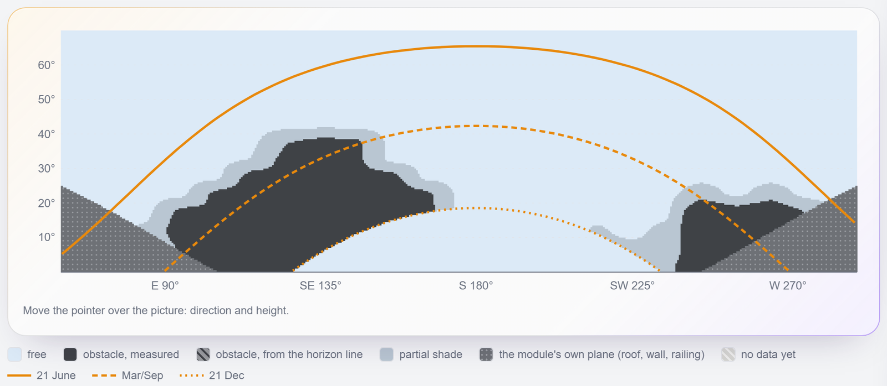
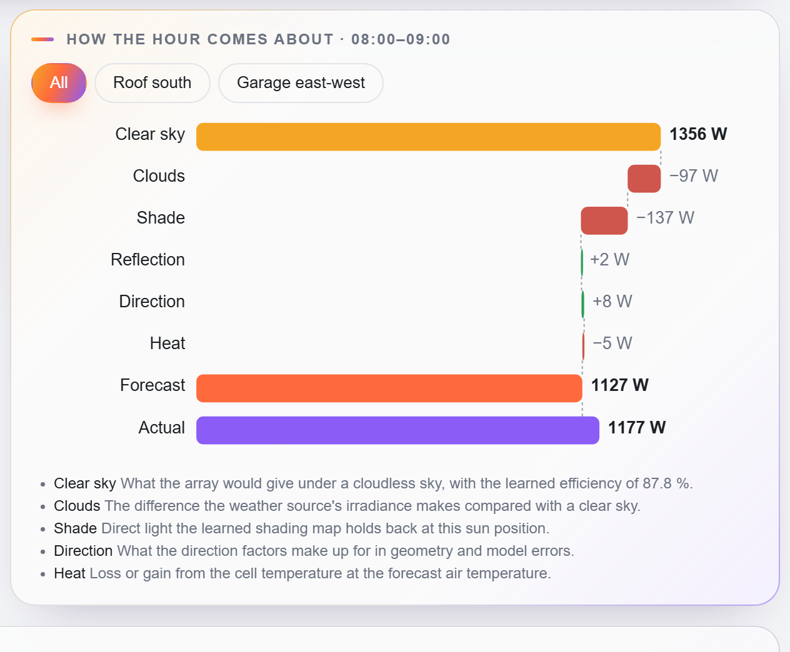
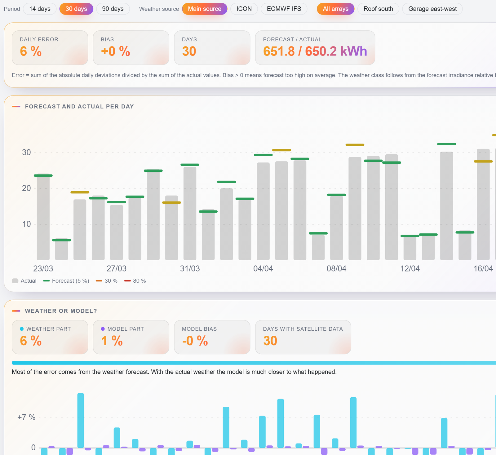
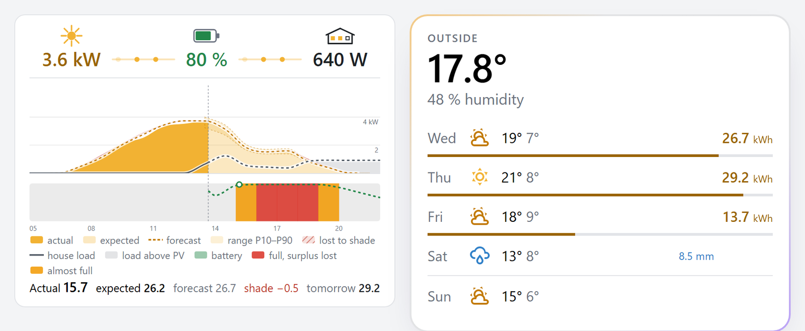

# Noxcast

**English** | [Deutsch](README.de.md)

**A PV forecast for Home Assistant that learns your installation and explains every number.**

Noxcast forecasts what your solar modules will produce today and in the next days, hour by hour. It starts from
solar geometry and the weather forecast, learns from your own measurements what your installation really does
(efficiency, shade from trees and houses, reflection, heat), and shows for every hour how the number came about.
Optional: a house load forecast, a battery simulation and the best time for the washing machine.

**Status:** version 0.x: stable releases, still young. While the version starts with 0, a minor version can bring
breaking changes; each one is marked in the [changelog](CHANGELOG.md) with what you have to do. All screenshots show demo data.

**Languages:** Noxcast is available in English and German (Deutsch). Setup, entities, panel and cards follow the
language of your Home Assistant user; other languages fall back to English.

- **New to PV forecasts?** Start with [Getting started](#getting-started).
- **Coming from another forecast integration?** Read [Why Noxcast](#why-noxcast).

## Why Noxcast

Most forecasts compute from tilt, azimuth and peak power, maybe with a damping factor or a horizon you enter by
hand. Noxcast uses those too, as the starting point, and then learns from your history what is different on your
roof.

| | Noxcast |
|---|---|
| **Shade** | Learned per sun position (10° azimuth × 5° elevation) from your own measurements: the tree in the south-east, the neighbour's house in the west. Nothing to draw or enter. |
| **Learning** | From up to two years of Home Assistant history you already have, on the first day. Then every night. |
| **Explanation** | Per hour from clear sky through clouds, shade, reflection, direction and heat to the forecast. No black box: physics first, learned values second, a statistical correction last. |
| **Range** | P10–P90 from your own archive of past forecasts. It shifts the clouds, so it never goes above a clear sky. |
| **Accuracy** | Every day-ahead forecast is archived and compared with what happened. With the satellite filter (an option), each day's error is split into weather part and model part. |
| **Data quality** | Hours with a full battery, excluded periods or outages are left out of learning. A power limit of an input or micro-inverter caps the forecast. |
| **Mounting** | Several orientations on one input (east + west, vertical balcony modules) as one array. |
| **Weather** | Open-Meteo, ICON and ECMWF IFS averaged hour by hour. No account, no API key, free for private use. |
| **Privacy** | Runs in Home Assistant. Only your coordinates go to Open-Meteo. |
| **Self-check** | Flags a configuration that cannot fit the measurements, such as an efficiency above 100 % or a wrong azimuth. |

### What it learns

Each cell of the shading map is a sun position. Red means less direct light arrives there. The lines are
the sun's paths in June, at the equinox and in December, so you can read off when an obstacle will matter.

The panorama shows the same as a camera on the module would: straight edges stay straight, so the tree and the
house look as they do on site. Drag to look around. The dotted area is the module's own plane, behind which the sun
cannot reach it.

### How an hour comes about

Every forecast hour breaks down into its steps. Here the morning sun is behind the tree:

### How good it is

Forecast against actual for the last 14, 30 or 90 days, by weather class and weather model. With the satellite
filter, each day's error is split: the weather part is what the weather forecast got wrong, the model part is
what Noxcast got wrong with the satellite-measured weather. Since satellite values are area means, the model part also
contains their errors (fog, for example): it says something about the model over many days, not on a single day. A comparison of the weather models shows, on request, which model or
pair of models would have suited your installation best over the past year.

### On the dashboard

A day card with power now and the course of the day, and a weather card with the expected yield per day.

### Everything it does

| Part | What you get |
|---|---|
| PV forecast | Per array and in total: today, tomorrow, day after (up to 7 days), hourly, with a P10–P90 band; offered as solar forecast in the energy dashboard |
| Today | Forecast fixed at 06:00, expected day (measured + corrected rest), remaining energy |
| Learning | Efficiency, shading map, horizon line, reflection, direction factor, sky view, temperature loss |
| Weather | Open-Meteo, also as a weather entity for the dashboard |
| Accuracy | Day-ahead archive: forecast against actual, split into weather error and model error; nightly backtest |
| Load (optional) | House load forecast: base load per hour plus your consumers |
| Battery (optional) | Simulation until tomorrow's charge start: full / empty, surplus, lost surplus, grid |
| Planning (optional) | Best window and PV share for flexible consumers (washer, dryer, …) |
| Frontend | Sidebar panel *Noxcast*, day card and weather card |

### What Noxcast is not

- It controls nothing. All results are sensors and attributes for your own automations.
- It needs a power sensor per array. A daily energy counter alone is not enough (see [below](#what-you-need)).
- The shading map fills with clear hours. A position the sun reaches only in winter stays open until a clear
  winter day comes; until then the horizon line fills in.

## Getting started

### What you need

| | Why | How to find it |
|---|---|---|
| Home Assistant 2026.10 or newer | | Settings → About |
| A **power sensor** for your PV (W or kW) | Noxcast learns from its history | Settings → Entities, search for your inverter. A power sensor shows the current output in W or kW and has a line graph in its history. |
| Tilt, azimuth and peak power of the modules | The starting point of the forecast | Datasheet or installer. Tilt: 0° flat, 90° vertical. Azimuth: 90° east, 180° south, 270° west. Peak power in watts (Wp). |
| Optional: the battery's state of charge | Hours with a full battery are left out, because the inverter may hold back then | Settings → Entities, a sensor in % |
| Internet access to Open-Meteo | The weather forecast | Free for non-commercial use, no key |

Which sensor? The best is one per MPPT input of the inverter (often called *PV1 power*, *PV2 power*, or *DC
power*). The inverter's total output works too, as long as all modules on it face the same way, or you enter
the other orientations (see the examples). An energy counter in kWh is not enough on its own; a *Derivative*
helper (Settings → Devices & services → Helpers) turns it into power.

Noxcast reads Home Assistant's long-term statistics, which the recorder keeps by default. The more history,
the sooner the learned values are good; up to two years are used.

### Install

1. Open HACS → ⋮ → *Custom repositories*, add `https://github.com/TelosNox/noxcast` with the category
   *Integration*.
2. Search for *Noxcast* in HACS and download it. HACS offers the latest stable release. To test a pre-release, let HACS
   show beta versions for Noxcast.
3. Restart Home Assistant.

Without HACS: copy `custom_components/noxcast` into `config/custom_components` and restart.

### Set up

1. Settings → Devices & services → *Add integration* → **Noxcast**. Pick the battery's state of charge sensor if
   you have one; everything else can stay empty.
2. On the integration page: ⋮ → *Add PV array*. Pick the power sensor(s), enter tilt, azimuth and peak power.
   Add one array per group of modules that is measured together.
3. Done. Noxcast learns right away from the history you have and then every night at 01:30.

Then open **Noxcast** in the sidebar: *Overview* shows what is due today and in the days ahead, *Learned* what it
found about each array, *Day* the forecast of today in detail.
For the dashboard: *Add card* → *Noxcast*.

### Examples

| Your installation | Arrays in Noxcast |
|---|---|
| One inverter, all modules facing south | One array with the inverter's power sensor |
| Hybrid inverter, east roof on PV1, west roof on PV2 | Two arrays: PV1 east, PV2 west |
| East and west modules on the same input | One array, east as the main orientation, west as *further orientation 2*, each with its own peak power |
| Balcony with a micro-inverter, two modules angled differently | One array with a further orientation |
| Two inverters, both south, one partly shaded by a tree | Two arrays, so the tree is learned only where it matters |

### When something looks wrong

- **Efficiency above 100 % or *Check* on the array:** the configuration does not fit the measurements. Most often
  the peak power is too low, the azimuth is mirrored (east and west swapped), or a sensor is missing from the
  array. *Learned* → the array → *Does the configuration fit?* says what to check.
- **Shading map mostly grey:** not enough clear hours yet. It fills over the weeks.
- **Forecast too high on days the battery was full:** add the battery's state of charge in the main entry, then
  call the service `noxcast.relearn`.
- **Days with maintenance or an outage:** leave them out with `noxcast.exclude_period`.
- *Diagnostics* in the panel lists every sensor Noxcast reads, missing data and errors. The diagnostics download
  of the integration holds what a bug report needs.

## Configuration

Settings → Devices & services → Add integration → **Noxcast**. Then add subentries on the
integration page (⋮ → *Add PV array* / *Add consumer* / *Add battery*).

### 1. Main entry

| Field | Meaning |
|---|---|
| Battery state of charge sensors | Hours in which a battery is full are left out of learning, and the correction of today's forecast does not read them as clouds (output may be curtailed) |
| Battery considered full at | SOC from which that applies (default 95 %); match your charge limit |
| House load | Optional. Whole-house power (W/kW). Enables the load forecast |
| Day type | Optional. Entity whose state at noon is the day type (Workday sensor, an `input_select` such as home office / office / holiday). Profiles are learned per state |
| Grid power | Optional. Power at the grid connection, positive = import (*invert* if export is positive) |
| Surplus is fed into the grid | Off = zero export: surplus with full batteries counts as unused |
| Forecast days | 2–7, today included (default 3) |

### 2. PV arrays (one per group of power sensors)

An array is what is measured together, usually one MPPT input or one inverter.

| Field | Meaning |
|---|---|
| Power sensors | One or more; they are summed |
| Tilt, azimuth, peak power | Of the modules (azimuth 180° = south) |
| Further orientations 2–4 | Optional: modules on the same sensors that face another way (e.g. east + south + west on one input, vertical east + west). Each with tilt, azimuth and its own peak power; the array's peak is the sum |
| Valid since (*Advanced*) | Optional: ignore history before this date (e.g. after a rebuild) |
| Temperature coefficient (*Advanced*) | Optional: datasheet Pmax coefficient in %/K; otherwise learned |
| Mounting | Free behind (balcony, rack; 30 K cell heating at 1000 W/m²), parallel on the roof (50 K) or integrated into the roof (60 K). An own value in K goes under *Advanced* |
| Each sensor delivers at most (*Power limit*) | Optional: when an MPPT input or a micro-inverter lets through less than the modules deliver, so the power stays flat at a maximum on sunny days. In W as the power sensors measure it (e.g. 800), for every sensor of the array. The forecast is capped at it. When the measurements show a limit, Noxcast suggests it under [Repairs](#repairs) |

Learning starts right away from the existing history and then runs every night (01:30).

### 3. Consumers (optional, for the load forecast)

A consumer with its own sensor is taken out of the house load and forecast on its own. The form has two steps: the
sensor and the timing first, then only the fields of that timing.

| Field | Meaning |
|---|---|
| Power or energy sensor | Power in W/kW with `state_class: measurement`, or energy in Wh/kWh with `state_class: total` or `total_increasing`. A power sensor is the first choice: energy counters often count in 0.1 kWh steps, too coarse for single hours. As energy, a meter that keeps counting and a counter per program (e.g. the program energy of a washer) both work; a counter that is unknown between runs counts as no consumption there |
| Remaining / elapsed time | Optional: a running program counts until it ends. With an energy sensor, the elapsed time gives the power of the running program, with either kind of counter |
| Timing | *Fixed*: part of the load forecast. *Flexible*: you choose when it runs; Noxcast suggests the window |
| Kind (fixed only) | *Profile*: own median per hour. *Program*: runs with an end (dishwasher); learned start times, runs per day, power curve. *Session*: on, then open-ended (PC, TV); learned on-probability and duration. *Regulated*: follows the outside temperature (heat pump, air conditioning) |
| Run power, run minutes | Flexible only, optional: otherwise learned from history |
| Start now from PV share | Flexible only, optional (default 70 %): threshold of the *start now* sensor |

### 4. Batteries (optional, needs the house load)

Name, state of charge sensor, capacity and coupling are on top; limits, power and a shared inverter are in sections
that stay closed until they hold a value.

| Field | Meaning |
|---|---|
| State of charge sensor, capacity | Required |
| Battery power sensor | Optional: charge/discharge power for the card, positive = charging (*invert* otherwise) |
| Max / min SOC | Number or entity (e.g. charge limit, backup reserve) |
| Reserve | Percent points above min SOC where discharging stops in practice (e.g. a feed-in stop rule) |
| Coupling, efficiency | DC (default round trip 95 %) or AC (90 %), or own value |
| Max charge / discharge power | Optional limits; above them surplus goes to the grid or the grid supplies |
| Output limit, PV array | Optional, for balcony systems: what the inverter may feed in (e.g. 800 W) and the PV array on the same inverter. PV and battery together deliver at most the limit; PV above it can only charge the battery. One battery per array |

All batteries are simulated as one storage (capacities add up, limits weighted by capacity).

### 5. Options (⋮ → Configure)

| Option | Default |
|---|---|
| Weather models | `icon_seamless` + `ecmwf_ifs`, averaged hour by hour; any Open-Meteo model can be added |
| Air temperature from archive | On: needed to learn the temperature loss |
| Satellite filter | Off: uses satellite irradiance to pick clear hours for learning and to split the forecast error into weather and model |
| Archive URLs, satellite model, API key | Open-Meteo; change only for self-hosted or commercial access |

Whether the satellite filter helps depends on the region (mountains and coastal fog make it worse). After switching it
on and the next nightly learning run, each array's **satellite agreement** sensor shows how well satellite and
installation agree on clear and cloudy hours (correlation, unshaded hours). At 0.9 or above the filter works well; on
the installation it was developed on it reached 0.90–0.94. Below about 0.8 it is probably no better than a coarse
reanalysis (0.69–0.78 there), and switching it off is worth a try. Without it, sky view, direction factor and the
temperature coefficient (unless a datasheet value is set) are not learned.

## Dashboard reference

### Sidebar panel *Noxcast* (full overview)

Appears in the sidebar after setup; nothing to configure. Tabs:

| Tab | Content |
|---|---|
| Overview | The start: today expected, so far against its forecast, rest of today and PV power now with the day's course; for flexible consumers whether to start now and the best windows; the battery's state of charge, full and empty times and lost surplus; the next days with range and clear sky; yesterday's forecast against actual and the error of the last 14 days; a status line with the last learning run, sensors that report no values and the installed version. Each part links to the tab that explains it |
| Learned | A learning status (last and next run, how far each array has come, a button to learn again now for administrators); per array the learned shade, reflection and direction maps over sun azimuth × elevation with the sun paths of the year, a date slider, values per cell, a month × hour grid, key figures (efficiency, sky view, temperature coefficient, coverage) and a plausibility check of tilt and azimuth |
| Day | One day (up to 400 days back, 2 ahead): the arrays stacked, forecast vs expectation vs actual, P10–P90, hourly weather, shade and reflection periods; under *Groups* the course of each array, measured part strong and forecast part faint; per hour a waterfall from clear sky through clouds, shade, reflection, heat to the forecast; how the day's expectation developed hour by hour; where the energy went (PV, battery, grid, house) |
| Forecast accuracy | Day-ahead forecasts against actual over 14 / 30 / 90 days: error, bias, calendar, by weather class, each weather model against the mean; with the satellite filter the split into weather part and model part; a nightly backtest: today's model on past days, and on days it did not learn from; on request a comparison of every weather model and pair over the past year, with a recommendation |
| Load | Rest of today and tomorrow by part (base load, each consumer), learned profiles, backtest, suggested recurring devices |
| Battery & surplus | Simulation until tomorrow's charge start, what-if with more capacity or an extra consumer, the morning prediction against what happened, last 30 days |
| Diagnostics | Installed version, weather, last learning run, archive; every sensor Noxcast reads with state, statistics and coverage; missing data and errors |

### Day card `custom:noxcast-card`

Registered automatically; add it via *Add card* → *Noxcast*. It always shows what Noxcast is
configured with (arrays, house load, grid, batteries, feed-in); the card settings only change the
display.

- **Power now** as a row of figures: PV, battery, home, grid, with moving dots for the
  flows. Icons above the figures show their state: the sun grows with the share of peak power, the
  battery is filled to its state of charge, a window of the house lights up per step of load, and
  the pylon gets a lightning bolt per step (blue while drawing, yellow while feeding in). A step
  goes up at once; it goes down at once below 60 % of its limit, otherwise after 30 s below it.
  Tapping a figure opens its entity. With several entities behind it, as with PV arrays and
  batteries, it first lists them with their current values; tapping a row opens that entity.
- **Day chart:** PV actual (solid), expectation and forecast (dashed), shade loss hatched, house
  load, battery level (measured, then simulated; red where it is full and surplus is lost), P10–P90
  band, a lane per array with shade and reflection periods, hourly weather symbols on top. The chart
  uses the full card width, the scale sits inside it. Hover or tap an hour for its values.
- **Numbers of the day** below the chart: actual, expected, the morning forecast, shade loss and
  tomorrow's forecast.

| Option | Default | |
|---|---|---|
| `show_battery`, `show_effects`, `show_band`, `show_load` | `true` | Battery level, shade/reflection lanes, P10–P90, house load in the chart |
| `show_weather` | `true` | Weather symbols above the chart |
| `range` | `production` | `production` (an hour around sunrise and sunset) or `day` (0–24 h, night compressed) |
| `labels` | `icons` | `icons` (icons that show the state) or `text` (names, battery percentage and power) |
| `sun_glow` | `false` | The sun icon glows by the share of peak power |
| `home_steps` | `[100, 300, 1000]` | Icons: a window of the house lights from each of these watts |
| `grid_steps` | `[300, 1000]` | Icons: second and third lightning bolt of the grid, either direction (the first comes with the flow, from `flow_min_w`) |
| `battery_arrows` | `false` | Up and down arrows beside the battery icon, the one of the flow lit |
| `flow_style` | `chain` | `chain` (dots between the figures) or `bus` (a line below them) |
| `flow_speed` | `normal` | `calm`, `normal`, `lively` |
| `flow_min_w` | `10` | Smallest flow shown, in W |
| `look` | `plain` | `plain` (Home Assistant card) or `noxcast` (panel look) |
| `legend` | `true` | Legend below the chart |
| `font_scale` | `1` | 0.8–1.6 |

All options are also in the visual editor, grouped into power now, day chart and look.

### Weather card `custom:noxcast-weather-card`

The coming days one per row (symbol, high / low, precipitation) with the PV yield Noxcast expects,
from Noxcast's own weather – the same that drives the forecast.

| Option | Default | |
|---|---|---|
| `days` | `5` | 1–7 days of weather; PV only within the forecast horizon |
| `show_pv` | `true` | PV yield per day |
| `pv_bar` | `line` | Share of the clear-sky yield as `line`, `fill` or `none` |
| `pv_today` | `expected` | Today's yield as `expected` (sensor "Expected today") or `forecast` (sensor "Forecast today") |
| `temperature`, `humidity`, `name` | – | Optional measured outside values above the days |
| `look` | `noxcast` | `noxcast` or `plain` |

## Entities

**Noxcast (total)** and **Noxcast *array*** devices:

| Entity | Total | Array | Notes |
|---|---|---|---|
| Forecast today | ✓ | ✓ | Fixed at 06:00 |
| Expected today | ✓ | ✓ | Measured hours + corrected rest |
| Expected remaining today | ✓ | ✓ | Rest of *Expected today* |
| Forecast tomorrow, day after | ✓ | ✓ | |
| Forecast in 3 … 6 days | ✓ | ✓ | Only within *Forecast days*; disabled until you enable them; no P10–P90 |
| System efficiency, shading map coverage, temperature coefficient, satellite agreement | | ✓ | Learned values |
| Shade today (sensor and image), shading map (image) | | ✓ | |
| Last learning run, forecast error (30 days) | ✓ | | Error per array and per weather model as attributes |
| Weather | ✓ | | Current hour, hourly and daily forecast for 7 days |

Forecast sensors carry `hourly` (ISO timestamp → kWh, `schema_version` 1); the total sensors also
`p10` / `p90`. The total is offered as solar forecast in the energy dashboard.

With house load: **Load rest of today**, **Load tomorrow** (attributes `hourly`, `base`,
`consumers`, `correction`, `backtest`). With batteries: **Surplus rest of today**, **Surplus lost
today**, **Battery full at**, **Battery highest level**, **Battery empty at**, **Battery at next
charge start** (attribute `grid`: grid energy until then). Per flexible consumer: **PV share now**,
**Best window today** and **Best window tomorrow** (start time; attributes `end`, `pv_share`, `lost_share`; unknown
when no run fits or none gets at least 5 % from surplus) and the binary sensor **Start now**: on while a run started now gets at least the configured PV
share from surplus and no more than 5 points less than the best window still to come today.

## Repairs

Noxcast reports problems under Settings → System → Repairs, and removes each report once it is solved:

| Issue | When |
|---|---|
| No PV array yet | The integration is set up, but no PV array is added |
| Sensors missing | A configured entity does not exist (renamed or removed) |
| No weather forecast | Open-Meteo could not be reached for more than a day |
| Configuration does not fit | A PV array delivers more than its configured modules can: peak power, sensor, tilt or azimuth are probably wrong (the *Check* badge under *Learned*) |
| Power seems to be limited | Every power sensor of a PV array without a *Power limit* stayed flat at or near its maximum on at least 3 days of the last 60, at times when the sun would have changed the power, and never went above it. Noxcast suggests that maximum as the limit: *Set limit*, *Other value* (both write it into the array's settings) or *There is no limit* (no more notice until the level moves by more than 5 %). Nothing changes until you answer |

## Services

| Service | |
|---|---|
| `noxcast.exclude_period` | Leave a period out of learning (e.g. curtailment while away, maintenance) |
| `noxcast.relearn` | Learn again from history now |

Both need an administrator, and so does the *Diagnostics* section of the panel.

## How it works

### Forecast of an hour

Computed in six 10-minute steps per hour (sun position at each step) and averaged:

1. **Weather:** Open-Meteo GHI, DNI, DHI and air temperature, the configured models averaged.
2. **Geometry:** beam, sky diffuse and ground reflection on the module plane; with several
   orientations per plane, each clipped at zero, summed by peak share.
3. **Learned array values:** beam × shade transmission × direction factor, sky diffuse × sky view,
   plus reflected light from the surroundings.
4. **Efficiency** (learned, at 25 °C) × peak power.
5. **Temperature:** cell temperature from air temperature and irradiance (heating), loss with the
   learned or datasheet coefficient.

### Clear sky

The clear-sky irradiance (reference for clearness, upper bound of the range and the corrections) is a fixed
physical model without learned values or weather data: sun position after NOAA from latitude, longitude and time,
irradiance after Ineichen's simplified Solis model with the air pressure from the altitude (standard atmosphere).
Latitude, longitude and altitude come from the Home Assistant settings. Aerosols (AOD 0.1 at 700 nm) and water
vapour (1 cm) are constant, the same for every location and season. Only afterwards do the learned values of the
array (shade, direction, reflection, sky view, efficiency) and the temperature loss at the forecast air
temperature turn this irradiance into the clear-sky power of the array.

### Learning (nightly, from long-term statistics)

- **Data filters:** hours with a full battery, excluded periods, outages and incomplete hours are
  left out. Unsteady hours (passing clouds, restarts) do not count for efficiency, direction factor and reflection.
  Hours at a *Power limit* still count for now: left out, only clouded and shaded hours would remain of the
  sunny ones, which bends the efficiency even further. With a limit well below what the modules deliver,
  efficiency and midday shade are therefore learned somewhat too low; learning that counts these hours as
  "at least this much" follows later.
- **Efficiency:** from hours with strong expected output. With the satellite filter, once the shading map knows
  enough free sun positions, only from hours at those positions, so shade it does not know yet (trees) does not pull it down. The
  plausibility check of tilt and azimuth (*Check geometry*) also uses only free hours and needs them on both sides
  of the modules' direction.
- **Shading map** (10° azimuth × 5° elevation): the share of direct light that arrives, only where
  direct light is possible. It follows the shape of real obstacles; values ≥ 0.9 count as free.
  Recent observations weigh more; consistent new observations replace old ones (a tree cut down).
- **Horizon line:** an obstacle on the horizon (houses, a forest, a hill) as one straight line
  (height at right angles, direction, azimuth range), fitted to clear hours. Towards the sides the
  obstacle is further away, so the line sinks. It fills only the cells without a learned value,
  mostly winter positions a few clear days cannot reach, and is drawn on as long as the data do not
  contradict it. It evens out irregularities: a single taller building or tree shows only in learned
  cells. Kept only if it clearly explains the shade in its range; shown under Learned, and cells it
  fills are marked in the map.
- **Direction factor** (coarse bins, 0.8–1.2): what remains at unshaded positions – geometry and
  model errors.
- **Reflection:** light from bright surfaces where the module itself gets little direct light.
- **Sky view:** share of the sky the modules see, from overcast hours (needs the satellite filter). Until there are
  enough of them, the forecast assumes a free sky and the panel shows "not learned yet".
- **Temperature coefficient:** upper envelope of output over cell temperature.

### During the day

- The forecast refreshes every 30 minutes and at start.
- **Forecast today** is fixed at 06:00. **Expected today** = measured hours + the rest corrected by
  how much clearer or cloudier the last hours were than forecast (half the shift for the current
  hour, halving every further hour, never above clear sky). The running hour counts from 15
  measured minutes. An hour with a full battery counts only if it was sunnier than forecast: the
  inverter may have held back, so less output says nothing about clouds.
- The **P10–P90 band** comes from the archive: how far the clearness of actual and forecast differed
  on past days with similar weather. It shifts the clouds, so it never goes above a clear sky (plus
  5 % for model errors).
- With a **power limit**, forecast, correction and band are computed without it, and the limit caps the result
  last: per 10-minute step of each hour, so an hour that only reaches the limit for part of the time loses only
  that part. An hour at the limit counts for the correction only if it was sunnier than forecast. The forecast
  sensors of the array show `limit_w` and `limited_wh` (energy above the limit), the total sensors `limited_wh`.

### Weather

- One Open-Meteo request returns all configured models; GHI, DNI and DHI are averaged alike.
  Each model is also archived on its own, so its accuracy can be compared with the mean.
- The weather entity uses the same averaged values for 7 days. Condition: precipitation
  ≥ 0.1 mm/h is rain (≥ 4 mm pouring, snow at ≤ 0 °C, sleet up to 2 °C), otherwise cloud cover
  < 20 % sunny / clear night, < 70 % partly cloudy, else cloudy; wind ≥ 10.8 m/s windy;
  thunderstorm and fog from the weather code. A day is judged on its daylight hours.
- If Open-Meteo cannot be reached, the last answer is used for up to 24 h, also after a restart.
- **Comparing weather models** (accuracy view, started by an administrator): each offered model's forecast made
  24 hours ahead for every hour of the past year comes from Open-Meteo's archive of earlier model runs, one request
  per model with pauses in between. Today's learned model runs on each model and on the hourly mean of every pair,
  scored on the same hours learning uses. A change is recommended only when the combination best on one half of
  the days also beats your choice on the other half, both ways, in 95 % of bootstrap resamples. The models are not
  changed automatically. A run costs about 300 of the roughly 10,000 daily calls Open-Meteo's free use allows per
  internet connection; the forecast and the nightly learning need about 100 to 200 a day. After a successful run the next one waits 7 days; a run
  stopped by an error or Open-Meteo's request limit can be repeated at once.

### Archive and accuracy

The forecast for tomorrow is overwritten until midnight; the last version is kept as the day-ahead
forecast (400 days) and completed with the measured output at night. During the day the expected
total is recorded at every full hour (05–21). With the satellite filter the same model is run on
the measured irradiance of each past hour: forecast − that = weather error, that − actual = model
error.

A second archive keeps the 5-minute means of every power sensor, taken every night from Home
Assistant's 5-minute statistics (which are kept only about ten days), for sharper shading later:
5 minutes cover about 1.25° of sun azimuth, and two modules of one array that differ at the same
moment show partial shade. Only periods with the sun in front of the modules, in whole watts, for
at most three years: about 0.5 MB per sensor, however long Noxcast runs. Not used for the forecast
yet; the diagnostics download shows how far it reaches (`fine_archive`).

### Load forecast

load(h) = base profile × correction + fixed consumers + regulated consumers + running flexible ones

- **Base profile:** house load minus all consumers, median per hour and day type (last weeks).
- **Correction:** ratio of the last 4 hours to the profile, fading towards 1 over the next hours;
  a sustained higher level (e.g. air conditioning) is added flat to the rest of the day.
- **Program:** expected starts per hour × run curve, capped at the most runs seen per day minus
  the runs already done; a running program counts with its remaining energy.
- **Session:** while on, the current power for the typical remaining duration at that time of day;
  otherwise on-probability × typical power.
- **Regulated:** daily energy against daily mean temperature (threshold + slope, learned over the
  seasons), spread by the consumer's mean hourly shape.

### Battery simulation and planning

- Hour by hour from now until tomorrow's charge start (first hour with PV above load): surplus
  charges up to the upper limit and the charge power, the rest is lost (or fed in); a deficit
  discharges down to min SOC + reserve, the rest comes from the grid. Losses by coupling.
- With an output limit, a battery delivers at most the limit minus what its PV array delivers in that
  hour, and PV of the array above the limit goes into the battery or is curtailed.
- The first simulation after 06:00 is kept per day and compared with the measured SOC.
- **Flexible consumers:** each run is placed into the surplus that would not go into the battery
  anyway; several are placed one after the other. Results: best window today and tomorrow, PV
  share if started now.

## Privacy

Noxcast sends only your coordinates to Open-Meteo. Everything else stays in Home Assistant. Error messages and
logs name the weather host and its answer, not the request, so they hold neither your location nor an API key.
The diagnostics download leaves out the location and API key, but lists your sensor IDs: look through it before
you post it.

## Development

- Concept and design decisions: [docs/concept.md](docs/concept.md)
- Tests: `pip install -r requirements_test.txt && pytest` (Linux/macOS; Home Assistant does not
  install on Windows). The physics tests compare against pvlib.

## License

GPL-3.0 – see [LICENSE](LICENSE).
