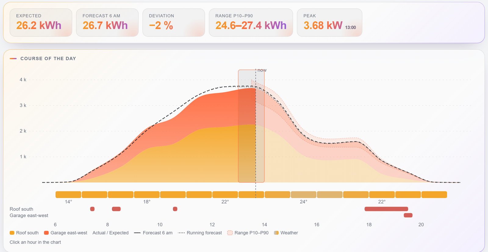
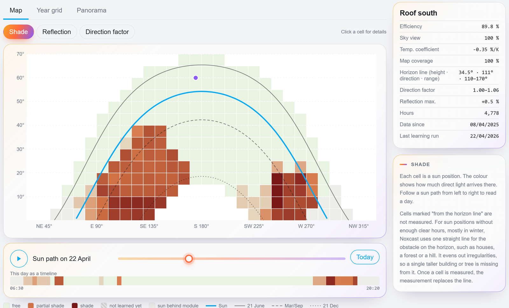
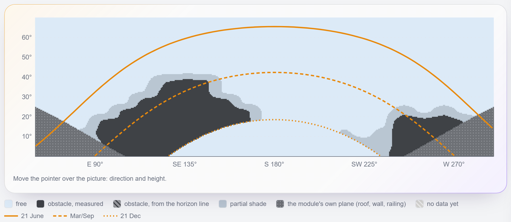
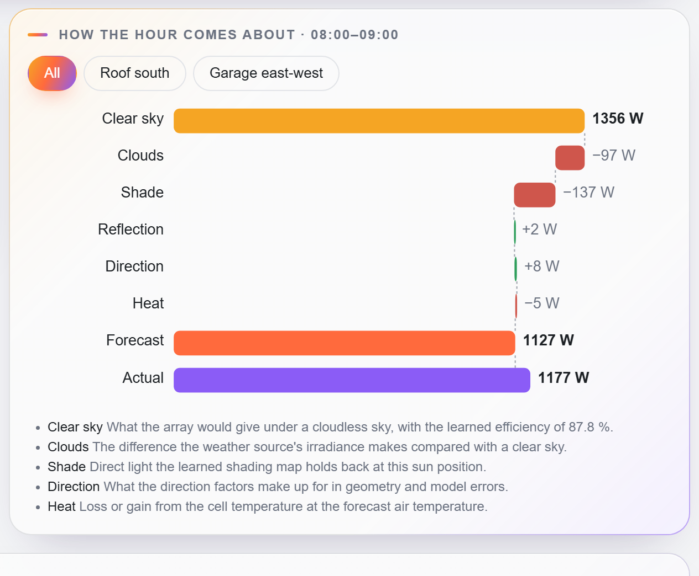
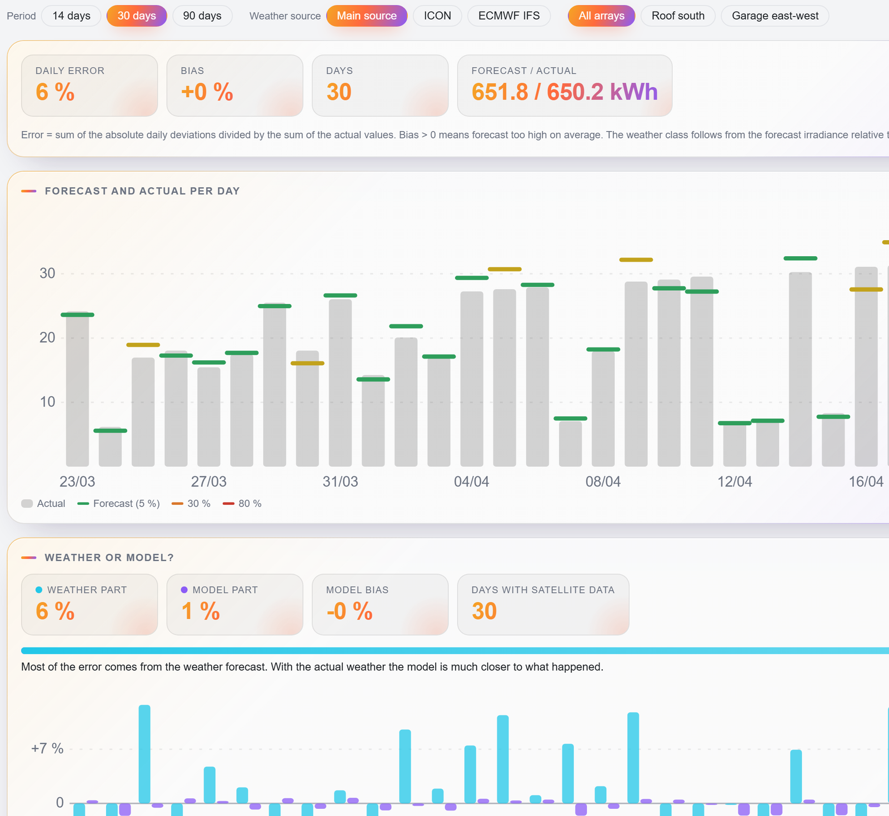
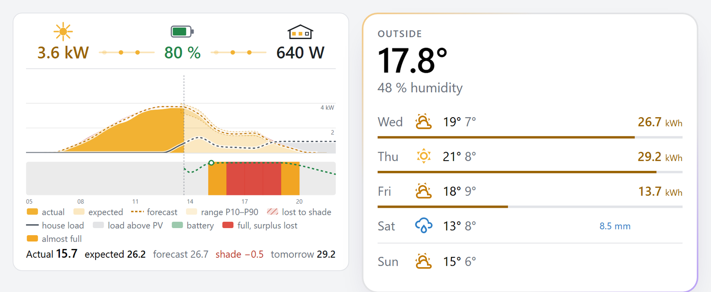
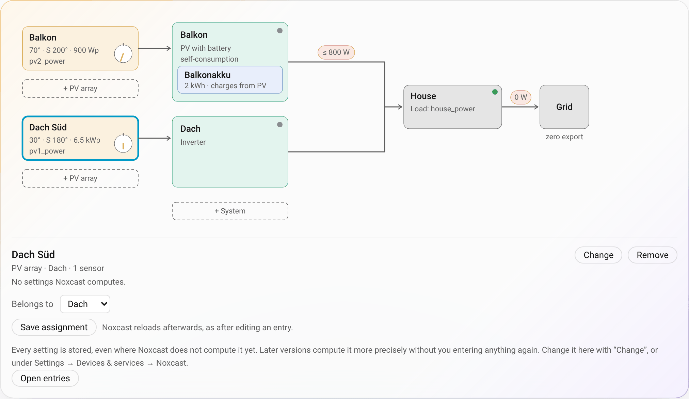

# Noxcast

**English** | [Deutsch](README.de.md)

**A PV forecast for Home Assistant that learns your installation and explains every number.**

Noxcast forecasts what your solar modules will produce today and in the next days, hour by hour. It starts from
solar geometry and the weather forecast, learns from your own measurements what your installation really does
(efficiency, shade from trees and houses, reflection, heat), and shows for every hour how the number came about.
Optional: a house load forecast, a battery simulation and the best time for the washing machine.



**You need** Home Assistant 2026.10 or newer, a power sensor of your PV and the tilt, azimuth and peak power of the
modules ([more](#what-you-need)). Everything else is optional.

**Status:** version 0.x: stable releases, still young. While the version starts with 0, a minor version can bring
breaking changes; each one is marked in the [changelog](CHANGELOG.md) with what you have to do. All screenshots show demo data.

**Languages:** Noxcast is available in English and German (Deutsch). Setup, entities, panel and cards follow the
language of your Home Assistant user; other languages fall back to English.

## Where to start

Pick the line that fits you best; each names what to set up and where the answer to your question appears.
Details and special cases further down are folded: open *Details* where you need them.

| You have or want | Set up | Then look at |
|---|---|---|
| Just to know what your modules will deliver | A system with its PV arrays ([Set up](#set-up)) | *Overview* in the panel, the sensors *Expected today* and *Forecast tomorrow*, the weather card |
| A balcony system with battery, without a meter for the whole house | The template *PV with battery in one device* with its output limit (e.g. 800 W), its battery, and a *Fixed base load* in the [main entry](#1-main-entry) | *Battery full at*, *Battery empty at*, the [blueprints](#notifications-blueprints) |
| A battery that should not run full too early or empty too soon | The battery with its power sensor, the house load in the main entry | The *Battery & surplus* tab, *Surplus lost today*, the blueprint *Battery full early* |
| To use more of your own PV: washer, dishwasher, heat pump | The house load and [consumers](#4-consumers-optional-for-the-load-forecast): flexible for what you can shift, fixed for the rest | *Start now*, *Best window today*, the *Load* tab |
| A dynamic tariff, an electric car or a tool such as EVCC, Predbat or EMHASS | The above as far as you have it | [Other tools](#other-tools-evcc-predbat-emhass), *Grid energy until charge start* |
| To understand or check the numbers | Nothing more: switch on *Details* in the [panel](#sidebar-panel-noxcast-full-overview) | *Learned*, *Forecast accuracy*, [How it works](#how-it-works), and [Why Noxcast](#why-noxcast) if you come from another forecast |

## Why Noxcast

Most forecasts compute from tilt, azimuth and peak power, maybe with a damping factor or a horizon you enter by
hand. Noxcast uses those too, as the starting point, and then learns from your history what is different on your
roof.

| | Noxcast |
|---|---|
| **Shade** | Learned per sun position (10° azimuth × 5° elevation) from your own measurements: the tree in the south-east, the neighbour's house in the west. Nothing to draw or enter. |
| **Learning** | From up to two years of Home Assistant history you already have, on the first day. Then every night. |
| **Explanation** | Per hour from clear sky through clouds, shade, reflection, direction and heat to the forecast. No black box: physics first, learned values second, a statistical correction last. |
| **Range** | P10–P90 from your own archive of past forecasts. It shifts the clouds, so it never goes above a clear sky. |
| **Accuracy** | Every day-ahead forecast is archived and compared with what happened. With the satellite filter (an option), each day's error is split into weather part and model part. |
| **Data quality** | Hours with a full battery, excluded periods, outages and snow on the modules are left out of learning. A power limit of an input, a micro-inverter or a system without battery caps the forecast. |
| **Mounting** | Several orientations on one input (east + west, vertical balcony modules) as one array. |
| **Weather** | Open-Meteo, ICON and ECMWF IFS averaged hour by hour. No account, no API key, free for private use. |
| **Privacy** | Runs in Home Assistant. Only your coordinates go to Open-Meteo. |
| **Self-check** | Flags a configuration that cannot fit the measurements, such as an efficiency above 100 % or a wrong azimuth. |

### What it learns

Each cell of the shading map is a sun position. Red means less direct light arrives there. The lines are
the sun's paths in June, at the equinox and in December, so you can read off when an obstacle will matter.



The panorama shows the same as a camera on the module would: straight edges stay straight, so the tree and the
house look as they do on site. Drag to look around. The dotted area is the module's own plane, behind which the sun
cannot reach it.



### How an hour comes about

Every forecast hour breaks down into its steps. Here the morning sun is behind the tree:



### How good it is

Forecast against actual for the last 14, 30 or 90 days, by weather class and weather model. With the satellite
filter, each day's error is split: the weather part is what the weather forecast got wrong, the model part is
what Noxcast got wrong with the satellite-measured weather. Since satellite values are area means, the model part also
contains their errors (fog, for example): it says something about the model over many days, not on a single day. A comparison of the weather models shows, on request, which model or
pair of models would have suited your installation best over the past year.



### On the dashboard

A day card with power now and the course of the day, and a weather card with the expected yield per day.



### Everything it does

| Part | What you get |
|---|---|
| PV forecast | Per array and in total: today, tomorrow, day after (up to 7 days), hourly and in 15-minute steps, with a P10–P90 band; offered as solar forecast in the energy dashboard |
| Today | Forecast fixed at 06:00, expected day (measured + corrected rest), remaining energy |
| Learning | Efficiency, shading map, horizon line, reflection, direction factor, sky view, temperature loss |
| Weather | Open-Meteo, also as a weather entity for the dashboard |
| Accuracy | Day-ahead archive: forecast against actual, split into weather error and model error; nightly backtest |
| Load (optional) | House load forecast: base load per hour plus your consumers |
| Battery (optional) | Simulation until tomorrow's charge start: full / empty, surplus, lost surplus, grid |
| Planning (optional) | Best window and PV share for flexible consumers (washer, dryer, …) |
| Frontend | Sidebar panel *Noxcast*, day card and weather card |

### What Noxcast is not

- It controls nothing. All results are sensors and attributes for your own automations; three
  [blueprints](#notifications-blueprints) send notifications from them.
- It needs a power sensor per array. A daily energy counter alone is not enough (see [below](#what-you-need)).
- The shading map fills with clear hours. A position the sun reaches only in winter stays open until a clear
  winter day comes; until then the horizon line fills in.

## Getting started

### What you need

| | Why | How to find it |
|---|---|---|
| Home Assistant 2026.10 or newer | | Settings → About |
| A **power sensor** for your PV (W or kW) | Noxcast learns from its history | Settings → Entities, search for your inverter. A power sensor shows the current output in W or kW and has a line graph in its history. |
| Tilt, azimuth and peak power of the modules | The starting point of the forecast | Datasheet or installer. Tilt: 0° flat, 90° vertical. Azimuth: 90° east, 180° south, 270° west. Peak power in watts (Wp). |
| Optional: the battery's state of charge | Hours with a full battery are left out, because the inverter may hold back then | Settings → Entities, a sensor in % |
| Internet access to Open-Meteo | The weather forecast | Free for non-commercial use, no key |

<details><summary>Details</summary>

Which sensor? The best is one per MPPT input of the inverter (often called *PV1 power*, *PV2 power*, or *DC
power*). The inverter's total output works too, as long as all modules on it face the same way, or you enter
the other orientations (see the examples). An energy counter in kWh is not enough on its own; a *Derivative*
helper (Settings → Devices & services → Helpers) turns it into power.

Noxcast reads Home Assistant's long-term statistics, which the recorder keeps by default. The more history,
the sooner the learned values are good; up to two years are used.

</details>

### Install

1. Open HACS → ⋮ → *Custom repositories*, add `https://github.com/TelosNox/noxcast` with the category
   *Integration*.
2. Search for *Noxcast* in HACS and download it. HACS offers the latest stable release. To test a pre-release, let HACS
   show beta versions for Noxcast.
3. Restart Home Assistant.

Without HACS: copy `custom_components/noxcast` into `config/custom_components` and restart.

### Set up

1. Settings → Devices & services → *Add integration* → **Noxcast**. Choose the feed-in rule (what may go to the
   grid: free, limited or zero export); everything else can stay empty.
2. The last step links to the *Installation* tab of the Noxcast panel. Tap *+ System* there and pick the template
   that fits your device (e.g. an inverter without battery), then *+ PV array* below it: pick the power sensor(s),
   enter tilt, azimuth and peak power. Add one array per group of modules that is measured together. The picture
   shows every part before you save it. (The same works on the integration page: ⋮ → *Add system*, then the
   system's menu.)
3. Done. Noxcast learns right away from the history you have and then every night at 01:30.

Then open **Noxcast** in the sidebar: *Overview* shows what is due today and in the days ahead, *Day* the forecast of today in
detail, and with *Details* switched on *Learned* what it found about each array.
For the dashboard: *Add card* → *Noxcast*.



### Examples

| Your installation | Arrays in Noxcast |
|---|---|
| One inverter, all modules facing south | One array with the inverter's power sensor |
| Hybrid inverter, east roof on PV1, west roof on PV2 | Two arrays: PV1 east, PV2 west |
| East and west modules on the same input | One array, east as the main orientation, west as *further orientation 2*, each with its own peak power |
| Balcony with a micro-inverter, two modules angled differently | One array with a further orientation |
| Two inverters, both south, one partly shaded by a tree | Two arrays, so the tree is learned only where it matters |

### When something looks wrong

<details><summary>Details</summary>

- **Efficiency above 100 % or *Check* on the array:** the configuration does not fit the measurements. Most often
  the peak power is too low, the azimuth is mirrored (east and west swapped), or a sensor is missing from the
  array. *Learned* → the array → *Does the configuration fit?* says what to check.
- ***Check* with power while the sun is down, or more PV than plausible on days the battery charges from the grid:** the
  power sensor measures the output of an inverter with a battery instead of PV only. Choose a sensor of the PV or MPPT
  power.
- **Shading map mostly grey:** not enough clear hours yet. It fills over the weeks.
- **Forecast too high on days the battery was full:** enter the battery with its system, then call the service
  `noxcast.relearn`.
- **Days with maintenance or an outage:** a day on which an array delivered almost nothing is left out on its own
  (*Does the configuration fit?* shows how many and the last one). A partial outage or maintenance: leave it out with
  `noxcast.exclude_period`.
- *Diagnostics* in the panel lists every sensor Noxcast reads, missing data and errors. The diagnostics download
  of the integration holds what a bug report needs.
- **What did learning see?** *Learned* → *Data basis* shows per array what its daylight hours were used for (used,
  capped, battery full, snow, no output, excluded), overall and per month, and points at anomalies with their most
  telling day. A calendar of the last year colours each day by output against the model; pale days stay within the
  usual range, only strong colours point at the model or the configuration. A click on a day shows its hours, a click
  on an hour how the model comes about.
- **Do the filters fit your installation?** *Hours as CSV* under *Does the configuration fit?* exports every measured
  daylight hour of an array with its status and every reason it was left out or capped (times in UTC), for a
  spreadsheet or an issue.

</details>

## Configuration

Settings → Devices & services → Add integration → **Noxcast**. Then add subentries on the
integration page (⋮ → *Add system* / *Add consumer*). A system's PV arrays, battery and subsystems sit inside its
entry: opening it shows a menu with everything in it, and each item opens its form.

### How it fits together


The household holds the house load, the grid and the *feed-in rule*. Inside it sit the systems: a system is what
delivers through one output to the house. It holds PV arrays and at most one battery, or subsystems: devices that
one control coordinates, such as the units of an EcoFlow Stream. The household is the Noxcast entry itself: change it
on the integration page with ⋮ → *Reconfigure*.

<details><summary>Details</summary>

Rules go from the outside in: a subsystem follows the regulation and feed-in of its system, a system follows the
household's feed-in rule. Only what differs is entered, as a deviation. Limits hold at every level, the tighter one
counts:


| Your installation | In Noxcast |
|---|---|
| Roof inverter without battery | One system *Inverter without battery* with its PV arrays, regulation *Full power* |
| Hybrid inverter with battery | One system *PV with battery in one device*: one PV array per MPPT input, its battery, regulation *Self-consumption* |
| Balcony device with battery | The same template with the output limit, e.g. 800 W |
| Plug-in battery that charges from surplus | One system *Battery at the house grid*, without PV arrays |
| EcoFlow Stream with Ultra and AC Pro | One system *Coupled systems* with the shared limit and *Batteries balance each other*; its subsystems are the Ultra with its PV arrays and battery and the AC Pro with its battery |
| Old roof inverter and a Stream, grid operator requires zero export | Two systems and the feed-in rule *Zero export*. The roof cannot hold it: its system gets the deviation *Feeds the rest in anyway*. The Stream follows the rule |

</details>

### 1. Main entry

| Field | Meaning |
|---|---|
| House load | Optional. Whole-house power (W/kW). Enables the load forecast |
| Fixed base load | Optional, only without *House load*: the load in W the house draws in every hour, for a balcony system without a meter for the whole house (the standby of fridge, router and the like; a smart plug or the meter at night shows it). The battery forecast, the surplus and the planner of flexible consumers then work with this value; a consumer with its own sensor adds its power while it runs. Nothing is learned from it, and the *Load* tab stays hidden |
| Day type | Optional. Entity whose state at noon is the day type (Workday sensor, an `input_select` such as home office / office / holiday). Profiles are learned per state |
| Grid power | Optional. Power at the grid connection, positive = import (*invert* if export is positive). A system with *Self-consumption* and no battery needs it: hours in which the household imported little or nothing at times (below 100 W) count as "at least this much" in learning, since the device may have held PV back |
| Feed-in rule, feed-in limit | What the household may feed in, as the grid operator requires it or you want it: free, at most a power in W, at most a share of the PV peak power in %, or zero export (nothing, ever; surplus with full batteries counts as unused). Every system follows this rule unless it names a deviation. The battery forecast feeds surplus without room in up to the limit and counts the rest as curtailed. With a limit and the *Grid power* sensor, hours in which the household's export reached the limit (within 5 %, at least 100 W) count as "at least this much" in learning, since the PV may have been held back; a share in % counts of the peak power of all PV arrays. A fixed cap set on the inverter itself (such as 60 % of the modules) does not show at the grid connection: enter it as the system's *Output limit* |
| Forecast days | 2–7, today included (default 3) |

### 2. Systems (how the modules reach the house)

A system is everything that delivers through one output to the house: an inverter, a device with PV and battery, a
battery with its own inverter at the house grid, or several devices that coordinate. Every PV array and every battery
belongs to a system. A system holds either PV arrays and at most one battery, or subsystems (one level), never both.

<details><summary>Details</summary>

A system first asks what it is (name, template, and for an existing one *Belongs to*), then its settings, filled in
by the template. Every setting stays changeable. Then its menu lists what it can do, each item marked: ✎ changes the
system itself or one of its subsystems, PV arrays or battery, + adds one, − removes one after asking (it names what
goes with it); a subsystem has a menu of its own. Each form saves when it is sent, *Done* only
closes the dialog. Deleting a system deletes everything inside it. Subsystems have no entry of their own: they are in the entry of their system, so the list of
entries shows what sits inside what.


| Template | For |
|---|---|
| Inverter without battery | Micro-inverter, string inverter, an older roof installation |
| PV with battery in one device | Balcony device with battery, hybrid inverter, a DC battery between modules and micro-inverter |
| Battery at the house grid | Plug-in battery or battery inverter with its own inverter, without PV |
| Coupled systems | Devices that coordinate and share a limit, e.g. EcoFlow Stream with several units; they become its subsystems |


| Setting | Meaning |
|---|---|
| Output limit | What the system delivers at most (e.g. 800 W). With subsystems: what they deliver together; every subsystem keeps its own limit as well, the tighter one wins. Without a battery below it the limit is fixed: learning counts hours at it as "at least this much", and it caps the PV forecast; with several PV arrays their sum, each array giving up its share of the power above. With a battery below it and its *Charge / discharge power* sensor, hours in which the output (PV less what the battery charged) reached the limit count as "at least this much" in learning, however much the battery took. Without a battery, enter it as the PV power sensors measure it at the limit: sensors of DC power show a few percent more than the AC rating. When the measurements show a limit, Noxcast suggests it under [Repairs](#repairs) |
| Limit holds per phase, phase | For devices whose limit holds for each phase on its own, not for the total (e.g. EcoFlow Stream in three-phase mode): each subsystem names its phase, and the devices on one phase share its limit, while a device alone on a phase gets the whole limit. Without it the limit holds for all subsystems together, whatever phase they feed into (a classic balcony system: at most 800 W in total). A *three-phase* device feeds a third of its output into each phase and shares each phase's limit with that third; three-phase devices alone share three times the limit. A device without a phase is left out of the phase limits, because how much of a phase it takes is not known |
| Regulation | *Full power* delivers everything the PV gives (plain inverter), *Self-consumption* follows a smart meter and covers the house load, *Fixed power* delivers a set power. A fixed power acts like an *Output limit*: without a battery it caps the forecast, and learning counts the hours at it as "at least this much"; with a battery, PV above it charges the battery, and hours with the battery full or charging at its maximum are left out or count as "at least". For a power that changes by a schedule, choose self-consumption, or fixed power with the average. Set on the system only: its subsystems are devices one control coordinates and follow it, also in the feed-in. A device that does not follow that control is a system of its own |
| Deviation from the feed-in rule | Optional, empty in most cases: the system follows the household's feed-in rule. *Feeds the rest in anyway*: an inverter at full power that cannot hold zero export, or a device whose feed-in control is off. *Never feeds in*: a device that keeps covering only the load when its battery is full, while the household may feed in. The *Installation* tab shows per system which rule it follows |
| Battery charges from | Own PV (before the output) or the household (own inverter at the house grid) |
| Batteries balance each other | The batteries of the subsystems even out their state of charge; they get one battery forecast |

The panel tab *Installation* draws the installation as a flow diagram, each setting where it acts: an array's
orientation as a compass needle, limits on the lines, the feed-in rule between house and grid. Tapping a part shows
its settings and whether Noxcast computes each exactly, simplified or not yet. *Change* (administrators) opens the
configuration form beside the diagram and draws every change before *Save*; *Belongs to* moves a part to another
system; the dashed boxes add a PV array, battery, subsystem or system where one fits; *Remove* first shows what goes
with the part. Noxcast stores every setting, also those it does not compute yet; later versions compute more of them
without new input.

*Swap device* on a system is for the day a device of the system is replaced and the PV modules stay where they
are. It is deliberately out of the way: select the system in the diagram, and at the very bottom of its details the
small link *Device replaced? Set up the swap …* first explains when the swap fits; only *Continue* opens the
assistant. Use it when

- a new inverter, microinverter or compact device (inverter, MPPTs and battery in one) takes over the same modules,
  each module on the same kind of input as before;
- only a new battery or a new meter arrives, with sensors of its own (switch *a new device converts the power* off);
- the same hardware gets a new integration, so that its sensors have new entity IDs (switch it off too).

Do not use it when

- modules are added, removed, moved or turned, or wired differently: that is a changed PV array, which *Change* on
  the array (or *Remove* and *+ PV array*) handles, and its shading map starts anew;
- a second device joins the system: add it with *+ Subsystem* or *+ PV array*;
- only a limit, the battery capacity or another setting changes, with the same sensors: use *Change*;
- the old statistics are already deleted: nothing learned can be carried over any more, so set up the new sensors
  with *Change*.

Install the new device first and let it run; the assistant suggests its sensors once Home Assistant has them. It
lists every sensor the system uses, each with the sensor of the new device Noxcast suggests, the swap date (empty:
the day the new PV sensors have their first values) and per PV array whether the new device converts its power.
*Swap* keeps the old device's hours in a store of its own, so the shading map stays, and learns the new device's
efficiency as a ratio to the old one; the day of the swap counts for neither device. Until the new device has about
20 clear hours at sun positions the old one also saw, its efficiency counts as the old one's (the *Learned* figures
show how many are still missing). Do not delete the old statistics under *Developer tools → Statistics* before the swap
is saved. The system then lists the swap, and the newest one can be undone while the old statistics still exist.
Check the new device's limits and battery with *Change* afterwards.

</details>

### 3. PV arrays (one per group of power sensors)

An array is what is measured together, usually one MPPT input or one inverter.


<details><summary>Details</summary>

| Field | Meaning |
|---|---|
| Belongs to | The system the array sits in. Empty: the system whose menu it was opened from |
| Power sensors | One or more; they are summed. Only what the modules generate (PV or MPPT power), not the output of an inverter with a battery behind it: that also counts what the battery delivers, including energy charged from the grid, as sun. If a sensor shows power while the sun is down, Noxcast reports it under [Repairs](#repairs) |
| Tilt, azimuth, peak power | Of the modules (azimuth 180° = south) |
| Further orientations 2–4 | Optional: modules on the same sensors that face another way (e.g. east + south + west on one input, vertical east + west). Each with tilt, azimuth and its own peak power; the array's peak is the sum |
| Valid since (*Advanced*) | Optional: ignore history before this date (e.g. after a rebuild) |
| Temperature coefficient (*Advanced*) | Optional: datasheet Pmax coefficient in %/K; otherwise learned |
| Mounting | Free behind (balcony, rack; 30 K cell heating at 1000 W/m²), parallel on the roof (50 K) or integrated into the roof (60 K). An own value in K goes under *Advanced* |
| Each sensor delivers at most (*Power limit*) | Optional: when an MPPT input or a micro-inverter lets through less than the modules deliver, so the power stays flat at a maximum on sunny days. In W as the power sensors measure it (e.g. 800), for every sensor of the array. The forecast is capped at it. When the measurements show a limit, Noxcast suggests it under [Repairs](#repairs) |

Learning starts right away from the existing history and then runs every night (01:30).

</details>

### 4. Consumers (optional, for the load forecast)

A consumer with its own sensor is taken out of the house load and forecast on its own. The form has two steps: the
sensor and the timing first, then only the fields of that timing.

<details><summary>Details</summary>

| Field | Meaning |
|---|---|
| Power or energy sensor | Power in W/kW with `state_class: measurement`, or energy in Wh/kWh with `state_class: total` or `total_increasing`. A power sensor is the first choice: energy counters often count in 0.1 kWh steps, too coarse for single hours. As energy, a meter that keeps counting and a counter per program (e.g. the program energy of a washer) both work; a counter that is unknown between runs counts as no consumption there |
| Remaining / elapsed time | Optional: a running program counts until it ends. With an energy sensor, the elapsed time gives the power of the running program, with either kind of counter |
| Timing | *Fixed*: part of the load forecast. *Flexible*: you choose when it runs; Noxcast suggests the window |
| Kind (fixed only) | *Profile*: own median per hour. *Program*: runs with an end (dishwasher); learned start times, runs per day, power curve. *Session*: on, then open-ended (PC, TV); learned on-probability and duration. *Regulated*: follows the outside temperature (heat pump, air conditioning) |
| Run power, run minutes | Flexible only, optional: otherwise learned from history |
| Start now from PV share | Flexible only, optional (default 70 %): threshold of the *start now* sensor |

</details>

### 5. Batteries (optional, needs the house load or a fixed base load)

Name, state of charge sensor, capacity and system (*Belongs to*) are on top; limits and power are in sections that stay closed until
they hold a value. The system says where the battery sits (see *Battery charges from*) and gives its output limit.

<details><summary>Details</summary>

| Field | Meaning |
|---|---|
| State of charge sensor, capacity | Required |
| Battery power sensor | Optional: charge/discharge power for the card, positive = charging (*invert* otherwise) |
| Max / min SOC | Number or entity (e.g. charge limit, backup reserve) |
| Counts as full from | Percent points below the upper limit from which the battery counts as full in learning (default 3: at an upper limit of 100 % from 97 %). Near the top a battery charges slower and PV may already be curtailed |
| Reserve | Percent points above min SOC where discharging stops in practice (e.g. a feed-in stop rule) |
| Belongs to | The system the battery sits in, one battery per system. Empty: the system whose menu it was opened from |
| Efficiency | Round trip; default 95 % before the output of a device with PV, 90 % at the house grid |
| Max charge / discharge power | Optional limits; above them surplus goes to the grid or the grid supplies. With the *Charge / discharge power* sensor, hours charging at the maximum count as "at least this much" in learning where PV may be held back (see below) |

With the *Charge / discharge power* sensor, Noxcast learns every night from the last 120 days what capacity and
round-trip efficiency the battery shows (three charging and three discharging runs of at least 15 percent points
since the last change of its capacity or sensors). The learned capacity replaces the entered one in the forecast, since
an aged battery holds less than its label; an entered efficiency stays. The *Battery & surplus* tab shows both.

With an output limit on its system, PV and battery together deliver at most the limit; PV above it can only charge the
battery. The batteries of one system are simulated as one storage. Separate systems are simulated each on its own,
each charging from its own PV and sharing the consumption evenly up to its discharge power; a system with *Fixed
power* delivers it whatever the house draws. *Battery full at*, *Battery empty at* and *Battery highest level* then
show the earliest system and list each one in the `systems` attribute.

For learning, an array's hours with a full battery are left out where that battery can curtail the array: the battery
of its own system, and of the subsystems it coordinates with. A battery that charges at its maximum power (an hour with
a 5-minute mean at 95 % of *Max charge power*) counts as "at least this much" where the rest cannot go out, like a
fixed limit. [Learning](#learning-nightly-from-long-term-statistics) has the details.

</details>

### 6. Options (⋮ → Configure)

| Option | Default |
|---|---|
| Weather models | `icon_seamless` + `ecmwf_ifs`, averaged hour by hour; any Open-Meteo model can be added |
| Air temperature from archive | On: needed to learn the temperature loss |
| Satellite filter | Off: uses satellite irradiance to pick clear hours for learning and to split the forecast error into weather and model |
| Archive URLs, satellite model, API key | Open-Meteo; change only for self-hosted or commercial access |

<details><summary>Details</summary>

Whether the satellite filter helps depends on the region (mountains and coastal fog make it worse). After switching it
on and the next nightly learning run, each array's **satellite agreement** sensor shows how well satellite and
installation agree on clear and cloudy hours (correlation, unshaded hours). At 0.9 or above the filter works well; on
the installation it was developed on it reached 0.90–0.94. Below about 0.8 it is probably no better than a coarse
reanalysis (0.69–0.78 there), and switching it off is worth a try. Without it, sky view, direction factor and the
temperature coefficient (unless a datasheet value is set) are not learned.

</details>

## Dashboard reference

### Sidebar panel *Noxcast* (full overview)

Appears in the sidebar after setup; nothing to configure. It starts with *Overview*, *Day*, *Battery & surplus* and
*Installation*; the *Details* switch in its header adds *Learned*, *Forecast accuracy*, *Load* and *Diagnostics*.
Each browser remembers the switch, and a link from the overview into one of those tabs turns it on. Tabs:

| Tab | Content |
|---|---|
| Overview | The start: today expected, so far against its forecast, rest of today and PV power now with the day's course; for flexible consumers whether to start now and the best windows; the battery's state of charge, full and empty times and lost surplus; the next days with range and clear sky; yesterday's forecast against actual and the error of the last 14 days; a status line with the last learning run, sensors that report no values and the installed version. Each part links to the tab that explains it |
| Learned | A learning status (last and next run, how far each array has come, a button to learn again now for administrators); what the last nightly learning run changed per array; per array the learned shade, reflection and direction maps over sun azimuth × elevation, with layers for how sure each cell is and how it changed in the last run, with the sun paths of the year, a date slider, values per cell, a month × hour grid, key figures (efficiency, sky view, temperature coefficient, coverage), how snow lay on it where learned, and a plausibility check of tilt and azimuth |
| Day | One day (up to 400 days back, 2 ahead): the arrays stacked, forecast vs expectation vs actual, P10–P90, hourly weather, shade and reflection periods; under *Groups* a chart per array with hour axis and scale, measured part strong, forecast part faint, the 6 am or day-ahead forecast dashed, and its actual value so far today; all arrays side by side on one scale, or one chosen array large with its own scale and its shade and reflection periods (the choice also sets the waterfall); for the whole day or a chosen hour, per array or all together, a waterfall from clear sky through clouds, shade, reflection, heat and, where learned, snow to the forecast and the actual value, and for past days why the actual value differed, in parts that add up: weather measured by satellite, shade missed, limited hours and the model (hours without satellite values stay not split); how the day's expectation developed hour by hour; where the energy went (PV, battery, grid, house) |
| Forecast accuracy | Day-ahead forecasts against actual over 14 / 30 / 90 days: error, bias, calendar, by weather class, each weather model against the mean; with the satellite filter the split into weather part and model part; how often the actual value fell below, inside or above the published P10–P90 range, per weather class, for whole days and single hours; a nightly backtest: today's model on past days, and on days it did not learn from; on request a comparison of every weather model and pair over the past year, with a recommendation |
| Load | Rest of today and tomorrow by part (base load, each consumer), learned profiles, backtest, suggested recurring devices |
| Battery & surplus | Simulation until tomorrow's charge start, with several systems also per system, what-if with more capacity or an extra consumer, the capacity and round trip each battery shows, the morning prediction against what happened, last 30 days |
| Installation | The installation as entered: household, systems, subsystems, PV arrays and batteries, and per setting whether Noxcast computes it exactly, simplified or not yet |
| Diagnostics | Installed version, weather, last learning run, archive; every sensor Noxcast reads with state, statistics and coverage; missing data and errors |

### Day card `custom:noxcast-card`

Registered automatically; add it via *Add card* → *Noxcast*. It always shows what Noxcast is
configured with (arrays, house load, grid, batteries, feed-in); the card settings only change the
display.

<details><summary>Details</summary>

- **Power now** as a row of figures: PV, battery, home, grid, with moving dots for the
  flows. Icons above the figures show their state: the sun grows with the share of peak power, the
  battery is filled to its state of charge, a window of the house lights up per step of load, and
  the pylon gets a lightning bolt per step (cyan while drawing, yellow while feeding in). A step
  goes up at once; it goes down at once below 60 % of its limit, otherwise after 30 s below it.
  Tapping a figure opens its entity. With several entities behind it, as with PV arrays and
  batteries, it first lists them with their current values; tapping a row opens that entity.
- **Day chart:** PV actual (strong area), expectation (pale area) and forecast (dashed), shade loss hatched, house
  load, battery level (measured, then simulated; ahead, the line and a soft tint below it turn orange where the battery is
  full and surplus is lost, hatched where that happens only with more sun, at P90), P10–P90
  band, a lane per array with shade and reflection periods, hourly weather symbols on top. The chart
  uses the full card width, the scale sits inside it. Hover or tap an hour for its values.
- **Numbers of the day** below the chart: actual, expected, the morning forecast, shade loss and
  tomorrow's forecast.

| Option | Default | |
|---|---|---|
| `show_battery`, `show_effects`, `show_band`, `show_load` | `true` | Battery level, shade/reflection lanes, P10–P90, house load in the chart |
| `show_weather` | `true` | Weather symbols above the chart |
| `range` | `production` | `production` (an hour around sunrise and sunset) or `day` (0–24 h, night compressed) |
| `labels` | `icons` | `icons` (icons that show the state) or `text` (names, battery percentage and power) |
| `sun_glow` | `false` | The sun icon glows by the share of peak power |
| `home_steps` | `[100, 300, 1000]` | Icons: a window of the house lights from each of these watts |
| `grid_steps` | `[300, 1000]` | Icons: second and third lightning bolt of the grid, either direction (the first comes with the flow, from `flow_min_w`) |
| `battery_arrows` | `false` | Up and down arrows beside the battery icon, the one of the flow lit |
| `flow_style` | `chain` | `chain` (dots between the figures) or `bus` (a line below them) |
| `flow_speed` | `normal` | `calm`, `normal`, `lively` |
| `flow_min_w` | `10` | Smallest flow shown, in W |
| `look` | `plain` | `plain` (Home Assistant card) or `noxcast` (panel look) |
| `legend` | `true` | Legend below the chart |
| `font_scale` | `1` | 0.8–1.6 |

All options are also in the visual editor, grouped into power now, day chart and look.

</details>

### Weather card `custom:noxcast-weather-card`

The coming days one per row (symbol, high / low, precipitation) with the PV yield Noxcast expects,
from Noxcast's own weather – the same that drives the forecast.

<details><summary>Details</summary>

| Option | Default | |
|---|---|---|
| `days` | `5` | 1–7 days of weather; PV only within the forecast horizon |
| `show_pv` | `true` | PV yield per day |
| `pv_bar` | `line` | Share of the clear-sky yield as `line`, `fill` or `none` |
| `pv_today` | `expected` | Today's yield as `expected` (sensor "Expected today") or `forecast` (sensor "Forecast today") |
| `temperature`, `humidity`, `name` | – | Optional measured outside values above the days |
| `look` | `noxcast` | `noxcast` or `plain` |

</details>

## Entities

**Noxcast (total)** and **Noxcast *array*** devices:

| Entity | Total | Array | Notes |
|---|---|---|---|
| Forecast today | ✓ | ✓ | Fixed at 06:00 |
| Expected today | ✓ | ✓ | Measured hours + corrected rest |
| Expected remaining today | ✓ | ✓ | Rest of *Expected today* |
| Forecast tomorrow, day after | ✓ | ✓ | |
| Forecast in 3 … 6 days | ✓ | ✓ | Only within *Forecast days*; disabled until you enable them; no P10–P90 |
| System efficiency, shading map coverage, temperature coefficient, satellite agreement | | ✓ | Learned values |
| Shade today (sensor and image), shading map (image) | | ✓ | |
| Last learning run, forecast error (30 days) | ✓ | | Error per array and per weather model as attributes |
| Weather | ✓ | | Current hour, hourly and daily forecast for 7 days |

<details><summary>Details</summary>

Forecast sensors carry `hourly` (ISO timestamp → kWh, `schema_version` 1) and `quarter_hourly` (the same in
15-minute steps, which add up to each hour); the total sensors also `p10` / `p90` and, from the running hour on, `hourly_p10` / `hourly_p90` (the range of each hour on
its own, so they do not add up to the day's `p10` / `p90`). The total is offered as solar forecast in the energy dashboard.

With house load or a fixed base load: **Load rest of today**, **Load tomorrow** (attributes `hourly`, `base`,
`consumers`, `correction`, `backtest`, `fixed_w`), and without batteries **Surplus rest of today** (PV above the load; attributes
`fed_in` and `curtailed` as below, `to_battery` 0). With batteries: **Surplus rest of today**, **Surplus lost
today** (both with the attributes `fed_in` and `curtailed`: what of the surplus without room goes into the grid and
what is curtailed), **Battery full at**, **Battery highest level**, **Battery empty at**, **Battery at next
charge start** (attribute `grid`: grid energy until then), **Grid energy until charge start** (what the battery
cannot cover until the PV takes over again; attribute `missing_soc`: the percent points of charge that would cover
it, for planning a cheap charge from the grid), **Battery lowest level (48 h)** (attributes `hourly`: the
expected level at every full hour of the next 48 hours in %, `grid_hourly` and `fed_in_hourly`: per hour the expected
energy from and into the grid in kWh, `lowest_at`, `until`: earlier when *Forecast days* end
before). Per flexible consumer: **PV share now**,
**Best window today** and **Best window tomorrow** (start time; attributes `end`, `pv_share`, `lost_share`; unknown
when no run fits or none gets at least 5 % from surplus) and the binary sensor **Start now**: on while a run started now gets at least the configured PV
share from surplus and no more than 5 points less than the best window still to come today.

</details>

## Notifications (blueprints)

Noxcast controls nothing, but three blueprints turn its forecast into a notification on your phone (Home Assistant
app). Import one with its link, then create an automation from it under Settings → Automations & scenes →
Blueprints and pick the Noxcast sensors and your phone.

| Blueprint | Notifies |
|---|---|
| [Battery full early](https://my.home-assistant.io/redirect/blueprint_import/?blueprint_url=https%3A%2F%2Fgithub.com%2FTelosNox%2Fnoxcast%2Fblob%2Fmain%2Fblueprints%2Fautomation%2Fnoxcast%2Fbattery_full_early.yaml) | At a time in the morning (08:00) when the battery is expected to be full before a time (13:00) and at least 1 kWh of surplus to be lost today: a good day for flexible consumers. Needs *Battery full at* and *Surplus lost today* |
| [Battery empty tonight](https://my.home-assistant.io/redirect/blueprint_import/?blueprint_url=https%3A%2F%2Fgithub.com%2FTelosNox%2Fnoxcast%2Fblob%2Fmain%2Fblueprints%2Fautomation%2Fnoxcast%2Fbattery_empty_tonight.yaml) | At a time in the evening (18:00) when the battery is expected to run empty within the next 24 hours, with the time. Needs *Battery empty at* |
| [Good time to start](https://my.home-assistant.io/redirect/blueprint_import/?blueprint_url=https%3A%2F%2Fgithub.com%2FTelosNox%2Fnoxcast%2Fblob%2Fmain%2Fblueprints%2Fautomation%2Fnoxcast%2Fstart_now.yaml) | When *Start now* of a flexible consumer turns on and stays on for a while (10 minutes), at most once a day, with the PV share |

The times, the threshold and the title can be changed per automation. The text of the notification is English.

## Other tools (EVCC, Predbat, EMHASS)

<details><summary>Details</summary>

Noxcast publishes its forecast in its own attributes, not in the format of another project. Each tool gets it through
its own way in: a setting, a template sensor or a REST command. The entity IDs below are those of an English setup;
the IDs follow the language Home Assistant had when Noxcast was added, so copy yours from the entity's settings.
The hourly values are kWh per hour, which is the same number as the mean power in kW; the values of
`quarter_hourly` are kWh per 15 minutes, a quarter of the mean power in kW. The weather forecast comes in hours, so
each 15-minute step gets its hour's cloudiness and follows the course of the sun within the hour (and stays under a
power limit); clouds that come and go within the hour are not in it.

</details>

### EVCC

EVCC reads the solar forecast of the Home Assistant energy dashboard. Choose Noxcast there as the solar forecast (and
no other one, since EVCC adds them up), then in EVCC:

<details><summary>Details</summary>

```yaml
tariffs:
  solar:
    - type: template
      template: homeassistant
      uri: http://homeassistant.local:8123
```

EVCC reads hourly values from it.

</details>

### Predbat

Predbat reads forecasts in the form of the Solcast integration: an attribute `detailedForecast` with half-hourly
entries (`period_start`, `pv_estimate` in kW), the day total in kWh as state. A template sensor per day builds it
from the `quarter_hourly` attribute, each half hour from its two quarter hours:

<details><summary>Details</summary>

```yaml
template:
  - sensor:
      - name: Noxcast Predbat today
        unique_id: noxcast_predbat_today
        unit_of_measurement: kWh
        state: "{{ states('sensor.noxcast_expected_today') }}"
        attributes:
          detailedForecast: >
            
            
            
            
            
            
              
              
              
            
            {{ ns.out }}
```

Repeat it with `sensor.noxcast_forecast_tomorrow` and `sensor.noxcast_forecast_day_after_tomorrow` (and
`sensor.noxcast_forecast_in_3_days`, which exists from 4 *Forecast days* on and is disabled until you enable it), then in Predbat's `apps.yaml`:

```yaml
  pv_forecast_today: sensor.noxcast_predbat_today
  pv_forecast_tomorrow: sensor.noxcast_predbat_tomorrow
  pv_forecast_d3: sensor.noxcast_predbat_day_after_tomorrow
  pv_forecast_d4: sensor.noxcast_predbat_in_3_days
```

`pv_estimate10` / `pv_estimate90` come from `hourly_p10` / `hourly_p90`, the range per hour (kWh per hour, the mean
power in kW), held around the half hour's value: in the morning and evening the half hours of one hour differ
more than its range; hours already past keep the central value. Predbat simulates the battery itself.

</details>

### EMHASS

EMHASS takes forecasts as a mapping from time to W, with the time zone in the key, and holds each value until the
next one in its own time steps. A REST command builds it from the `quarter_hourly` attributes of PV and the `hourly`
attributes of the load (set EMHASS to a 15-minute time step, since with a longer one it takes only the value at the
start of each step); `sensor.battery_soc` stands for your
battery's state of charge in %:

<details><summary>Details</summary>

```yaml
rest_command:
  emhass_mpc:
    url: http://localhost:5000/action/naive-mpc-optim
    method: POST
    content_type: application/json
    payload: >
      
        
        
          
            
          
        
        {{ '{' ~ ns.items | join(', ') ~ '}' }}
      
      {"prediction_horizon": 48,
       "pv_power_forecast": {{ watts(['sensor.noxcast_expected_today', 'sensor.noxcast_forecast_tomorrow'],
                                     'quarter_hourly', 4) }},
       "load_power_forecast": {{ watts(['sensor.noxcast_load_rest_of_today', 'sensor.noxcast_load_tomorrow'],
                                       'hourly', 1) }},
       "soc_init": {{ states('sensor.battery_soc') | float / 100 }}}
```

The load forecast contains every configured consumer. Leave out what EMHASS plans as a deferrable load, or the load
counts twice: configure such a consumer as *flexible* in Noxcast (it then counts with zero).

</details>

## Repairs

Noxcast reports problems under Settings → System → Repairs, and removes each report once it is solved:

<details><summary>Details</summary>

| Issue | When |
|---|---|
| No PV array yet | The integration is set up, but no PV array is added |
| Sensors missing | A configured entity does not exist (renamed or removed) |
| No weather forecast | Open-Meteo could not be reached for more than a day |
| Configuration does not fit | A PV array delivers more than its configured modules can, or its sensor showed power while the sun was down in the last 60 days (then the sensor measures more than PV, such as a battery behind the inverter). Otherwise peak power, sensor, tilt or azimuth are probably wrong (the *Check* badge under *Learned*) |
| Which PV arrays charge the battery? | A battery charges before the output of a device with PV, but no array belongs to its system (after the update: its former settings did not name its array). Choose its system in those arrays, or change the system to *Battery at the house grid*. Until then it computes as before |
| Power seems to be limited | Every power sensor of a PV array without a *Power limit* stayed flat at or near its maximum on at least 3 days of the last 60, at times when the sun would have changed the power, and never went above it. Noxcast suggests that maximum as the limit: *Set limit*, *Other value* (both write it into the array's settings) or *There is no limit* (no more notice until the level moves by more than 5 %). Nothing changes until you answer |
| System: output seems to be limited | The PV arrays of a system without battery and without *Output limit* stayed flat together at or near their highest sum on at least 3 days of the last 60, in the 5-minute values, at times when the learned clear sky would have changed that sum and lay clearly above it (east and west on one inverter, where no sensor is flat alone). Not for a system that covers the house load or delivers a fixed power. Noxcast suggests that maximum as the system's output limit, as the sensors measure it: *Set output limit*, *Other value* (both write it into the system's settings) or *There is no limit*, as above |

</details>

## Services

| Service | |
|---|---|
| `noxcast.exclude_period` | Leave a period out of learning (e.g. curtailment while away, maintenance) |
| `noxcast.relearn` | Learn again from history now |

Both need an administrator, and so does the *Diagnostics* section of the panel.

## How it works

### Forecast of an hour

<details><summary>Details</summary>

Computed in six 10-minute steps per hour (sun position at each step) and averaged:

1. **Weather:** Open-Meteo GHI, DNI, DHI and air temperature, the configured models averaged.
2. **Geometry:** beam, sky diffuse and ground reflection on the module plane; with several
   orientations per plane, each clipped at zero, summed by peak share.
3. **Learned array values:** beam × shade transmission × direction factor, sky diffuse × sky view,
   plus reflected light from the surroundings.
4. **Efficiency** (learned, at 25 °C) × peak power.
5. **Temperature:** cell temperature from air temperature and irradiance (heating), loss with the
   learned or datasheet coefficient.
6. **Snow** (only where learned): an array that has cleared from at least two snowfalls in its history (with the
   satellite archive) has shown how long snow lies on it and what it still delivers meanwhile. When the weather
   forecasts a day with at least 1 cm of snow at up to 3 °C, its forecast takes that share for as many daylight
   hours after the last snow, unless 24 degree hours above 0 °C melt it first. An array without such a history
   forecasts as if there were no snow; the *Learned* tab shows what was learned, the hour's waterfall the *Snow* step.

</details>

### Clear sky

<details><summary>Details</summary>

The clear-sky irradiance (reference for clearness, upper bound of the range and the corrections) is a fixed
physical model without learned values or weather data: sun position after NOAA from latitude, longitude and time,
irradiance after Ineichen's simplified Solis model with the air pressure from the altitude (standard atmosphere).
Latitude, longitude and altitude come from the Home Assistant settings. Aerosols (AOD 0.1 at 700 nm) and water
vapour (1 cm) are constant, the same for every location and season. Only afterwards do the learned values of the
array (shade, direction, reflection, sky view, efficiency) and the temperature loss at the forecast air
temperature turn this irradiance into the clear-sky power of the array.

</details>

### Learning (nightly, from long-term statistics)

<details><summary>Details</summary>

- **Batteries:** which batteries leave hours out for an array follows from the systems: its own system's battery; with
  *covers the house load*, also those of the subsystems it coordinates with; for a subsystem without a battery under a
  shared output limit, those of the other subsystems. A battery outside the array's system, also one at the house grid
  with zero export, does not count: the inverter that holds the export at zero does not know it. A battery counts as
  full from *Counts as full from* below its upper limit. One that charges at its maximum power takes no more either:
  where the rest cannot go out, these hours count as "at least this much", since leaving them out would drop just the
  bright hours. The charge power is read from means, since a single reading can lie far above what the battery takes:
  an hour counts when one of its 5-minute means reaches 95 % of *Max charge power*; hours from before Noxcast's own
  5-minute archive count from an hourly mean of 85 %, and between 70 and 85 % they are left out.
- **Data filters:** hours with a full battery that may curtail the array (see *Batteries*), excluded periods, outages
  and incomplete hours are left out. So are days on which an array delivered at most 2 % of a clear day (off,
  fully under snow or too dark for the inverter), and, with *Air temperature from archive*, the hours after a snowfall of
  at least 1 cm (in hours up to 3 °C; warmer it falls as rain) until the array delivers again, it thawed or a week has passed. Unsteady hours (passing clouds, restarts) do not count for efficiency, direction factor and reflection.
  Hours at a *Power limit* count as "at least this much": the modules could have delivered more. Taken as measured,
  they would make efficiency and midday shade look too low; left out, only the clouded and shaded ones of the sunny
  hours would remain. A short peak at the limit, as at the edge of a cloud, does not count: an hour stays as measured
  when its mean stayed below 80 % of the limit and reached 90 % of what the modules give unshaded under the
  satellite sky, since then the limit can have cut little. Sun positions where most clear hours were at the limit show no shade on the map (marked *at
  the power limit*): shade there is visible only once it pushes the power below the limit. With a limit far below
  what the modules deliver, the efficiency comes from low sun and morning or evening hours, where the model is
  least exact, and may be a few percent off; the limit caps the forecast on sunny hours anyway. Where even those
  hours do not show it, Noxcast uses the typical 90 % and marks it in the panel (*typical value*).
- **Efficiency:** from hours with strong expected output. With the satellite filter, once the shading map knows
  enough free sun positions, only from hours at those positions, so shade it does not know yet (trees) does not pull it down. The
  plausibility check of tilt and azimuth (*Check geometry*) also uses only free hours and needs them on both sides
  of the modules' direction.
- **Shading map** (10° azimuth × 5° elevation): the share of direct light that arrives, only where
  direct light is possible. It follows the shape of real obstacles; values ≥ 0.9 count as free.
  Recent observations weigh more; consistent new observations replace old ones (a tree cut down).
- **Horizon line:** an obstacle on the horizon (houses, a forest, a hill) as one straight line
  (height at right angles, direction, azimuth range), fitted to clear hours. Towards the sides the
  obstacle is further away, so the line sinks. It fills only the cells without a learned value,
  mostly winter positions a few clear days cannot reach, and is drawn on as long as the data do not
  contradict it. It evens out irregularities: a single taller building or tree shows only in learned
  cells. Kept only if it clearly explains the shade in its range; shown under Learned, and cells it
  fills are marked in the map.
- **Certainty of the shading map** (layer *Certainty* under Learned): per cell how many hours its value rests on,
  where it comes from (clear hours, all hours, fitted to the hourly course, from the neighbouring cells, at the power
  limit) and how far those hours scatter. *Sure* needs at least 12 clear hours within ±0.05 (without the satellite
  filter 30 hours), *fairly sure* 6 clear hours within ±0.12 (or 12 hours); *derived* cells have no hours of their own.
- **What the last learning run changed** (card *Last learning run* and layer *Change* under Learned, from the second
  run on): hours, efficiency, sky view, map coverage and the shading cells that got darker or lighter by 0.05 or
  more, with their value before, the largest of them with the hours they rest on, and newly left-out days. A clear
  day on the 15th of each month, computed with the old and the new state, shows in kWh what all changes together
  amount to.
- **Direction factor** (coarse bins, 0.8–1.2): what remains at unshaded positions – geometry and
  model errors.
- **Reflection:** light from bright surfaces where the module itself gets little direct light.
- **Sky view:** share of the sky the modules see, from overcast hours (needs the satellite filter). Until there are
  enough of them, the forecast assumes a free sky and the panel shows "not learned yet".
- **Temperature coefficient:** upper envelope of output over cell temperature.

</details>

### During the day

<details><summary>Details</summary>

- The forecast refreshes every 30 minutes and at start.
- **Forecast today** is fixed at 06:00. **Expected today** = measured hours + the rest corrected by
  how much clearer or cloudier the last hours were than forecast (half the shift for the current
  hour, halving every further hour, never above clear sky). The running hour counts from 15
  measured minutes. An hour with a full battery counts only if it was sunnier than forecast: the
  inverter may have held back, so less output says nothing about clouds.
- The **P10–P90 band** comes from the archive: how far the clearness of actual and forecast differed
  on past days with similar weather. It shifts the clouds, so it never goes above a clear sky (plus
  5 % for model errors).
- With a **power limit**, forecast, correction and band are computed without it, and the limit caps the result
  last: per 10-minute step of each hour, so an hour that only reaches the limit for part of the time loses only
  that part. A limit shared by several PV arrays (the output limit of a system without battery) caps their sum in
  each step; each array follows its own clear-sky course within the hour and gives up the part above in proportion
  to its power at that step. An hour at the limit counts for the correction only if it was sunnier than forecast.
  The forecast sensors of the array show `limited_wh` (energy above the limit) and `limit_w` (its own limit, empty
  where it only shares one); the total sensors `limited_wh`.

</details>

### Weather

<details><summary>Details</summary>

- One Open-Meteo request returns all configured models; GHI, DNI and DHI are averaged alike.
  Each model is also archived on its own, so its accuracy can be compared with the mean.
- The weather entity uses the same averaged values for 7 days. Condition: precipitation
  ≥ 0.1 mm/h is rain (≥ 4 mm pouring, snow at ≤ 0 °C, sleet up to 2 °C), otherwise cloud cover
  < 20 % sunny / clear night, < 70 % partly cloudy, else cloudy; wind ≥ 10.8 m/s windy;
  thunderstorm and fog from the weather code. A day is judged on its daylight hours.
- If Open-Meteo cannot be reached, the last answer is used for up to 24 h, also after a restart.
- **Comparing weather models** (accuracy view, started by an administrator): each offered model's forecast made
  24 hours ahead for every hour of the past year comes from Open-Meteo's archive of earlier model runs, one request
  per model with pauses in between. Today's learned model runs on each model and on the hourly mean of every pair,
  scored on the same hours learning uses. A change is recommended only when the combination best on one half of
  the days also beats your choice on the other half, both ways, in 95 % of bootstrap resamples. The models are not
  changed automatically. A run costs about 300 of the roughly 10,000 daily calls Open-Meteo's free use allows per
  internet connection; the forecast and the nightly learning need about 100 to 200 a day. After a successful run the next one waits 7 days; a run
  stopped by an error or Open-Meteo's request limit can be repeated at once.

</details>

### Archive and accuracy

<details><summary>Details</summary>

The forecast for tomorrow is overwritten until midnight; the last version is kept as the day-ahead
forecast (400 days) and completed with the measured output at night. During the day the expected
total is recorded at every full hour (05–21). With the satellite filter the same model is run on
the measured irradiance of each past hour: forecast − that = weather error, that − actual = model
error.

A second archive keeps the 5-minute means of every power sensor, taken every night from Home
Assistant's 5-minute statistics (which are kept only about ten days), for sharper shading later:
5 minutes cover about 1.25° of sun azimuth, and two modules of one array that differ at the same
moment show partial shade. Only periods with the sun in front of the modules, in whole watts, for
at most three years: about 0.5 MB per sensor, however long Noxcast runs. Not used for the forecast
yet; the diagnostics download shows how far it reaches (`fine_archive`).

Air temperature, snowfall and satellite irradiance of past hours are kept as well. Each night Noxcast fetches only the
new hours and the last two weeks again, which the archives still correct. Another archive URL, satellite model or
location fetches the whole history anew. If an archive that is switched on cannot be reached, the nightly learning run
is skipped: the previous learned values stay, and the overview shows why.

</details>

### Load forecast

<details><summary>Details</summary>

load(h) = base profile × correction + fixed consumers + regulated consumers + running flexible ones

Without a house load sensor, a *Fixed base load* stands in for the base profile: the same value in every hour, without
correction, plus the consumers that run now.

- **Base profile:** house load minus all consumers, median per hour and day type (last weeks).
- **Correction:** ratio of the last 4 hours to the profile, fading towards 1 over the next hours;
  a sustained higher level (e.g. air conditioning) is added flat to the rest of the day.
- **Program:** expected starts per hour × run curve, capped at the most runs seen per day minus
  the runs already done; a running program counts with its remaining energy.
- **Session:** while on, the current power for the typical remaining duration at that time of day;
  otherwise on-probability × typical power.
- **Regulated:** daily energy against daily mean temperature (threshold + slope, learned over the
  seasons), spread by the consumer's mean hourly shape.

</details>

### Battery simulation and planning

<details><summary>Details</summary>

- In quarter hours from now until tomorrow's charge start (first hour with PV above load): surplus
  charges up to the upper limit and the charge power, the rest is lost for the battery; a deficit
  discharges down to min SOC + reserve, the rest comes from the grid. Losses by where the battery sits. The PV follows
  its 15-minute forecast within each hour (the sun's course), the load is spread evenly over the hour, since its
  profiles are hourly; with several systems each one's PV gets the course of the whole. Results are shown per hour,
  the level per quarter hour.
- With an output limit on its system, a battery delivers at most the limit minus what the system's arrays
  deliver in that hour, and their PV above the limit goes into the battery or is curtailed. Subsystems under a
  shared limit: their PV and batteries together deliver at most the limit.
- Surplus without room goes into the grid as far as the feed-in rule allows: up to the household's feed-in limit,
  nothing under zero export; the rest is curtailed, as is PV above an output limit. A system with a deviation of its
  own (always or never feeds in) counts with its share of the hour's PV; what it feeds in anyway counts against the
  household's limit. The limit is compared with the hour's mean power: short
  peaks above it do not count as curtailed.
- The same simulation also runs for the next 48 hours, past the charge start, as far as the PV forecast reaches:
  *Battery lowest level (48 h)*, for tariff and charge planners.
- The first simulation after 06:00 is kept per day and compared with the measured SOC.
- **Flexible consumers:** without a battery, a run's PV share is the part the surplus (PV above the load) covers.
  With a battery, surplus is not free: what a run takes would otherwise charge the battery, which then runs empty
  earlier. There the battery simulation runs with and without the run over the 48-hour outlook: the PV share is
  the part that needs neither the grid nor energy the battery would still hold at the end, so a run at noon on a day
  the battery does not fill costs its energy in the night, and a run before the battery gets full anyway costs
  nothing. Between equal shares, the window that uses the most surplus that would be lost wins, then the earlier
  one. Several runs are placed one after the other, each counting the ones before. Results: best window today and
  tomorrow, PV share if started now.

</details>

## Privacy

Noxcast sends only your coordinates to Open-Meteo. Everything else stays in Home Assistant. Error messages and
logs name the weather host and its answer, not the request, so they hold neither your location nor an API key.
The diagnostics download and the CSV export leave out the location, API keys and the addresses of your own
services, and name sensors only by an alias (`sensor.entity_1`). Array and system names and the notes of excluded
periods stay as you gave them, and the course of the hours over the year shows the region roughly: look through
the file before you post it.

## Development

- Concept and design decisions: [docs/concept.md](docs/concept.md)
- Tests: `pip install -r requirements_test.txt && pytest` (Linux/macOS; Home Assistant does not
  install on Windows). The physics tests compare against pvlib.

## License

GPL-3.0 – see [LICENSE](LICENSE).
